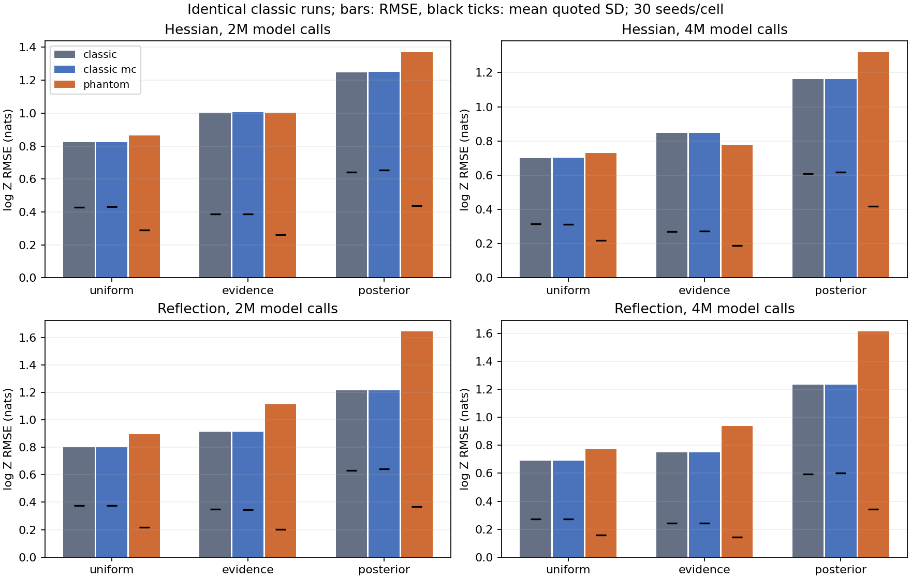

# Phantom evidence in the allocation comparison

This extends the [matched-work allocation comparison](ALLOCATION_REPORT.md)
for [issue #312](https://github.com/Joshuaalbert/jaxns/issues/312).
See the [extension protocol](ALLOCATION_PHANTOM_PROTOCOL.md).

## Results

All 180 replays and 360 evidence comparisons completed. At 4M calls, phantom
conditioning lowers the point RMSE only for Hessian/evidence allocation;
its paired bootstrap interval includes zero change. Reflection RMSE worsens
under all three strategies, with positive paired intervals. Quoted uncertainties
shrink and two-standard-deviation coverage worsens in every cell.

Uniform retains the lowest observed phantom RMSE for both kernels. Posterior
allocation remains worse than uniform across the paired bootstrap intervals.
The smaller evidence-versus-uniform differences remain unresolved.

| Kernel | Allocation | Classic RMSE, 2M | Phantom RMSE, 2M | Classic RMSE, 4M | Classic MC RMSE, 4M | Phantom RMSE, 4M |
|---|---|---:|---:|---:|---:|---:|
| Exact scaled Hessian | uniform | 0.824 | 0.863 | 0.699 | 0.701 | 0.730 |
| Exact scaled Hessian | evidence_improving | 1.004 | 1.001 | 0.847 | 0.848 | 0.777 |
| Exact scaled Hessian | posterior_improving | 1.247 | 1.369 | 1.162 | 1.163 | 1.318 |
| Reflection | uniform | 0.802 | 0.896 | 0.690 | 0.689 | 0.773 |
| Reflection | evidence_improving | 0.914 | 1.112 | 0.748 | 0.748 | 0.936 |
| Reflection | posterior_improving | 1.215 | 1.642 | 1.234 | 1.234 | 1.612 |

RMSE and bias are in nats against true log Z = 0, with 30 seeds per cell.
The classic MC control nearly reproduces the original moment-based RMSE.
The larger changes are attributable to phantom conditioning, rather than
the point-estimate convention.



### Bias and error calibration at 4M

| Kernel | Allocation | Classic bias | Phantom bias | Classic mean SD | Phantom mean SD | Classic within 2 SD | Phantom within 2 SD |
|---|---|---:|---:|---:|---:|---:|---:|
| Exact scaled Hessian | uniform | -0.401 | -0.309 | 0.314 | 0.220 | 17/30 | 13/30 |
| Exact scaled Hessian | evidence_improving | -0.443 | -0.347 | 0.271 | 0.190 | 16/30 | 12/30 |
| Exact scaled Hessian | posterior_improving | -0.339 | -0.515 | 0.610 | 0.419 | 20/30 | 12/30 |
| Reflection | uniform | -0.137 | -0.135 | 0.272 | 0.160 | 18/30 | 10/30 |
| Reflection | evidence_improving | -0.185 | -0.294 | 0.244 | 0.143 | 13/30 | 7/30 |
| Reflection | posterior_improving | -0.464 | -0.903 | 0.594 | 0.344 | 17/30 | 10/30 |

The retained chains have the same poor ridge coverage described in the
original report. Shared weights account for observations within a chain;
they do not add missing ridge support or estimate a correction for bias
from poorly mixed seed populations. The smaller conditional uncertainty
therefore does not establish improved accuracy.

### Paired RMSE changes at 4M

10,000 paired bootstrap resamples over the same 30 seed indices give the
following 95% percentile intervals for phantom minus classic RMSE:

| Kernel | Allocation | RMSE change | Paired 95% interval |
|---|---|---:|---:|
| Exact scaled Hessian | uniform | +0.031 | [-0.107, +0.189] |
| Exact scaled Hessian | evidence_improving | -0.070 | [-0.207, +0.057] |
| Exact scaled Hessian | posterior_improving | +0.156 | [-0.014, +0.323] |
| Reflection | uniform | +0.083 | [+0.028, +0.141] |
| Reflection | evidence_improving | +0.188 | [+0.083, +0.289] |
| Reflection | posterior_improving | +0.378 | [+0.174, +0.570] |

For allocation differences using phantom estimates throughout:

| Kernel | Evidence minus uniform | Posterior minus uniform |
|---|---:|---:|
| Exact scaled Hessian | [-0.221, +0.308] | [+0.219, +0.939] |
| Reflection | [-0.056, +0.385] | [+0.460, +1.210] |

These intervals describe across-seed variation on this toy, not corrected
uncertainties for individual runs. The largest MC standard error of any
estimated mean is 0.0106 nat; it is small relative to the run scatter.
The conditioning gate covers at least 94.92% of the inferred evidence
in every snapshot. Phantom conditioning is therefore active through the
bulk of the evidence, rather than being suppressed by the default gate.

The sum of per-snapshot conditioning wall times, including compilation
and contention, is 5.38 hours across concurrent workers.
This is post-processing cost and adds no likelihood calls.

## Method and validation

The original 180 runs did not retain phantom observations. All 180 were
replayed with collection enabled, using the original kernel configurations,
30 seeds per kernel/allocation cell, float64 coordinates, initial roots,
replacement width, allocation increments, and 2M/4M model-call budgets.
All 360 snapshots exactly reproduce the classic coordinates, likelihoods,
constraints, weights, volumes, seed and parent identities, batch identities,
likelihood counts, evidence summaries and completed epochs. Collection adds
no likelihood calls. Rejected self-transitions remain in the chains.

Hessian retains 89 intermediate slice endpoints per constrained child;
reflection retains eight complete-cycle endpoints. Each child defines one
phantom cluster, with one shared Gamma weight across its retained states
and all likelihood blocks. Prior roots have no cluster. Reflection's
intermediate trajectory points are not retained as phantom observations.

Each snapshot has 4,096 classic and 4,096 phantom shrinkage draws, with the
default Kish gate `C_min=20`. Classic MC is included to distinguish the
classic moment approximation from the effect of conditioning. The evidence
draws are independent shrinkage realizations, not independent sampler runs.
Snapshots stop at the first complete replacement batch reaching each call budget.
Posterior coverage and movement diagnostics in the original report still
refer to these same sampled points and their classic posterior weights.

### Offline calculation

JAX's Gamma sampling was costly on this CPU: the Hessian pilot required
810.5 seconds for its 2M classic ensemble. The full cohort therefore uses
a benchmark-only NumPy/SciPy implementation of the **same evidence law**.
Production sampling and evidence code are unchanged. It uses the production
sparse event plan and Kish gate, with SciPy sparse multiplication for the
shared-cluster counts. NumPy draws the Gamma weights in batches of 64.

Only the strict-survival probability enters evidence. For an active gate,
it is `(G_gt + weighted_B) / (G_gt + G_complement + weighted_A)`.
Combining independent equality and below-block Gamma variables gives
`G_complement ~ Gamma(alpha_eq + alpha_lt, 1)` exactly. The equality mass
of tied blocks is retained. This avoids drawing an unused split of the
complement; it does not assume the blocks are singletons.

Tests compare the sparse count operators and survival probabilities with
the independent dense reference, including tied blocks and active/inactive
gates, and compare the evidence quadrature with production. Two additional
kernel tests check exact classic-sampling parity and archive/public-API
parity in both conditioning modes. These three cases and the four repository
review checks pass; Ruff, Flake8 and whitespace checks pass.

The actual-run checks below use independent random streams. They compare
Monte Carlo means, so agreement is limited by finite-draw noise.

| Kernel/budget | Estimator | JAX draws | JAX mean log Z | NumPy draws | NumPy mean log Z |
|---|---|---:|---:|---:|---:|
| Hessian, 2M | classic MC | 4,096 | 0.422302 | 4,096 | 0.419808 |
| Hessian, 2M | phantom MC | 128 | 0.236755 | 4,096 | 0.262228 |
| Reflection, 2M | classic MC | 4,096 | 0.793390 | 4,096 | 0.792500 |
| Reflection, 2M | phantom MC | 4,096 | 0.546085 | 4,096 | 0.544938 |
| Reflection, 4M | classic MC | 4,096 | 0.888115 | 4,096 | 0.888230 |
| Reflection, 4M | phantom MC | 4,096 | 0.896429 | 4,096 | 0.895149 |

The largest mean discrepancy is the 128-draw Hessian phantom check:
0.0255 nat, about 1.16 combined Monte Carlo standard errors. The redundant
4,096-draw Hessian phantom pilot was interrupted after these checks; none
of the 180 cohort replays or their requested evidence ensembles was cut short.
The exploratory RBG timing check is not part of the cohort.

Runtime: Python 3.12.9, JAX 0.11.1, JAXCTX 1.2.0, NumPy 2.2.6, SciPy 1.15.3.
Each worker is pinned to one CPU. Timing includes compilation and contention
with other workers; it is reported separately from logical likelihood work.
Replay metadata records parent commit `522fbb7`; the added benchmark scripts
are identified by their source hashes, verified for all 360 snapshots.

## Reproduction

Use the original report's commands to generate the baseline archives first.
Keep their environment and source versions fixed: replay deliberately fails
if classic samples or work differ. The extension scripts are:

- `run_allocation_phantoms.py`: replay, assert exact parity and archive the
  canonical race/phantom inputs. It records hashes of the frozen sources
  and both the baseline and phantom archives.
- `condition_allocation_phantoms.py`: infer both evidence ensembles, retaining
  all draws and the conditioning gate, with deterministic independent keys.
- `summarise_allocation_phantoms.py`: audit all 360 snapshots and summarize
  RMSE, bias, uncertainty, coverage and paired bootstrap intervals.

For example, from this worktree, with the baseline archives under `/tmp`:

```bash
PYTHONPATH=.:src JAX_ENABLE_X64=1 conda run --no-capture-output -n jaxns_py \
  python -m benchmarks.issue_312.run_allocation_phantoms \
  --kernel hessian --allocation uniform --seeds 0 --cpu 0 \
  --output-dir /tmp/jaxns-allocation-phantoms-reproduction
PYTHONPATH=.:src JAX_ENABLE_X64=1 conda run --no-capture-output -n jaxns_py \
  python -m benchmarks.issue_312.condition_allocation_phantoms \
  --records /tmp/jaxns-allocation-phantoms-reproduction/results.jsonl \
  --cpu 0 --output /tmp/jaxns-allocation-phantoms-reproduction/evidence.jsonl
```

Raw cohort records are `raw/allocation-phantoms-*.jsonl`; shard `a` is seeds
0–14 and shard `b` is seeds 15–29. Input and draw archives remain under
`/tmp/jaxns-allocation-phantoms-v1-*`, with their hashes and paths in the records.
They are generated data, not committed to the PR. The fixed PCG64 seed
derivation and post-processing source hashes are recorded with every result.
