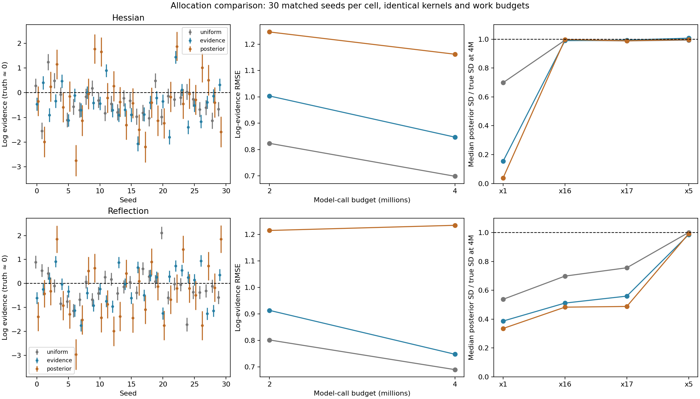
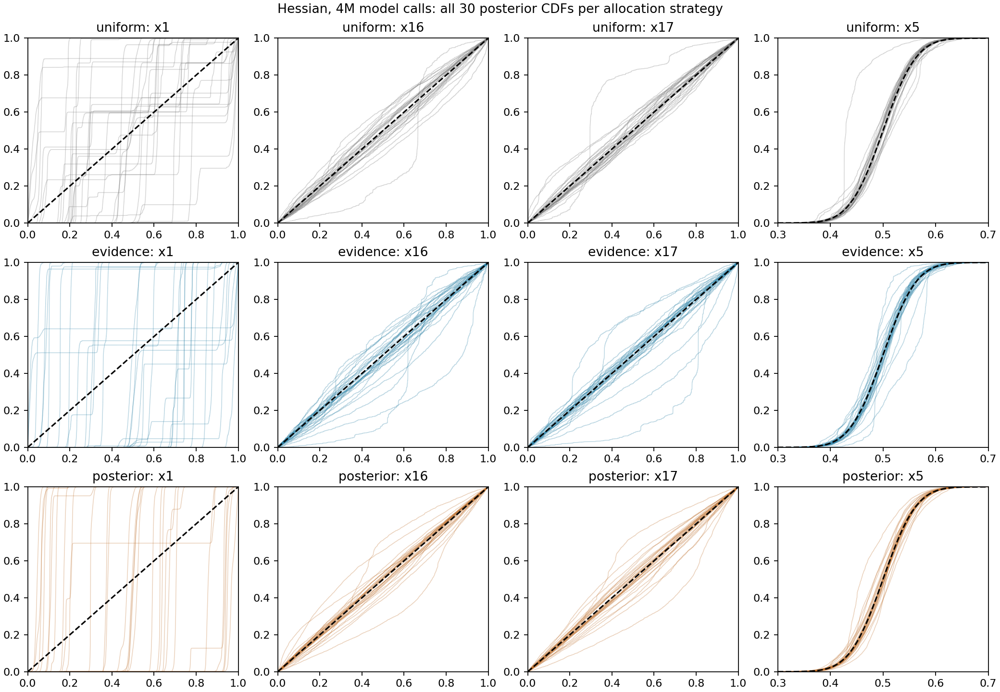
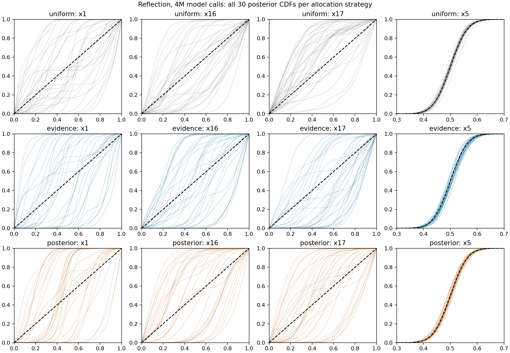
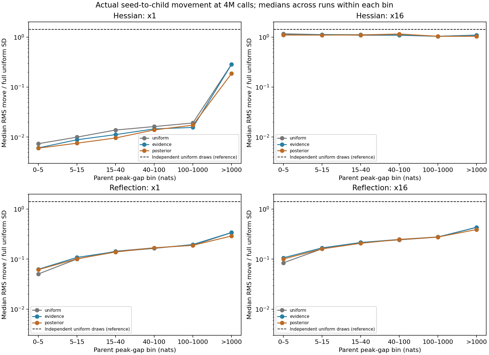

# Allocation at matched model-call budgets

Tracks [issue #312](https://github.com/Joshuaalbert/jaxns/issues/312).
The [prespecified protocol](ALLOCATION_PROTOCOL.md) compares all three
allocation strategies for the same exact scaled-Hessian and reflection
kernels, with 30 seeds per cell and identical initial prior populations.

At four million model calls, uniform allocation gives the lowest observed
evidence RMSE and the broadest ridge marginal for both kernels. Posterior
allocation raises nominal weight ESS substantially while worsening evidence
and ridge coverage. Its RMSE increase relative to uniform is positive across
the paired bootstrap intervals for both kernels. Evidence allocation has
worse ridge coverage; its smaller RMSE differences from uniform are not
resolved by this 30-seed cohort. None of the strategies recovers the entire
ridge posterior.

## Results

All 180 runs completed, producing 360 validated snapshots. Every cell uses
seeds 0–29. Actual mean work at the four-million target is 4.012–4.021M calls;
the largest overshoot is 54,055 calls, or 1.35%, within one complete batch.
The differences below cannot be explained by the earlier unequal work budgets.

| Kernel | Allocation | RMSE at 2M | RMSE at 4M | Mean quoted SD at 4M | Median weight ESS at 4M |
|---|---|---:|---:|---:|---:|
| Exact scaled Hessian | uniform | 0.824 | 0.699 | 0.314 | 2,892 |
| Exact scaled Hessian | evidence_improving | 1.004 | 0.847 | 0.271 | 1,578 |
| Exact scaled Hessian | posterior_improving | 1.247 | 1.162 | 0.610 | 8,480 |
| Reflection | uniform | 0.802 | 0.690 | 0.272 | 3,375 |
| Reflection | evidence_improving | 0.914 | 0.748 | 0.244 | 1,995 |
| Reflection | posterior_improving | 1.215 | 1.234 | 0.594 | 12,490 |

RMSE uses the effectively zero true log evidence. At 4M, mean log-evidence
errors are -0.401/-0.443/-0.339 for Hessian uniform/evidence/posterior and
-0.137/-0.185/-0.464 for reflection. The respective numbers within two quoted
SD are 17/16/20 and 18/13/17 out of 30: the error bars remain poorly calibrated.

Paired bootstrap 95% percentile intervals for the RMSE change relative to
uniform at 4M are:

| Kernel | Evidence minus uniform | Posterior minus uniform |
|---|---:|---:|
| Exact scaled Hessian | [-0.112, +0.396] | [+0.158, +0.755] |
| Reflection | [-0.197, +0.324] | [+0.233, +0.849] |

These describe this cohort's seed variation, not corrected uncertainties for
individual runs or a claim that uniform allocation is best on other targets.



### Posterior coverage at 4M

| Kernel | Allocation | Median SD x1 | Median SD x16 | Median SD x17 | Median SD x5 |
|---|---|---:|---:|---:|---:|
| True posterior | — | 0.2887 | 0.2887 | 0.2887 | 0.0500 |
| Exact scaled Hessian | uniform | 0.2017 | 0.2866 | 0.2852 | 0.0497 |
| Exact scaled Hessian | evidence_improving | 0.0446 | 0.2857 | 0.2867 | 0.0503 |
| Exact scaled Hessian | posterior_improving | 0.0111 | 0.2881 | 0.2855 | 0.0499 |
| Reflection | uniform | 0.1551 | 0.2015 | 0.2182 | 0.0500 |
| Reflection | evidence_improving | 0.1116 | 0.1476 | 0.1615 | 0.0493 |
| Reflection | posterior_improving | 0.0967 | 0.1394 | 0.1408 | 0.0496 |

Median x1 Wasserstein distances are 0.201/0.290/0.310 cube units for Hessian
uniform/evidence/posterior and 0.194/0.216/0.209 for reflection. Width alone
does not determine marginal error: posterior-reflection is narrower than
evidence-reflection, but its median x1 Wasserstein distance is slightly lower.
All six arms still have distorted ridge CDFs. The Hessian recovers the two
inert marginal widths under every strategy, while reflection loses inert
coverage as well. Both kernels recover the moderately constrained x5 width.





### Actual chain movement

For parent contours 5–15 nats below the peak, the median per-run statistics
are below. All 30 runs contribute to every cell. RMS moves are in unit-cube
coordinates; two independent full-uniform draws have RMS difference 0.4082.

| Kernel | Allocation | RMS x1 move | x1 pair correlation | RMS x16 move |
|---|---|---:|---:|---:|
| Exact scaled Hessian | uniform | 0.00288 | 0.99988 | 0.3229 |
| Exact scaled Hessian | evidence_improving | 0.00255 | 0.99924 | 0.3238 |
| Exact scaled Hessian | posterior_improving | 0.00218 | 0.95813 | 0.3158 |
| Reflection | uniform | 0.02896 | 0.98210 | 0.0463 |
| Reflection | evidence_improving | 0.03120 | 0.95960 | 0.0484 |
| Reflection | posterior_improving | 0.02924 | 0.95269 | 0.0462 |

Changing allocation does little to change movement at comparable contours.
Hessian chains traverse the inert directions well but make tiny moves along
x1. Reflections move about ten times farther along x1, while making much
smaller inert-coordinate moves. These are observations from unchanged kernels
on the populations produced by each policy, not changes to the intrinsic
transition law at a fixed point and contour.

Correlation alone is misleading here: posterior-Hessian's x1 correlation
falls to 0.958 while its posterior width collapses to 0.011. A fixed small move
can decorrelate a narrow, already collapsed seed cloud more easily than a
broad one. Its absolute RMS displacement is still only about 0.0022.

Posterior allocation concentrates more chains in the high-posterior region:
the median counts in the 5–15-nat bin are 7,013 versus 2,504 for Hessian
posterior versus uniform, and 10,479 versus 2,873 for reflection. It greatly
increases weight ESS while repeatedly exploring a limited part of the ridge.
The observations support an interaction between allocation and insufficient
decorrelation; they do not establish a unique causal explanation for the
population collapse.



### Budget and tail checks

At 4M, median root degrees for uniform/evidence/posterior are 450/508.5/167
for Hessian and 450/637.5/170 for reflection. More allocated roots alone do
not explain the coverage ordering: evidence allocation has more roots than
uniform but worse ridge coverage. Reflection gradient-call means are
1.629M/1.705M/1.436M, already included in the approximately 4M total calls.

As an additional finite-budget audit, use the known likelihood peak to bound
remaining evidence under the classic expected-volume model. The maximum
ratio of that tail bound to expected accumulated evidence is 0.01055 for
Hessian and 0.00716 for reflection, both in the evidence-allocation arms.
Every other arm has a maximum of 0.00101 or less. These bounds are conditional
on the shrinkage model; they do not account for poor mixing. Within that
model, omitted tails are much too small to explain the observed evidence
errors. Three Hessian evidence runs have not yet committed a complete depth
epoch at 4M, reinforcing the distinction between budget and goal completion.

## Controlled comparison

The preceding uncertainty-goal experiment changed allocation and stopping
together. This comparison changes only allocation. Each of the 180 runs
starts with 150 roots, replacement width 150, `delta_K=150`, float64 cube
coordinates, no phantoms, and the same default depth condition. The Hessian
uses 90 contour-scaled MH-corrected slice transitions; reflection uses nine
cycles of one isotropic slice and ten midpoint reflections at step size 0.003.
The target remains the 18D curved ridge with `sigma_stiff=1e-5`, curvature
0.3, true log evidence effectively zero, and exact flat marginals for x1,
x16 and x17. Their true standard deviation is 0.288675; x5 has SD 0.05.

Every run saves a snapshot at the first complete batch crossing two million
and four million cumulative logical model calls, then stops at the latter.
There is no uncertainty or ESS goal. Automatic sample-buffer growth stays
enabled. Snapshots can lie inside a depth epoch; the experiment does not
present a budget return as a completed scientific goal. Actual work and
overshoot are archived, with overshoot bounded by the last complete batch.
This avoids truncating individual chains according to their rejection cost.

Reflection value-and-gradient calls count once in model calls and are also
reported separately. Analytic Hessian arithmetic is additional to its
likelihood-call count. Neither a gradient call nor a Hessian operation is
assumed to cost the same as a value-only call. Host observation and seed-plan
replay add time but no model calls. The study compares logical work, not
production wall-clock throughput.

## Observer and validation

[allocation_observer.py](allocation_observer.py) uses the existing
interruptible one-batch continuation. The production driver still owns
allocation, seed publication, capacity growth and completed-depth bookkeeping.
After a batch, the observer replays only its deterministic seed planner using
the original state and random key. Accepted contours and batch lengths must
match. No host callback enters compiled sampling and no production API changes.

The observer records the actual chain seed separately from the race-tree
parent. Sample arrays remain in append order, so these indices directly
identify both coordinates and birth contours. Snapshot conversion publishes
an exact likelihood ordering on an analysis copy and leaves the continuing
state untouched. All six cells' initial coordinates and likelihoods are
checked for identical hashes for each seed.

Focused tests reproduce actual sampled children from replayed requests for
all three allocation policies, compare the complete observed run state with
the unobserved run, and resume an interrupted prefix without an extra goal
boundary. Those tests, both kernel test modules and reviewer autochecks pass:
22 tests in total. The full repository suite and the pRT retrieval were not
rerun.

All 360 archives pass the independent validation. Maximum likelihood
discrepancy is 2.453e-5 nats, within the existing 5e-5 absolute tolerance for
TFP scalar normalization constants at large prior residuals. Ruff, Flake8 and
whitespace checks pass. The 100,000-call CLI smoke run is separate from the
prespecified cohort and is not included in any reported aggregate.

Movement is measured from actual seed-to-child pairs in fixed parent
peak-gap bins. Per-run RMS displacements and pair correlations require at
least 30 pairs in a bin; summaries take medians over runs. Correlation here
is not an integrated autocorrelation time, and weight ESS is not corrected
for chain dependence. Changes in the distribution of seed positions within
a bin can change these observed statistics even though the kernel itself
is unchanged.

## Reproduction

Use JAX 0.11.1, JAXCTX 1.2.0 and Python 3.12.9. Each process is pinned to one
CPU before importing JAX. Run each kernel/allocation cell in two shards:
seeds 0–14 in `a`, seeds 15–29 in `b`. For example:

```bash
PYTHONPATH=.:src JAX_ENABLE_X64=1 conda run --no-capture-output -n jaxns_py \
  python benchmarks/issue_312/run_allocation_comparison.py \
  --kernel hessian --allocation uniform --cpu 0 \
  --seeds 0 1 2 3 4 5 6 7 8 9 10 11 12 13 14 \
  --output-dir /tmp/jaxns-allocation-hessian-uniform-a
```

Each output folder contains `results.jsonl` and per-seed
`calls-2000000.npz` / `calls-4000000.npz` archives. The final result logs are
copied to `raw/allocation-KERNEL-ALLOCATION-SHARD.jsonl`; full sample archives
remain in the corresponding `/tmp/jaxns-allocation-*` directories. Rebuild
validation, tables and plots with:

```bash
MPLBACKEND=Agg conda run --no-capture-output -n jaxns_py \
  python benchmarks/issue_312/summarise_allocation.py
```

The summary program verifies configurations, source/archive hashes, complete
seed sets, matched starting populations, first budget crossings, root/gradient
accounting, seed eligibility, actual parent likelihoods, float64 cube support,
independent NumPy likelihood values, peak gaps, moments and ESS. It recomputes
Wasserstein distances and movement from the saved arrays. Bootstrap intervals
use 10,000 paired seed resamples with RNG seed 312043.

Aggregates are saved in [allocation_summary.json](allocation_summary.json);
all run/snapshot rows are in [allocation_summary.csv](allocation_summary.csv),
and per-run contour-bin movement is in
[allocation_movement.csv](allocation_movement.csv).
