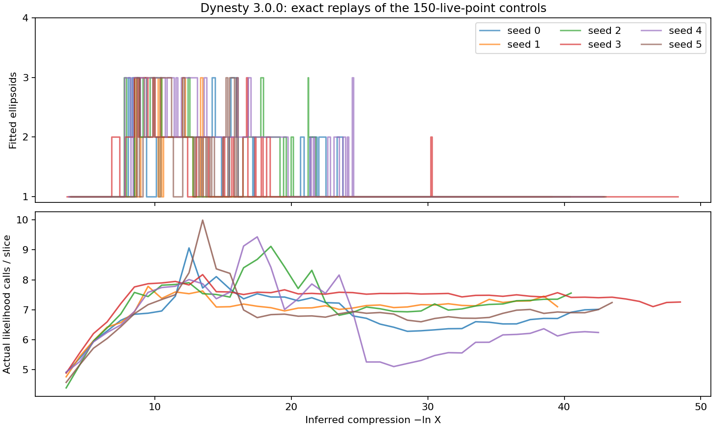
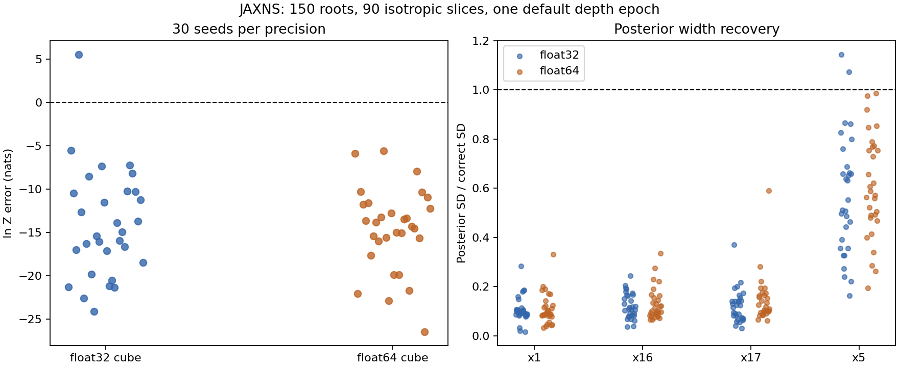

# Dynesty runtime comparison and JAXNS cube precision

Tracks [issue #312](https://github.com/Joshuaalbert/jaxns/issues/312) and
[draft PR #314](https://github.com/Joshuaalbert/jaxns/pull/314).

The useful differences are population-fitted directions, frequent geometry
refreshes, and a tuned local slice bracket. Dynesty also uses a sequential
live population rather than the JAXNS race-tree scheduler. The existing
benchmarks change these mechanisms together; they do not identify one cause
of the accuracy difference. Float64 cube coordinates do not resolve the
JAXNS failure in the new 30-seed control.

This investigation changes benchmark programs only. It does not introduce a
new JAXNS sampling policy or a production precision API.

## What the tested Dynesty runtime actually did

The configuration is Dynesty 3.0.0, 18 dimensions, 150 live points,
`bound="multi"`, `sample="rslice"`, `slices=90`, no worker pool, and
`run_nested(dlogz=0.01)`. Its identity prior and likelihood use NumPy float64.
See [the original control](DYNESTY_REPORT.md) for its six-seed results:
evidence RMSE 2.950 nats, 3.739M mean actual likelihood calls, and persistent
collapse of the uniform ridge coordinate.

The [instrumented replay](trace_dynesty_runtime.py) calls the installed
functions without changing their arguments, return objects, random draws,
or likelihood evaluations. Every sample, likelihood, log volume, and log
weight from all six replays is exactly equal to its original archive.
Compressed traces are `raw/dynesty-runtime-150-{0..5}.json.gz`.

| Seed | First rslice iteration | Bound fits | Median fit interval, e-folds | Doubling enabled at iteration | Actual likelihood calls / slice |
| --- | ---: | ---: | ---: | ---: | ---: |
| 0 | 554 | 289 | 0.140 | 1681 | 6.885 |
| 1 | 581 | 263 | 0.133 | 1372 | 7.074 |
| 2 | 583 | 282 | 0.133 | 1614 | 7.325 |
| 3 | 538 | 338 | 0.133 | 1243 | 7.415 |
| 4 | 557 | 303 | 0.133 | 1606 | 6.678 |
| 5 | 572 | 295 | 0.133 | 1454 | 6.951 |

Every rslice replacement executes exactly **90 accepted transitions**, not
90 sweeps of 18 transitions. Before that phase, Dynesty performs independent
uniform-cube rejection sampling. It switches after at least 300 counted calls
and when cumulative efficiency falls below 10%; the observed switch is after
roughly 3.6–3.9 inferred compression e-folds.

All six runs fit between one and three ellipsoids. After inferred compression
`-ln X > 25`, five runs use one ellipsoid for every replacement; seed 3 uses
one for 99.6% of replacements. The late-run advantage therefore does not come
from a many-component decomposition that covers the whole curve.



## Geometry: current live points, recursive splits, frequent refreshes

Dynesty calculates the empirical mean and covariance of the current live
population. An eigendecomposition provides covariance axes; it enlarges the
covariance enough to enclose all assigned points, then inflates each fitted
ellipsoid's **volume** by 1.25. This is not a 25% increase in every axis.
For this rslice configuration, bootstrap fitting is disabled.

`multi` recursively proposes two-component K-means splits. It standardizes
coordinates by the original cloud's coordinate standard deviations, starts
K-means at the parent ellipsoid's major-axis endpoints, and uses ten K-means
iterations. Each child needs at least `2D = 36` points. Splits require a
dimension- and population-dependent reduction in enclosing volume; recursion
can justify a split even if the immediate two-child proposal fails. This is
an enclosing-volume criterion, not a GMM likelihood/EM fit. With 150 points,
the minimum child size permits at most four components.

Covariance regularization is also different: Dynesty normally keeps the
empirical covariance, repairs extreme eigenvalue condition numbers above
`1e12`, and has diagonal/spherical fallbacks for numerical failures. Our
experimental covariance always adds `1e-8 * trace(C)/D * I`.

The actual default update interval is **90 × 150 = 13,500 counted proposal
tests**, plus forced updates when a selected seed falls outside the current
bound. There were 11–24 such forced updates per run. The runtime property in
`RSliceSampler` is `slices`; a constructor docstring still mentions
`2 * slices`, which is not what this version executes. The measured median
cadence is about 20–21 replacements, or 0.13–0.14 e-folds. Our experiment's
one-e-fold cadence is substantially slower.

The fitted datasets differ too. Dynesty fits its 150 current live points,
including the about-to-be-replaced worst point when fitting before insertion
of the replacement. Our experiment fits **all stored classics above the
shallowest contour of a dispatch batch**. Some of those classics were born
above that contour. They are useful geometry observations but do not form the
same empirical distribution as a current live population. In JAXNS, the
stationary seed population has the additional crossing requirement
`birth_contour <= requested_contour < sample_likelihood`.

Sources: pinned [`bounding.py`](https://github.com/joshspeagle/dynesty/blob/v3.0.0/py/dynesty/bounding.py),
[`sampler.py`](https://github.com/joshspeagle/dynesty/blob/v3.0.0/py/dynesty/sampler.py),
[`dynesty.py`](https://github.com/joshspeagle/dynesty/blob/v3.0.0/py/dynesty/dynesty.py),
and JAXNS [`covariance.py`](../../src/jaxns/sampling/covariance.py).

## Direction selection is independent of the chain's location

For each replacement, Dynesty selects a seed uniformly from live points
strictly above the discarded likelihood. Independently, it selects an
ellipsoid with probability proportional to enclosing volume. One axes matrix
is used throughout that replacement's 90 transitions. Each transition draws
a fresh Gaussian vector, normalizes it in whitened coordinates, and uses

```text
direction = adapted_scale * axes @ (normal / norm(normal))
```

It does not choose the ellipsoid containing the current chain position, use
GMM responsibilities, or refit at each accepted point. For frozen geometry,
the direction mixture is independent of position. The fitted mean centers
the covariance/enclosing ellipsoid; it does not move the slice anchor away
from the current chain point.

Our covariance experiment uses `normalize(cholesky @ normal)`. With the same
covariance, this has the **same line-orientation distribution**. Normalizing
after the transform does not destroy whitening. Magnitude matters to
Dynesty's initial bracket width, but cancels from a full-cube chord in exact
arithmetic. Our staged GMM chooses a component per transition, using
contour-trimmed fitted volumes rather than Dynesty's enclosing volumes.

The rslice trial acceptance is cube support plus the strict likelihood
constraint. Trials are not rejected merely for leaving the fitted ellipsoids;
those bounds supply directions and initial widths in this configuration.

## Local brackets and scale adaptation

Dynesty starts from a randomly offset interval of one direction-vector
length around the seed. It caps that initial vector length at `sqrt(D)/2`.
It evaluates the two endpoints and steps out while endpoints are inside the
likelihood contour. Out-of-cube endpoint tests count toward native `ncall`
but skip the expensive likelihood. Rejected interior proposals shrink the
interval toward the anchor, as in JAXNS.

All six runs encounter a transition needing more than 1,000 linear expansion
steps. The implementation finishes that transition, warns, and switches to
doubling for subsequent transitions and replacements. About 81–90% of all
rslice transitions use doubling. Its acceptance includes Neal's recursive
doubling check: simply copying the doubling expansion without that check
would not reproduce this kernel.

With queue size one, it updates the scalar width after every replacement:

```text
E = max(accumulated_n_expand, 1)
scale *= clip(2 * E / (E + accumulated_n_contract), 0.5, 2)
```

In doubling mode its `n_expand` counts equivalent linear expansion lengths
(`1 + 2 + ...`), not actual endpoint evaluations. The replay separates these
counters. Actual calls average 6.68–7.42 per slice; the JAXNS precision arms
average 14.28 and 14.55 logical likelihood calls per slice respectively.
This is a comparison of the complete kernels, not an isolated measurement of
the bracket's contribution.

Full-cube bracketing can waste calls, but it does not geometrically shorten
the true contour chord. For a connected valid interval, rejected exterior
points never discard any of that interval. A smaller initial bracket cannot
make an isotropic direction traverse a stiff contour farther. Disconnected
line intersections introduce additional dependence for shrinkage kernels;
local stepping out does not guarantee discovery of distant valid intervals.
See the earlier [geometry analysis](GEOMETRY_REVIEW.md).

Source: [`internal_samplers.py`](https://github.com/joshspeagle/dynesty/blob/v3.0.0/py/dynesty/internal_samplers.py)
and JAXNS [`slice.py`](../../src/jaxns/sampling/slice.py).

## Outer algorithm and inference

Dynesty removes the current worst of 150 live points, runs one replacement
chain, inserts its endpoint immediately, and repeats. JAXNS allocates logical
threads across parent contours, selects stationary crossing seeds, and
executes batches of up to 150 chains here. Its frozen source plus recent-sample
reservoir controls when newly produced points become available for seeding.
Uniform allocation and 150 roots play a comparable budget role but do not
imply the same seed genealogy or sequence of population updates.

For continuous singleton arrivals both use the classic Beta shrinkage model.
Dynesty uses fixed-live expected-volume quadrature with trapezoidal likelihood
weights and adds its final live points. JAXNS reconstructs lineage counts
from the race tree, computes block evidence moments, and reports a moment
approximation for log evidence. These local JAXNS controls collect no phantoms
and use classic results, so phantom conditioning is not a difference here.
Neither uncertainty calculation measures missing posterior coverage.

The stopping rules also differ. Dynesty stops when
`log(1 + Lmax_live * Xlive / Z_dead) < 0.01`. JAXNS uses its default
remaining-evidence fraction `dlogZ = log1p(1e-3)`, roughly 0.1%, evaluated from
the classic block path at scheduling boundaries. They are not identically
defined or numerically matched tolerances. All reported runs completed their
requested stopping conditions without a work cap.

## Float32 versus float64 cube coordinates

Thirty seeds in each arm use the current experimental branch including the
cube-face fix, 150 roots, 90 isotropic slices, uniform allocation, and one
default depth epoch. Physical parameters, likelihood outputs, and evidence
arithmetic are float64 in both arms. Only the JAXCTX base-coordinate dtype
changes. `jax_enable_x64` alone does not change its float32 default.

| Cube dtype | Mean ln Z | Evidence RMSE | Mean calls | Median peak deficit | Median SD x1 / x16 / x17 | Median SD x5 |
| --- | ---: | ---: | ---: | ---: | --- | ---: |
| float32 | -14.135 | 15.419 | 10.105M | 4.567 | 0.0281 / 0.0325 / 0.0346 | 0.0266 |
| float64 | -14.634 | 15.379 | 10.282M | 4.571 | 0.0264 / 0.0293 / 0.0330 | 0.0290 |
| Correct posterior | 0 | — | — | — | 0.2887 / 0.2887 / 0.2887 | 0.0500 |

Neither arm has any evidence error within twice its quoted uncertainty.
The RMSE change is -0.040 nats; a paired-seed bootstrap's 95% percentile
interval is [-2.53, +2.59] nats. This does not establish numerical equivalence
to an arbitrary tolerance, but clearly shows that float64 does not recover
the evidence, peak, or flat directions here. The seed labels are paired;
changing random-number dtype changes draws from initialization onward, so
the trajectories themselves are not coupled.

Twenty-seven float32 runs match every checked historical metric exactly.
Seeds 15, 26, and 28 differ. The only production-source difference since the
original direction experiment is the cube-face bracket fix, so the new
matched float32 RMSE is 15.42 rather than the earlier 15.61. We do not compare
the new float64 arm only against the older, uncorrected baseline.



The summarizer verifies both actual stored U dtypes, identity transforms,
cube support, weighted posterior moments, and every stored likelihood against
the analytic float64 expression. The largest likelihood discrepancy is
`2.15e-5` nats over all samples and `3.94e-6` for interior contours within
50 nats of the peak. TFP's scalar moderate-Gaussian constants are float32 in
both arms; their small difference is shared and cannot explain these errors.
All runs reach their requested depth in one epoch without hard termination.

## Interpretation and next controlled comparisons

Dynesty's early multi-ellipsoid fits and frequent live-population refreshes
help define useful line directions. Once its population occupies one short
arc, a single covariance can follow that arc reasonably well. This is
consistent with its good peak and often wider inert marginals while its full
ridge marginal remains wrong; it is not proof that this is the causal pathway.

The most informative next comparisons would separately test geometry built
from stationary crossing points, a refresh cadence near 0.13 e-folds, and
local bracket/width adaptation with the correct step-out or doubling rules.
Combining them immediately would make it harder to identify which mechanism
changes accuracy and which mainly saves likelihood calls. No such sampler
changes are made in this investigation.

## Reproduction and artifacts

Use the existing isolated Dynesty 3.0.0 installation and the worktree source:

```bash
PYTHONPATH=/tmp/issue312-dynesty-3.0.0 conda run --no-capture-output -n jaxns_py \
  python benchmarks/issue_312/trace_dynesty_runtime.py \
  --seeds 0 1 2 3 4 5 --cpu 0 --output-dir /tmp/new-dynesty-runtime

PYTHONPATH=src JAX_ENABLE_X64=1 conda run --no-capture-output -n jaxns_py \
  python benchmarks/issue_312/run_ridge.py --mode isotropic \
  --unit-dtype float64 --seeds 0 1 2 --cpu 0 --no-warmup \
  --archive-dir /tmp/new-precision-f64 --output /tmp/new-precision-f64.jsonl
```

Repeat the precision command for float32 and all seeds 0–29. The stored runs
used three ten-seed processes per dtype on CPUs 0–5; Dynesty replays ran
concurrently, so no wall-time performance inference is made. After its
completed seed 0, the initial serial replay was interrupted and seeds 1–5
were replayed independently; every retained replay matches the original.

The benchmark override supplies `base_dtype` to the process-local
`jaxns.model.transform` binding before tracing. It does not modify installed
JAXCTX or production JAXNS source. The exact precision-run script is retained
as `raw/precision_run_ridge.py.gz`; the current runner differs only by an
import-separation blank line added to satisfy Ruff.

Per-run metrics and archive checksums are in [precision_summary.csv](precision_summary.csv),
with aggregate and provenance data in `precision_summary.json` and
`dynesty_runtime_summary.json`. The summarizer reads the precision sample
archives from `/tmp/issue312-precision-{f32,f64}/seed-{seed}.npz`; those larger
archives remain local and can be regenerated by the runner. Committed raw
JSONL records preserve all reported precision metrics. The compressed Dynesty
traces preserve every replacement and geometry update. Both plots have PDF
siblings. New/modified benchmark scripts pass Ruff and Flake8.
