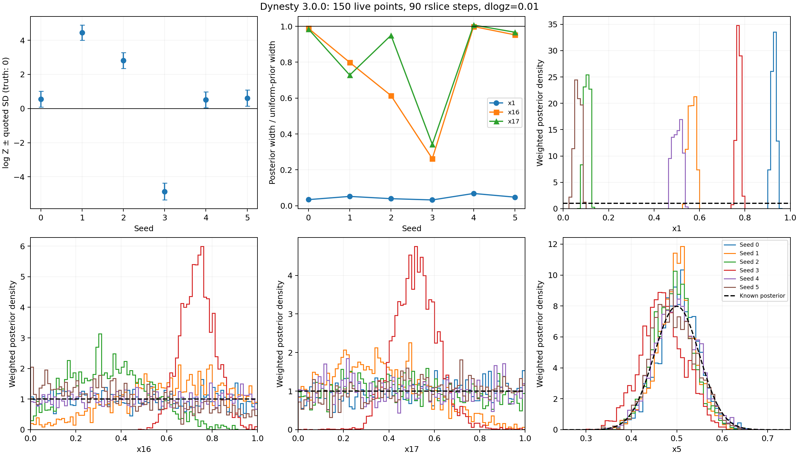
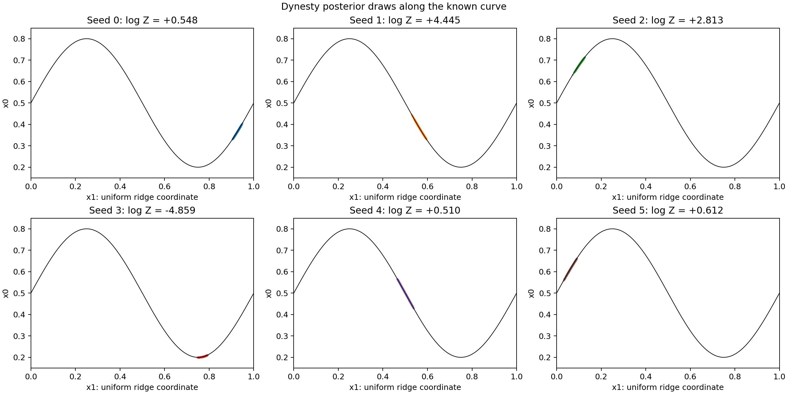

# Verify the reported Dynesty control

The reporter's successful toy result is plausible, but **Dynesty does not
reliably solve the full toy at the reported 150-live-point configuration**.
Six local runs with Dynesty 3.0.0, `bound="multi"`, `sample="rslice"`, 90 slices
and `dlogz=0.01` produce three evidence errors near +0.5 nats and three errors
of +4.44, +2.81 and -4.86 nats. All six reach within one nat of the peak, and
all six collapse the uniformly distributed ridge coordinate x1.

This verifies the analytic toy only. It neither reproduces nor contradicts
the reported convergence of a larger Dynesty run on the separate pRT model.
It also does not excuse the documented JAXNS failures or establish which
sampling mechanism causes either implementation's remaining errors.

The subsequent [1,000-live-point controls](LARGE_POPULATION_REPORT.md) test six
seeds each with Dynesty and UltraNest. They retain substantial evidence errors
and incomplete ridge coverage at the tested settings.
The [runtime audit](DYNESTY_ALGORITHM_REPORT.md) subsequently reproduces every
archived sample and weight while observing the actual Dynesty geometry and
adaptation choices. Its accompanying 30-seed JAXNS precision control rules out
float64 cube coordinates as a remedy for this toy's failure.

Tracks [issue #312](https://github.com/Joshuaalbert/jaxns/issues/312) and
[draft PR #314](https://github.com/Joshuaalbert/jaxns/pull/314).

## What the pasted user report actually says

The report distinguishes the pRT retrieval from the analytic toy:

- **pRT:** Dynesty with 1,000 live points and 72 `rslice` steps agrees with the
  UltraNest reference: evidence difference -0.4 ± 0.18 nats, maximum log L
  2942.9, median marginal W1 0.22 reference widths, and inert width ratio 0.99.
  Its cheaper 150-live-point random-walk run has inert width ratio 0.19.
  Those are different configurations. This investigation does not rerun the
  pRT likelihood.
- **Toy:** the reported 150-live-point, 90-slice, seed-0 run has log Z
  +0.39 ± 0.47, peak gap 1.1, x1/x16/x17 widths 0.01/0.23/0.24 and x5 width
  0.045. The target widths are 0.289 for all three flat coordinates and 0.05
  for x5. The report explicitly acknowledges x1 collapse even with Dynesty.
  Its 18-slice control has poorer inert widths, 0.10 and 0.06.

Thus the report supports a good evidence/peak result for one toy seed and
better inert mixing at 90 slices. It does not show full toy-posterior recovery
or a replicated evidence-calibration result for that configuration.

## Local reproduction

The [runner](run_dynesty_ridge.py) uses the normalized 18-D likelihood in NumPy
float64 with identity prior transform:

```python
sampler = dynesty.NestedSampler(
    log_likelihood, lambda u: u, 18,
    nlive=150, bound="multi", sample="rslice", slices=90,
    rstate=np.random.default_rng(seed),
)
sampler.run_nested(dlogz=0.01)
```

All remaining scientific options keep their Dynesty 3.0.0 defaults. There
are no iteration or evaluation caps, and the remaining 150 live points are
included in the final results. The progress callback only records progress.
The stopping parameter is a remaining-evidence criterion, not a log-evidence
uncertainty target. These are static Dynesty runs, not the later JAXNS staged
uncertainty-0.1/ESS-doubling protocol. See the
[versioned API](https://dynesty.readthedocs.io/en/v3.0.0/api.html).

The likelihood uses sigma_stiff `1e-5`, curvature 0.3, fourteen Gaussian
coordinates with sigma 0.05, and three flat coordinates. Its log evidence is
zero up to negligible Gaussian tails outside the cube. The NumPy expression
was checked against independently evaluated normalized Gaussian factors on
64 points, including points near the ridge, before every run. Validation uses
separate random keys and is excluded from sampling-call counts.

The initial cohort was seeds 0–2. After two large evidence misses, the check
was extended to seeds 3–5. Every completed run is reported; no seed was
discarded or rerun to select a favorable result.

| Seed | log Z ± quoted SD | Peak gap | Actual likelihood calls | Dynesty ncall | x1 SD | x16 SD | x17 SD | x5 SD |
| --- | ---: | ---: | ---: | ---: | ---: | ---: | ---: | ---: |
| 0 | +0.5485 ± 0.4691 | 0.799 | 3.67M | 3.95M | 0.0099 | 0.2855 | 0.2843 | 0.0467 |
| 1 | +4.4448 ± 0.4444 | 0.760 | 3.38M | 3.55M | 0.0150 | 0.2306 | 0.2102 | 0.0414 |
| 2 | +2.8131 ± 0.4595 | 0.993 | 3.64M | 3.81M | 0.0114 | 0.1773 | 0.2742 | 0.0439 |
| 3 | -4.8588 ± 0.4967 | 0.775 | 4.50M | 4.58M | 0.0094 | 0.0758 | 0.0988 | 0.0487 |
| 4 | +0.5103 ± 0.4678 | 0.959 | 3.54M | 4.06M | 0.0198 | 0.2884 | 0.2907 | 0.0487 |
| 5 | +0.6121 ± 0.4709 | 0.590 | 3.70M | 4.00M | 0.0139 | 0.2750 | 0.2792 | 0.0482 |

Evidence RMSE is **2.950 nats**; only **3/6** runs are within two quoted
standard deviations of zero. The other three misses are about 10.0, 6.1 and
9.8 quoted standard deviations. The mean log Z of +0.678 hides the large
scatter and the large negative error in seed 3.

Dynesty often mixes the inert coordinates much better than the JAXNS runs,
but that is not uniform across seeds. Seed 3 collapses both inert directions.
All x1 widths are 0.0094–0.0198 instead of 0.2887. The selected ridge segment
varies between seeds; a near-correct evidence estimate does not imply that
the full ridge was explored. The x5 widths are 0.0414–0.0487 instead of 0.05.





The curve plot displays 2,000 weighted resamples per seed only for visualization.
All numerical summaries use the complete weighted result, including final
live points. A separate visualization RNG has no effect on the runs.

## Cost accounting and implementation checks

The `evaluations` column instruments calls to the actual likelihood. Dynesty's
own `ncall` is slightly larger: its slice routine counts an interval test even
when the proposed point lies outside the unit cube and the likelihood is not
called. Both counters are retained, and `sum(results.ncall)` equals the final
`sampler.ncall` in every run. Mean costs are 3.739M actual likelihood calls and
3.992M reported calls. The reporter's 4.05M is comparable to the latter scale;
their precise counting method is not supplied.

Source inspection confirms several differences from the current JAXNS setup:

- Dynesty refreshes its bounds from the current live population. Its
  multi-ellipsoid implementation selects axes with ellipsoid-volume weights,
  independently of the selected seed's location. See
  [`propose_live` and `update_bound`](https://github.com/joshspeagle/dynesty/blob/v3.0.0/py/dynesty/sampler.py)
  and [`get_random_axes`](https://github.com/joshspeagle/dynesty/blob/v3.0.0/py/dynesty/bounding.py).
- Each `rslice` transition transforms a random direction by those axes and
  an adapted scale. It expands an initially local bracket rather than starting
  from the full cube chord. When doubling is used, acceptance includes the
  doubling-specific check. See
  [`RSliceSampler`, `generic_slice_step` and `tune_slice`](https://github.com/joshspeagle/dynesty/blob/v3.0.0/py/dynesty/internal_samplers.py).
- All six local runs warned about more than 1,000 expansion steps and then
  automatically enabled doubling. This is default adaptation in the pinned
  version, not an extra option supplied to obtain better results.

The control changes several mechanisms together, so these runs do not isolate
whitening, bracket construction or adaptation as the cause of an advantage.
They also do not test a location-dependent component-selection rule.

## Provenance, reproduction and validation

Dynesty 3.0.0 was installed without dependencies into
`/tmp/issue312-dynesty-3.0.0`; the development environment and repository runtime
dependencies were not changed. Runs used Python 3.12.9, NumPy 2.2.6 and SciPy
1.15.3, with one CPU per process and affinity set before numerical imports.
Elapsed time was 89–119 seconds per run, with three processes running
concurrently; no hardware-throughput comparison is inferred from that.

Source HEAD was `c316a4a`; the new runner's hash and the full sample archive's
hash are included in every record. The reporter used Python 3.13 and did not
supply NumPy/SciPy versions or explicit RNG construction in the control
snippet. This is a configuration reproduction, not a bitwise replication of
their seed 0. Dynesty uses float64 coordinates here; the earlier local JAXNS
benchmarks used float32 U-space coordinates with float64 evidence arithmetic.

```bash
conda run --no-capture-output -n jaxns_py python -m pip install \
  --no-cache-dir --no-deps --target /tmp/issue312-dynesty-3.0.0 dynesty==3.0.0

PYTHONPATH=/tmp/issue312-dynesty-3.0.0 conda run --no-capture-output -n jaxns_py \
  python benchmarks/issue_312/run_dynesty_ridge.py \
  --seed 0 --cpu 2 --output /tmp/dynesty-ridge-seed-0.jsonl
```

Repeat with seeds 1–5 and separate output paths. The runner refuses to
overwrite completed results. The committed inputs to the summary are
`raw/dynesty-rslice90-150-{seed}.jsonl`, with `.progress.jsonl` and `.npz`
siblings. Regenerate the [CSV](dynesty_ridge_summary.csv),
[JSON](dynesty_ridge_summary.json) and PNG/PDF figures with:

```bash
MPLCONFIGDIR=/tmp/issue312-matplotlib conda run --no-capture-output -n jaxns_py \
  python benchmarks/issue_312/summarise_dynesty_ridge.py
```

All six runs completed normally. The summarizer checks version/configuration,
inclusion of the final live points, the remaining-evidence estimate, both call
counters, source/archive checksums, cube support, normalization, weighted
moments and `logsumexp(logwt) == log Z`. It also independently recomputes every
stored likelihood from the saved coordinates. These checks pass. Both new
scripts pass Ruff and full Flake8 at line length 100, and both figures were
visually inspected. Production JAXNS code is unchanged and its tests were not
rerun for this external control.

The larger pRT run and other Dynesty live-point/slice configurations remain
outside this verification. The defensible conclusion is that the reported
good toy outcome can occur, but reliable evidence and full posterior recovery
are not established by the reported 150-live-point configuration.
