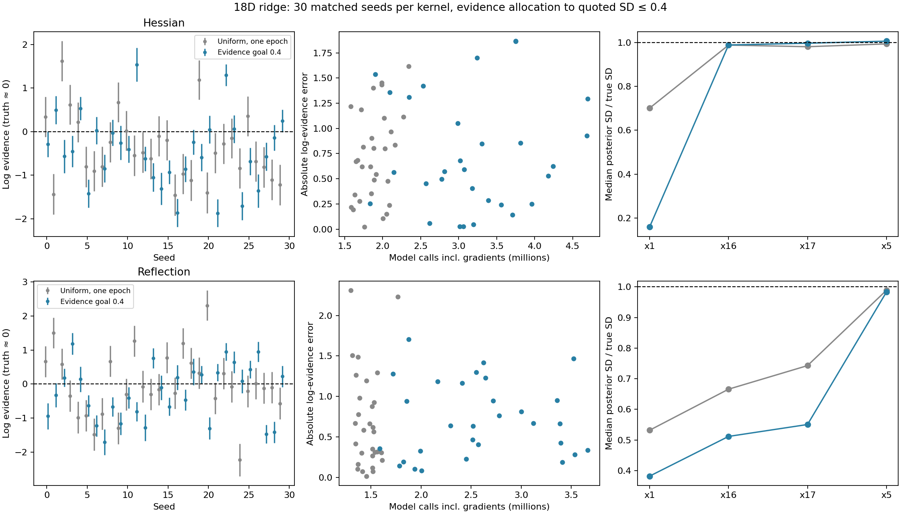
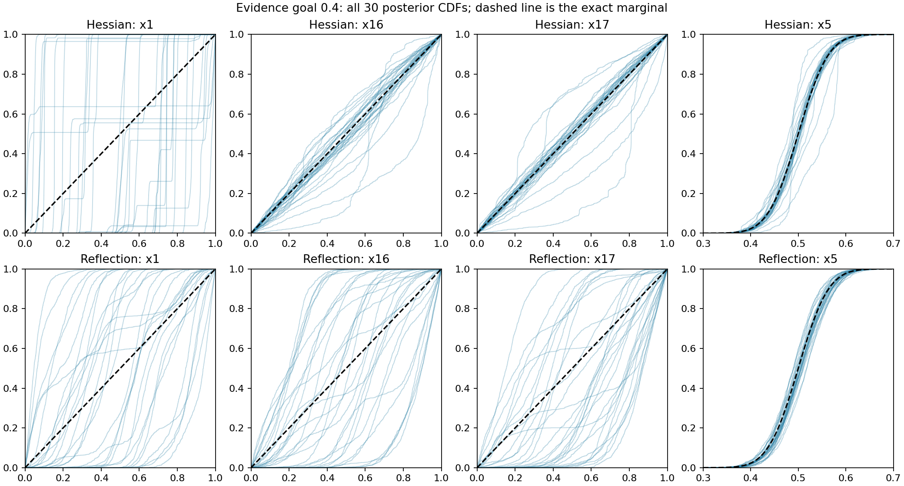

# Evidence allocation with exact curvature and reflections

Tracks [issue #312](https://github.com/Joshuaalbert/jaxns/issues/312).

Evidence allocation to a classic uncertainty goal of 0.4 does not bring
empirical log-evidence RMSE close to 0.4 on this ridge. Across 30 matched
seeds per kernel, RMSE is **0.930 nats for the exact scaled Hessian** and
**0.845 for reflections**, versus 0.846 and 0.922 with uniform allocation.
The achieved mean quoted uncertainty is 0.317 for both, with 69% and 76%
more model calls. Ridge coverage deteriorates, especially for the Hessian.

## Prespecified comparison

Run 30 matched seeds, 0 through 29, for each of the two unchanged kernels:

- Exact contour-scaled Hessian: 90 slice transitions with the existing
  position-dependent direction law and per-transition MH correction.
- Reflection: nine cycles of one isotropic slice and ten true-gradient
  midpoint reflections, with trajectory step size 0.003 and the existing
  endpoint acceptance rule.

Each run starts from 150 prior roots on the curved 18D ridge with
`sigma_stiff=1e-5`, float64 cube coordinates, replacement width 150,
`delta_K=150`, no phantoms, and `allocation_target="evidence_improving"`.
The outer goal is `state.expected_log_Z_uncert <= 0.4`, checked at completed
depth epochs. The default depth condition remains
`dlogZ=log1p(1e-3)`; automatic sample-buffer growth is enabled. There is no
fixed number of epochs, and no evidence-error-based early stopping across
seeds. This goal concerns classic evidence uncertainty, not phantom conditioning.

Compare evidence RMSE against the known log evidence (effectively zero),
mean error, quoted uncertainty, coverage, model calls, peak gap, and the four
previously monitored posterior marginals. Reuse all 30 matching seeds from
the existing uniform-allocation single-epoch Hessian/reflection controls.
The allocation strategy and stopping rule are the only changes from those
controls. The baseline kernels are unchanged; no fitted geometry is added.

Reflection model-call counts include each value-and-gradient call once;
gradient calls are also reported separately. Additional epochs may allocate
new prior roots, so cumulative gradient counts use the actual final root
degree rather than subtracting the initial 150 roots from sample count.

The experiment runner is [run_evidence_kernels.py](run_evidence_kernels.py).
Both kernels are benchmark-only implementations; production defaults,
allocation machinery, stopping, and evidence estimators are unchanged.

## Evidence and work

All 60 runs reached the requested goal without a terminal budget condition.
Four Hessian runs and three reflection runs needed two completed depth epochs;
the other 53 needed one. Evidence allocation adds work within a depth epoch,
so one epoch here is not equivalent to one uniform-allocation epoch.
The scientific goal is checked at a completed depth boundary, not at each
allocation update. Consequently, uncertainty can overshoot below 0.4:
Hessian runs finish at 0.248–0.391 and reflection runs at 0.251–0.394.

| Kernel and allocation | Mean ln Z | ln Z RMSE | Mean quoted SD | Mean model calls | Of which value + gradient | Within 2 quoted SD |
|---|---:|---:|---:|---:|---:|---:|
| Hessian, uniform, one epoch | -0.387 | 0.846 | 0.461 | 1.886M | 0* | 21/30 |
| Hessian, evidence goal 0.4 | -0.460 | 0.930 | 0.317 | 3.181M | 0* | 16/30 |
| Reflection, uniform, one epoch | -0.017 | 0.922 | 0.460 | 1.465M | 0.586M | 22/30 |
| Reflection, evidence goal 0.4 | -0.262 | 0.845 | 0.317 | 2.574M | 1.073M | 14/30 |

\* The analytic Hessian arithmetic is additional to likelihood calls. Each
reflection value-and-gradient operation counts once in total model calls,
and is also identified in the gradient column. Gradient and value-only calls
need not have equal runtime. These are logical work counts, not wall-time
speedup claims. Compilation is included in recorded run timings.

RMSE is `sqrt(mean(log_Z**2))`, using the effectively zero true log evidence.
The empirical standard deviations across seeds are 0.822 and 0.817 for the
new Hessian and reflection runs. Their RMS errors divided by each run's own
quoted uncertainty are 2.90 and 2.68 respectively. Narrower classic error
bars are not evidence that constrained draws have become independent.

A paired bootstrap over the 30 seed indices, with 10,000 draws and RNG seed
312040, gives 95% percentile intervals for the RMSE change of
[-0.194, +0.336] nats for the Hessian and [-0.367, +0.235] for reflections.
Both include zero; the observed small RMSE changes do not establish an
improvement from this allocation/stopping protocol. The new RMSE intervals
are [0.711, 1.120] and [0.678, 1.001] respectively. These intervals describe
finite-cohort variation, not a correction to individual run uncertainties.

Final root degrees are 251–540 for Hessian runs and 254–526 for reflections,
versus 150 throughout the uniform controls. Median peak gaps are 1.655 and
1.594 nats, compared with 1.150 and 1.023 in the controls.



## Posterior coverage

| Kernel and allocation | Median SD x1 | Median SD x16 | Median SD x17 | Median SD x5 |
|---|---:|---:|---:|---:|
| True posterior | 0.2887 | 0.2887 | 0.2887 | 0.0500 |
| Hessian, uniform | 0.2023 | 0.2853 | 0.2832 | 0.0497 |
| Hessian, evidence goal 0.4 | 0.0459 | 0.2855 | 0.2878 | 0.0503 |
| Reflection, uniform | 0.1535 | 0.1922 | 0.2144 | 0.0494 |
| Reflection, evidence goal 0.4 | 0.1103 | 0.1477 | 0.1589 | 0.0492 |

The Hessian keeps the two inert marginals broad and recovers the Gaussian
width, but the ridge-coordinate width collapses further. Its median x1
Wasserstein distance increases from 0.202 to 0.291 cube units. Reflection
widths become narrower in all three flat directions; median x1 Wasserstein
distance rises from 0.200 to 0.217. All 30 CDFs are shown below, avoiding
selection of a representative-looking seed. Gaussian widths alone and
near-zero aggregate evidence do not establish coverage of the ridge.

This comparison changes allocation and stopping together, from fresh prior
initializations. It is not a continuation of the old uniform runs and does
not isolate the effect of stopping alone. It does not establish why evidence
allocation worsens the marginal coverage. No pRT retrieval was run.



## Reproduction and validation

Runs use JAX 0.11.1, JAXCTX 1.2.0 and Python 3.12.9, with one pinned CPU per
process. For each kernel (`hessian` or `reflection`), run seeds 0–9, 10–19
and 20–29 into folders `/tmp/jaxns-evidence-KERNEL-a`, `-b`, and `-c`.
For example, the first Hessian batch is:

```bash
PYTHONPATH=.:src JAX_ENABLE_X64=1 conda run --no-capture-output -n jaxns_py \
  python benchmarks/issue_312/run_evidence_kernels.py \
  --kernel hessian --cpu 0 --seeds 0 1 2 3 4 5 6 7 8 9 \
  --output-dir /tmp/jaxns-evidence-hessian-a
```

Each output folder contains `results.jsonl`, `progress.jsonl`, and one NPZ
sample archive per seed. The six completed result logs are committed under
`raw/evidence-KERNEL-LETTER.jsonl`; each includes full epoch history and
archive/source hashes. Full sample arrays remain in the stated `/tmp`
folders. Reused baseline metrics are in `reflection_summary.csv` and their
validation is documented in the preceding reflection report.

After copying each completed result log to its corresponding `raw` path,
rebuild the validation, summary tables and figures with:

```bash
MPLBACKEND=Agg conda run --no-capture-output -n jaxns_py \
  python benchmarks/issue_312/summarise_evidence_kernels.py
```

[summarise_evidence_kernels.py](summarise_evidence_kernels.py) verifies all
60 new archives: complete seed sets, frozen kernel configuration, first
eligible goal boundary, cached/final evidence agreement, cumulative work
and actual root counts, float64 cube support, strict likelihood constraints,
independent NumPy likelihood values, peak gaps, weighted moments, ESS and
source/archive hashes. Maximum likelihood discrepancy is 2.362e-5 nats,
within the existing 5e-5 absolute tolerance for TFP scalar normalization
constants at large prior residuals. It independently recomputes Wasserstein
distances and all aggregate metrics.

The executed runner predates a lint-only explicit binding of the goal
callback's loop variables; its exact source is preserved in
`raw/run_evidence_kernels.executed.py.gz`. The callback executes synchronously
within each seed's run; the binding change does not change that behavior.
Kernel sources match the existing benchmark versions exactly.

Validation passes: 22 focused tests and reviewer checks covering both
kernels, goal boundaries, automatic growth and uncertainty-goal continuation;
Ruff, Flake8 and whitespace checks for the new tooling. The full repository
suite was not rerun. Numerical results and bootstrap intervals are in
[evidence_kernels_summary.json](evidence_kernels_summary.json), with all
120 new/control rows in [evidence_kernels_summary.csv](evidence_kernels_summary.csv).
