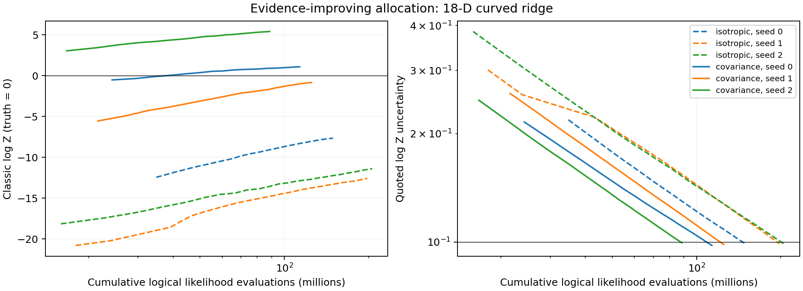

# Evidence-improving allocation to log-evidence uncertainty 0.1

Follow-up to [issue #312](https://github.com/Joshuaalbert/jaxns/issues/312) and
the [single-epoch experiment](REPORT.md).

All three covariance-direction runs reached the requested classic uncertainty
of at most 0.1. Their log-evidence estimates still miss the known value of zero
by many quoted standard deviations, and their posterior flat directions remain
collapsed. Additional evidence allocation does not resolve the mixing failure
in these runs.

## Configuration

Start fresh runs with `allocation_target="evidence_improving"` and stop at the
first completed depth epoch satisfying
`state.expected_log_Z_uncert <= 0.1`. Seeds 0, 1 and 2 are used for both
covariance and isotropic directions.

The per-epoch depth condition remains the released default:

```python
DepthCondition(
    dlogZ=jnp.log1p(1e-3),
    cummax_XL_frac=None,
)
```

Despite its name, `dlogZ` is a remaining-evidence fraction cutoff:

```text
L_g * X_g / (Z_through_g + L_g * X_g)
```

The threshold is approximately 0.0009995, evaluated along the expected classic
shrinkage path. The depth planner keeps the complete prefix through the last
contour failing the cutoff. This limits each epoch's depth; the uncertainty
goal decides whether another allocation epoch is needed.

The curved toy, 150 initial roots, 90 slice transitions, replacement width 150,
default `delta_K=150`, `1e-8` relative covariance ridge, and one-e-fold refresh
cadence are unchanged. No constrained-sampler code was modified for this
follow-up. Automatic sample-buffer growth is explicitly unlimited so the
default 150,000-sample cap cannot substitute for the requested uncertainty
goal. Checkpoints are saved after each completed epoch.

## Covariance directions

The known log evidence is zero up to negligible Gaussian truncation tails.
Uncertainties below are the classic block-moment approximation, not
phantom-conditioned Monte Carlo uncertainty.

| Seed | Epochs | Samples | Likelihood calls | Log Z | Quoted uncertainty | Peak deficit |
| --- | ---: | ---: | ---: | ---: | ---: | ---: |
| 0 | 18 | 103,713 | 113.40M | +1.0935 | 0.0978 | 2.00 |
| 1 | 20 | 114,665 | 124.99M | -0.8412 | 0.0984 | 2.82 |
| 2 | 17 | 86,130 | 88.58M | +5.4149 | 0.0995 | 1.36 |

All three miss zero by more than twice their reported uncertainty. The errors
are about 11.2, 8.5 and 54.4 quoted standard deviations, respectively.

Posterior standard deviations remain incorrect:

| Seed | x1 | x16 | x17 | x5 |
| --- | ---: | ---: | ---: | ---: |
| Expected | 0.2887 | 0.2887 | 0.2887 | 0.0500 |
| 0 | 0.0231 | 0.0326 | 0.0393 | 0.0243 |
| 1 | 0.0882 | 0.0487 | 0.0485 | 0.0357 |
| 2 | 0.0238 | 0.0536 | 0.1023 | 0.0357 |

The trajectories distinguish reduction in reported uncertainty from reduction
in actual error:

| Seed | After first evidence epoch | At uncertainty goal |
| --- | ---: | ---: |
| 0 | -0.5170 +/- 0.2156 | +1.0935 +/- 0.0978 |
| 1 | -5.5488 +/- 0.2588 | -0.8412 +/- 0.0984 |
| 2 | +3.0486 +/- 0.2479 | +5.4149 +/- 0.0995 |

Seed 1 moves substantially closer to zero, while seeds 0 and 2 finish with
larger absolute error than after their first evidence epoch. Narrower internal
uncertainty is not evidence that the population has regained contour coverage.

## Isotropic controls at the same uncertainty goal

| Seed | Epochs | Samples | Likelihood calls | Log Z | Quoted uncertainty |
| --- | ---: | ---: | ---: | ---: | ---: |
| 0 | 20 | 135,001 | 149.32M | -7.6538 | 0.0989 |
| 1 | 26 | 164,657 | 197.80M | -12.6029 | 0.0989 |
| 2 | 27 | 176,409 | 205.89M | -11.3957 | 0.0986 |

All six runs meet the uncertainty goal with no hard termination. Two isotropic
runs exceed the former default sample cap, so allowing buffer growth matters.

Across these three paired seeds, covariance directions reduce evidence RMSE
from 10.76 to 3.23 nats and mean likelihood calls from 184.33M to 108.99M.
Neither arm has any run within two quoted standard deviations of the truth.
Median inert-coordinate widths are 0.0364/0.0382 for isotropic directions and
0.0487/0.0485 for covariance directions, versus 0.2887 expected. The evidence
improvement does not establish successful posterior exploration.

These three-seed RMSEs should not be compared directly with the earlier
30-seed single-epoch aggregates as an estimate of the allocation strategy's
effect; they use different cohort sizes and stopping rules.



Solid lines use covariance directions; dashed lines use isotropic directions.
The horizontal references are the true log evidence of zero and the requested
uncertainty of 0.1. The figure is also available as [PDF](evidence_progress.pdf).
Exact values are in [evidence_summary.csv](evidence_summary.csv) and
[evidence_summary.json](evidence_summary.json).

## Reproduction and validation

The benchmark implementation is commit
`17536dd3c640a641f143728bb401c8616a7c25bf`; each raw record reports a clean
tracked-source diff at launch. The sampler implementation remains `0b16e67`.
Runs use JAX 0.11.1, Python 3.12.9, the CPU backend, x64 covariance/evidence
arithmetic, and the model's float32 unit-cube coordinates, as in the previous
experiment. Processes are pinned before importing backend libraries.

Runs have no separate warmup; elapsed times include compilation. Six processes
run concurrently, so comparisons use logical likelihood work rather than
claiming a wall-time speedup. This is a three-seed follow-up on the analytic
toy, not a new pRT retrieval or a large calibration study.

The [README](README.md) gives the full run command. Completed results and
per-epoch progress are in `raw/evidence-*.jsonl`. Regenerate the tables and
trajectory figure with:

```bash
conda run -n jaxns_py python benchmarks/issue_312/summarise_evidence.py
```

The summariser verifies the mode, seed, allocation policy, target uncertainty,
successful goal flag, and lack of hard termination for every run. The benchmark
and summariser pass Ruff and Flake8. This follow-up changes benchmark tooling
only; the previous 149 targeted sampler/core tests and four repository checks
were not rerun.
