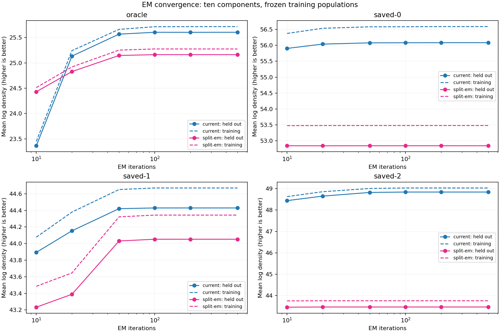
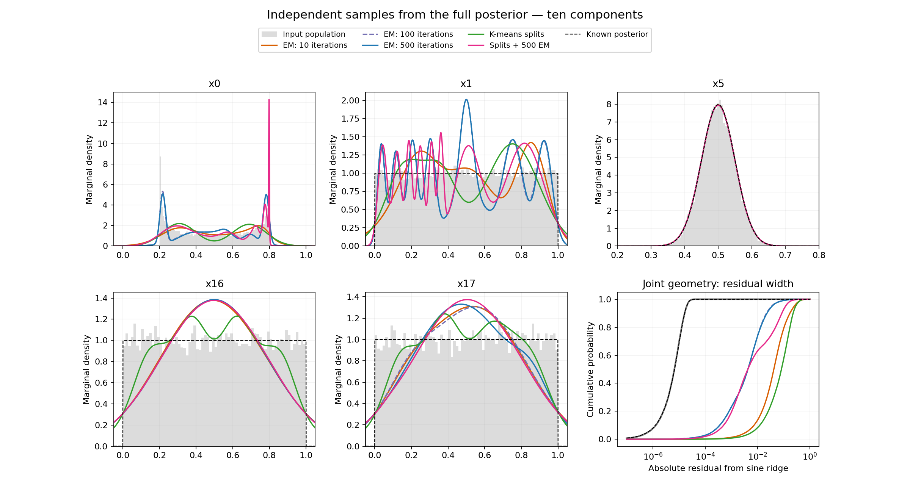
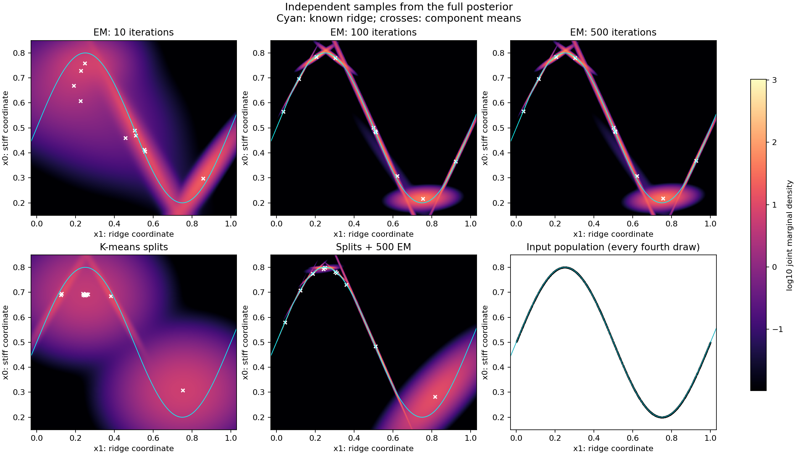
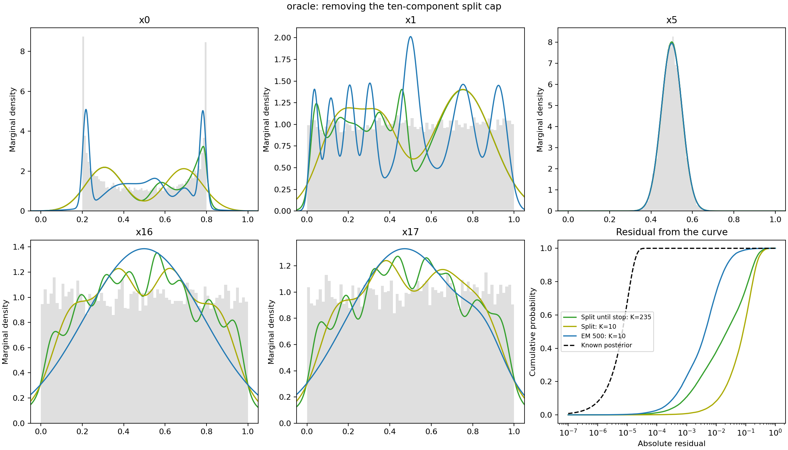

# GMM iterations and recursive ellipsoid splitting on the curved ridge

Tracks [issue #312](https://github.com/Joshuaalbert/jaxns/issues/312) and
continues the [staged GMM experiment](STAGED_GMM_REPORT.md). This follow-up
compares density fits only; it does not change the production sampler or rerun
nested sampling with the refined fits.

**Ten EM iterations are insufficient on a well-covered posterior cloud.**
Increasing to 100 improves validation mean log density by 2.241 nats per point
and reduces the RMS residual of mixture draws from the curve from 0.112 to
0.0227. Increasing from 100 to 500 adds only 0.000268 nats per point. That fit
has settled, but its density is still much broader than the true ridge.
The K-means split alternative performs worse in this experiment, both at a
matched ten-component budget and when allowed to split until it stops.

The checked EM arithmetic agrees with the independent NumPy reference.
These results identify under-convergence, initialization sensitivity and
remaining approximation error; they do not establish an EM implementation bug
or show that more iterations fix constrained-sampler mixing.

## Matched inputs and fitting protocol

The target is the same 18-dimensional unit-cube ridge, with
`x0 = 0.5 + 0.3 sin(2 pi x1) + Normal(0, 1e-5)`, fourteen independent Gaussian
coordinates `x2:x16` of width 0.05, and uniform `x1`, `x16`, `x17`.
There are four datasets, each with 16,384 training and 16,384 validation rows:

- **Oracle:** independent draws from the known full posterior. Cube rejection
  handles the negligible Gaussian tails; values are cast to float32 to match
  the sampler's U-space precision.
- **Saved 0, 1, 2:** separate weighted resamples of the three saved populations
  at the evidence-stage boundary, before the staged GMM continuation. Those
  populations already have collapsed flat directions. Training and validation
  draws are independent resamples of the **same empirical distribution** and
  can contain the same source rows. They are not independent posterior draws.

Each method receives the same equally weighted training cloud. Resampling
allows the enclosing-volume split rule to see the posterior population rather
than a hull dominated by ancient classics with negligible posterior weight.
This is a controlled density-fitting comparison, not a bitwise rerun of the
original fit to all weighted classics. The old weighted ten-iteration fit is
shown separately in the saved-population plots as a gray dotted reference;
its validation score is not an independent holdout score.

The current fit uses production `initialise_gmm` and `fit_gmm`, with ten
full-covariance components and relative regularisation `1e-6`. Passing an
all-true mask and zero log weights exercises the production weighted
initializer: deterministic mass quantiles of input order, with shared diagonal
initial covariance. Fitting uses float64 arithmetic. Each trajectory continues
the same fit through 10, 20, 50, 100, 200 and 500 cumulative EM iterations.
The split-initialized fit uses the same EM implementation and iteration sweep.

Dataset seeds are 20261021 through 20261024. This is one initialization per
dataset and method, not a claim about the best attainable GMM optimum.

## Full posterior: iterations matter, then the fit plateaus

Validation log density is the average `log q(x)` over independent posterior
draws, in nats per point; higher is better. Residual RMS is measured from
65,536 **untruncated mixture draws** using
`x0 - 0.5 - 0.3 sin(2 pi x1)`. It is a vertical residual, not an orthogonal
distance. The true posterior residual RMS is approximately `1e-5`.

| Fit | Components | Validation mean log density | Residual RMS |
| --- | ---: | ---: | ---: |
| Current EM, 10 iterations | 10 | 23.362896 | 0.111813 |
| Current EM, 100 iterations | 10 | 25.603846 | 0.022746 |
| Current EM, 500 iterations | 10 | 25.604114 | 0.022574 |
| K-means splits, Gaussian moments | 10 | 22.828961 | 0.141542 |
| Splits followed by 10 EM iterations | 10 | 24.430420 | 0.042260 |
| Splits followed by 500 EM iterations | 10 | 25.161977 | 0.052540 |
| K-means splits until natural termination | 235 | 21.906278 | 0.106787 |

The validation mean log density of the known posterior is approximately
32.1896. The estimated `KL(p || q)` decreases from 8.8267 to 6.5854 nats for
the current fit between 10 and 500 iterations. The train/validation traces
show the plateau directly:



The one-dimensional marginals alone understate the problem. The Gaussian
coordinates fit well, but they contain little information about the curved
dependence. The two-dimensional marginal makes the change visible: ten
iterations leave broad blobs; 100 and 500 produce similar ellipses along the
curve, with substantial remaining error near the turning points.





All heatmaps analytically marginalize the remaining 16 dimensions and share
the same log-density color scale. They are not slices through a chosen value
of the nuisance coordinates. Crosses mark component means; cyan marks the
known curve. The input scatter is subsampled only for display.

At 500 iterations only 0.861% of the fitted mixture's draws lie within three
true residual standard deviations of the curve, compared with approximately
99.73% for the posterior. About 16.45% of mixture draws lie outside the cube.
This describes an untruncated Gaussian density approximation; the actual
slice sampler enforces the cube and does not propose these mixture samples.
Neither statistic by itself establishes the usefulness of its direction law.

The remaining error is compatible with a finite Gaussian mixture trying to
cover extreme curvature, a local EM solution, and regularisation. This
experiment does not isolate those contributions or establish that ten
components are intrinsically insufficient for useful directions.

## Historical split rule with K-means proposals

The rule was recovered from
[`cluster_split` and `ellipsoid_clustering` at d700ead](https://github.com/Joshuaalbert/jaxns/blob/d700eadbcf7e1be103ada277fb37b7a402b77320/src/jaxns/sampling/ellipsoid.py),
before the rejection-sampling decomposition was removed. For each cluster,
compute its empirical covariance and enlarge its ellipsoid by the maximum
Mahalanobis radius so it contains all cluster members. Accept a proposed pair
of children when

```text
V(enclosing child 0) + V(enclosing child 1) < V(enclosing parent)
```

The benchmark retains that volume-reduction criterion, breadth-first
traversal, and at least `D+1` members per child. It also rejects singular
empirical covariances. Two-means in raw 18-dimensional U-space proposes each
split: ten K-means initializations, at most 100 iterations, tolerance `1e-6`,
and a deterministic seed per attempt. K-means selects the lowest-inertia
partition; the enclosing-volume criterion then accepts or rejects it. No
whitening or knowledge of the curved coordinates is supplied.

The historical implementation additionally enlarged ellipsoids to a supplied
constrained-prior volume estimate, propagating that estimate by child counts.
A posterior cloud has no single known contour volume, so this adaptation
**omits that volume floor**. It also uses K-means instead of the historical
EM or assignment-refinement proposals. It is a test of the requested split
criterion with K-means, not a reproduction of the whole retired sampler.

The output density uses child population fractions and empirical Gaussian
moments, with the same relative covariance ridge as EM. Enclosing radii affect
split acceptance only; using them as Gaussian widths would artificially
inflate the fitted density.

All four capped fits reached ten components. To check whether the cap hid an
advantage, a second experiment allowed splitting to terminate naturally:

| Input | Final components | Training mean log density | Validation mean log density |
| --- | ---: | ---: | ---: |
| Oracle | 235 | 26.0088 | 21.9063 |
| Saved 0 | 29 | 52.2966 | 50.8364 |
| Saved 1 | 50 | 44.8773 | 43.9057 |
| Saved 2 | 18 | 44.1896 | 43.6374 |

No EM refinement was applied to these larger mixtures. The unreachable cap
`floor(N / (D+1)) + 1` ensures termination comes from the volume, member-count
or rank checks. Every accepted split and every terminal rejection is recorded.

On the oracle, an early proposed split of the negative sine half increases
enclosing volume by 3.39%, so that branch stops. Its single component retains
8,244 of 16,384 rows, or 50.3% of the mixture mass. The other half keeps
splitting, including along flat coordinates, until mostly the support limits
stop it. Increasing the cap cannot revisit that earlier rejection. The large
training/validation gap shows overfitting, while the broad half remains.
An enclosure-volume objective therefore does not automatically choose a good
Gaussian density decomposition in this example.



## Fits to the saved, already collapsed populations

The scores below evaluate the same resampled empirical population for each
row. Their absolute values are not comparable with the oracle score: collapse
itself makes a concentrated empirical distribution easier to fit densely.

| Input | Current EM 10 | Current EM 100 | Current EM 500 | Splits, K=10 | Splits + EM 500 |
| --- | ---: | ---: | ---: | ---: | ---: |
| Saved 0 | 55.9029 | 56.0804 | 56.0825 | 49.6770 | 52.8442 |
| Saved 1 | 43.8937 | 44.4287 | 44.4287 | 41.3635 | 44.0522 |
| Saved 2 | 48.4410 | 48.8426 | 48.8426 | 43.2860 | 43.4646 |

More iterations improve these fits too, although the improvement is smaller
than on the full posterior. Their marginal plots follow the collapsed input
clouds. Improving the density fit to those clouds does not supply evidence
about the missing ridge coverage. It also does not rule out recovery by a
subsequent, better-mixing sampler; that would need a sampling experiment.

| Input | Focused marginals | All 18 marginals | Curved-pair joint density | Uncapped splits |
| --- | --- | --- | --- | --- |
| Oracle | [PNG](gmm_fit/oracle-marginals.png) | [PNG](gmm_fit/oracle-all-marginals.png) | [PNG](gmm_fit/oracle-joint.png) | [PNG](gmm_fit/oracle-adaptive-split.png) |
| Saved 0 | [PNG](gmm_fit/saved-0-marginals.png) | [PNG](gmm_fit/saved-0-all-marginals.png) | [PNG](gmm_fit/saved-0-joint.png) | [PNG](gmm_fit/saved-0-adaptive-split.png) |
| Saved 1 | [PNG](gmm_fit/saved-1-marginals.png) | [PNG](gmm_fit/saved-1-all-marginals.png) | [PNG](gmm_fit/saved-1-joint.png) | [PNG](gmm_fit/saved-1-adaptive-split.png) |
| Saved 2 | [PNG](gmm_fit/saved-2-marginals.png) | [PNG](gmm_fit/saved-2-all-marginals.png) | [PNG](gmm_fit/saved-2-joint.png) | [PNG](gmm_fit/saved-2-adaptive-split.png) |

Each PNG has a same-named PDF for export. The focused plots include a residual
CDF, and saved-population plots overlay the original weighted ten-iteration
fit. [summary.csv](gmm_fit/summary.csv) contains all 31 capped-fit records;
[adaptive-split.json](gmm_fit/adaptive-split.json) contains the uncapped results
and their complete split traces. Per-dataset JSON files include model
parameters, convergence traces and input/source checksums.

## Validation and reproduction

Production source is `40554c9a4188d69aaac19c6f9a8b761733740b7c`; the benchmark
files were new at execution time and their SHA-256 hashes are saved in each
fit record. The environment was Python 3.12.9, JAX 0.11.1, NumPy 2.2.6,
SciPy 1.15.3 and scikit-learn 1.6.1. K-means uses the existing development
dependency; no runtime dependency was added. CPU affinity is set before
numerical imports. Timings include compilation and are not sampler throughput
measurements.

The four committed input NPZ files make fitting reproducible without the
large nested-sampling checkpoints. If a saved-population NPZ is removed, its
evidence checkpoint from the staged experiment is needed to recreate it.
Run from the worktree root, selecting an available CPU:

```bash
for dataset in oracle saved-0 saved-1 saved-2; do
  PYTHONPATH=src JAX_ENABLE_X64=1 conda run --no-capture-output -n jaxns_py \
    python benchmarks/issue_312/compare_gmm_fits.py \
    --dataset "$dataset" --components 10 --iterations 500 --cpu 2
done

MPLCONFIGDIR=/tmp/issue312-matplotlib conda run --no-capture-output -n jaxns_py \
  python benchmarks/issue_312/plot_gmm_fits.py

MPLCONFIGDIR=/tmp/issue312-matplotlib conda run --no-capture-output -n jaxns_py \
  python benchmarks/issue_312/compare_split_limits.py --cpu 2
```

Validation completed:

- `test_em_gmm.py` and `test_multi_ellipsoid.py`: **12 passed**.
- Production EM agrees with the independent NumPy reference on 512 ridge
  rows, three components and ten iterations, separately for all four inputs
  (`rtol=1e-5`, `atol=1e-8` for means, covariances and log masses).
- The NumPy enclosing-volume calculation agrees with production
  `ellipsoid_params`/`log_ellipsoid_volume` on anisotropic 2-D and 18-D clouds
  to absolute log-volume errors of `1.04e-12` and `4.02e-13`.
- Accepted splits conserve member counts, have at least 19 rows in each child
  and strictly reduce enclosing volume. Uncapped runs have exactly `K-1`
  accepted splits and `K` terminal rejections. Final covariances are positive
  definite and mixture masses normalize. Analytic marginal normalization and
  input/script checksums pass.
- All four new Python files pass Ruff and full Flake8 with line length 100.

The arithmetic checks do not prove convergence or an adequate density model.
The sampler's component selection still uses contour-trimmed ellipsoid
volumes independently of the current point; this experiment changes neither
that selection nor its stationarity requirements. No evidence improvement is
claimed from the density-fitting results alone.
