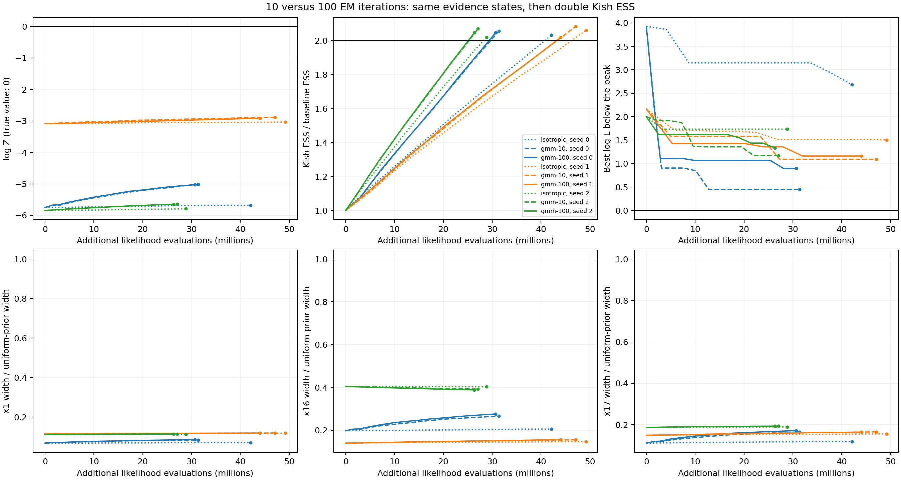

# Repeat the staged toy with 100 GMM iterations

Increasing the GMM fit from ten to 100 EM iterations makes no material
difference to evidence recovery in these three paired runs. Evidence RMSE is
**4.680 nats with 100 iterations, versus 4.666 with ten**, for true log Z
approximately zero. All three continuations reach twice the baseline Kish
ESS, but flat posterior directions remain collapsed. Mean continuation
likelihood work falls by 4.24%.

This follows the [density-fit audit](GMM_FIT_REPORT.md), which found that more
EM iterations substantially improve a fit to an independently sampled full
posterior. Here the fit is made to the sampler's actual, already collapsed
population at the requested late fitting boundary. The result therefore tests
the requested staged workflow; it does not contradict that density-fit result
or rule out other fitting times or direction laws.

Tracks [issue #312](https://github.com/Joshuaalbert/jaxns/issues/312) and
[draft PR #314](https://github.com/Joshuaalbert/jaxns/pull/314). No production
sampler code changed in this follow-up.

## Protocol

The target is the same 18-D curved ridge with sigma_stiff `1e-5`, curvature
0.3, fourteen Gaussian coordinates of width 0.05, and uniform posterior
marginals for x1, x16 and x17. The boundary correction from `f72a696` is included.

For each seed 0, 1 and 2:

1. Reuse the saved isotropic `evidence_improving` checkpoint after it reached
   `state.expected_log_Z_uncert <= 0.1`. These are exactly the checkpoints used
   by the [ten-iteration GMM and isotropic controls](STAGED_GMM_REPORT.md).
   Reusing them preserves the input population, random keys and ESS target.
2. Fit ten GMM components once, using **100 EM iterations** instead of ten:
   `state.fit_gmm_directions(num_components=10, num_iterations=100)`.
3. Continue with `posterior_improving` allocation until the classic
   posterior-weight Kish ESS is at least twice its value before fitting.
   Keep the fitted geometry frozen throughout continuation.

All other settings match the previous runs: 150 initial roots, **180 slices
(10D)**, replacement width 150, default delta_K, default depth condition
`dlogZ=log1p(1e-3)` without a `cummax_XL_frac` cutoff, no phantoms and unlimited
sample-buffer growth. GMM regularisation is `1e-6` with a 1% isotropic mixture.
Covariance whitening stays disabled. The fit uses all stored classics with
their expected posterior weights and does not call the likelihood or consume
sampler keys. The earlier control results are reused, not regenerated.

## Evidence, stopping and cost

The first-stage likelihood costs are 319.27M, 282.75M and 365.77M for seeds
0, 1 and 2. The following continuation costs exclude that common first stage.

| Seed | Before continuation: log Z | 10 EM: final log Z ± SD | 100 EM: final log Z ± SD | 10 EM: extra calls | 100 EM: extra calls |
| --- | ---: | ---: | ---: | ---: | ---: |
| 0 | -5.7528 | -5.0127 ± 0.1002 | -5.0260 ± 0.1002 | 31.38M | 30.72M |
| 1 | -3.0882 | -2.8858 ± 0.0974 | -2.9228 ± 0.0975 | 47.12M | 44.05M |
| 2 | -5.8456 | -5.6432 ± 0.0987 | -5.6474 ± 0.0987 | 27.08M | 26.34M |

The paired changes in final log Z are -0.0132, -0.0370 and -0.0042 nats.
Those are small compared with the 2.92–5.65 nat errors remaining. None of the
100-iteration runs is within two quoted standard deviations of truth; the
errors are approximately 30–57 quoted standard deviations.

| Continuation | Evidence RMSE | Mean extra likelihood calls | Mean total likelihood calls |
| --- | ---: | ---: | ---: |
| Isotropic control | 5.0025 | 40.05M | 362.65M |
| GMM, 10 EM iterations | 4.6655 | 35.19M | 357.79M |
| GMM, 100 EM iterations | 4.6796 | 33.70M | 356.30M |

The 100-iteration arm uses 4.24% fewer continuation calls than the
ten-iteration arm and 15.85% fewer than isotropic continuation. Including the
shared evidence stage, the reduction relative to ten iterations is 0.42%.
These three seeds do not establish a general performance advantage. Goal
checks occur at depth boundaries, so different overshoot also affects cost.

| Seed | Baseline ESS | 10 EM: ESS ratio | 100 EM: ESS ratio | 100 EM: epochs | 10 EM: peak gap | 100 EM: peak gap |
| --- | ---: | ---: | ---: | ---: | ---: | ---: |
| 0 | 12,250.77 | 2.057 | 2.048 | 13 | 0.450 | 0.898 |
| 1 | 16,027.32 | 2.084 | 2.020 | 11 | 1.092 | 1.161 |
| 2 | 10,519.56 | 2.070 | 2.046 | 11 | 1.172 | 1.334 |

Peak gap is the analytic maximum log likelihood minus the best observed
likelihood. All runs improve on their starting peaks, but 100 iterations
does not improve the final peak relative to ten in these seeds.

All goals complete with termination reason zero. The posterior-stage goal is
ESS only; seed 0's final uncertainty is 0.100150, slightly above the first
stage's threshold. That does not invalidate reaching uncertainty 0.1 before
the fit, and no second-stage uncertainty condition was imposed.

## Posterior widths

These are posterior standard deviations. The expected values are 0.288675
for x1, x16 and x17, and 0.05 for x5.

| Seed | EM iterations | x1 | x16 | x17 | x5 |
| --- | ---: | ---: | ---: | ---: | ---: |
| 0 | 10 | 0.0243 | 0.0767 | 0.0477 | 0.0339 |
| 0 | 100 | 0.0247 | 0.0797 | 0.0496 | 0.0339 |
| 1 | 10 | 0.0344 | 0.0448 | 0.0478 | 0.0338 |
| 1 | 100 | 0.0344 | 0.0450 | 0.0474 | 0.0336 |
| 2 | 10 | 0.0331 | 0.1132 | 0.0558 | 0.0328 |
| 2 | 100 | 0.0329 | 0.1121 | 0.0558 | 0.0330 |

The inert widths remain 0.045–0.112, and the ridge coordinate remains confined
to a small segment. Median inert-coordinate Wasserstein distances are 0.2416
and 0.3547 in cube units, versus 0.2405 and 0.3545 at ten iterations. The small
changes do not recover missing posterior coverage. Kish ESS measures posterior
weight concentration and does not correct for constrained-chain dependence.

## Fitted geometry and component selection

Every seed retains ten valid components, and the fit-update count remains
exactly one at every posterior-stage boundary. Observed isotropic fractions
are 0.9971%, 1.0045% and 0.9886%, consistent with the requested 1% mixture.
The fitted direction path is active throughout the experiment.

| Seed | 100 EM: range of centres in x1 | 10 EM: largest component probability at peak − 10 | 100 EM: largest component probability at peak − 10 |
| --- | --- | ---: | ---: |
| 0 | 0.5274–0.5786 | 99.9998% | 99.99999% |
| 1 | 0.7095–0.7881 | 99.8958% | 99.9949% |
| 2 | 0.2428–0.3649 | 99.8935% | 99.9482% |

These are calculated selection probabilities conditional on the GMM branch,
not observed component counts or posterior mixture masses. The existing
selector uses contour-trimmed ellipsoid volume independently of the current
point. Increasing EM iterations leaves its concentration at this contour and
the limited fitting coverage unresolved. These observations are compatible
with the lack of recovery, but do not isolate a causal mechanism or show that
the fixed direction kernel violates stationarity.

## Reproduction and validation

The [README command](README.md#staged-gmm-with-100-em-iterations) reproduces the
experiment from each local evidence checkpoint. Use the earlier evidence-stage
command first if those checkpoints are unavailable. The new raw files are
`raw/staged-gmm100-180-{seed}.gmm.jsonl`, with `.progress.jsonl` and `.fit.json`
siblings. Final records retain all 18 posterior means and standard deviations,
both sampler and evidence provenance, and baseline checkpoint checksums.

All new runs started at clean source commit
`cd125c3eaf344d71913ece2be1373b2ff29bf2d7`. Production source has no changes since
`f72a696`; intervening commits contain benchmark tooling and reports. The
runner already supported `--fit-iterations`, so its implementation is unchanged.
The environment is JAX 0.11.1 and Python 3.12.9, with x64 enabled, float32
U-space coordinates and float64 evidence arithmetic. Seeds 0/1/2 ran on CPUs
2/4/6, with affinity set before importing JAX. Fitting took 40–47 seconds;
whole continuations including fitting took 262–309 seconds. These concurrent
host timings include compilation and are not a throughput comparison with
the earlier runs.

The [comparison script](summarise_gmm_iterations.py) validates all nine
continuation records, checking identical baseline checksums and metrics,
first-stage uncertainty, exact doubled ESS targets, final goals, iteration
counts, other fit settings, absence of whitening, fit-update counts and
likelihood-call accounting. It writes the [CSV](gmm_iterations_summary.csv),
[JSON](gmm_iterations_summary.json) and [PNG](gmm_iterations_progress.png)/
[PDF](gmm_iterations_progress.pdf). These checks pass, as do Ruff and full
Flake8 on the new script with a 100-character line limit. The figure was
visually inspected. No production behavior changed, so the previously passing
GMM and sampler suites were not rerun for this benchmark-only continuation.

The experiment tests a single late fit followed by ESS doubling. It does not
test an earlier fit, refitting during continuation, longer posterior allocation,
a different component count or a different component-selection law.
