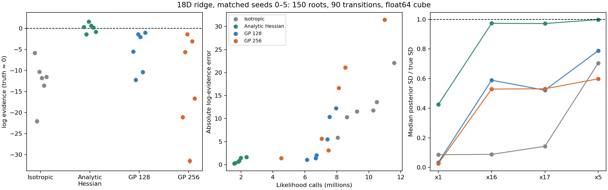
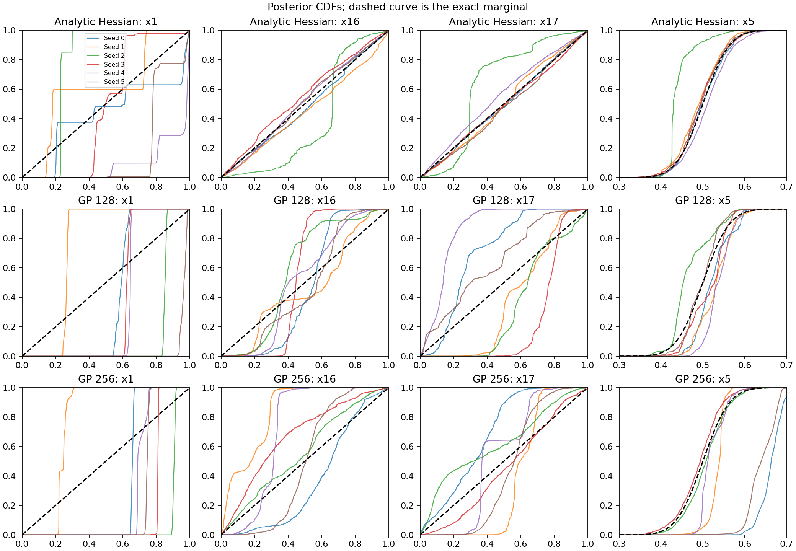
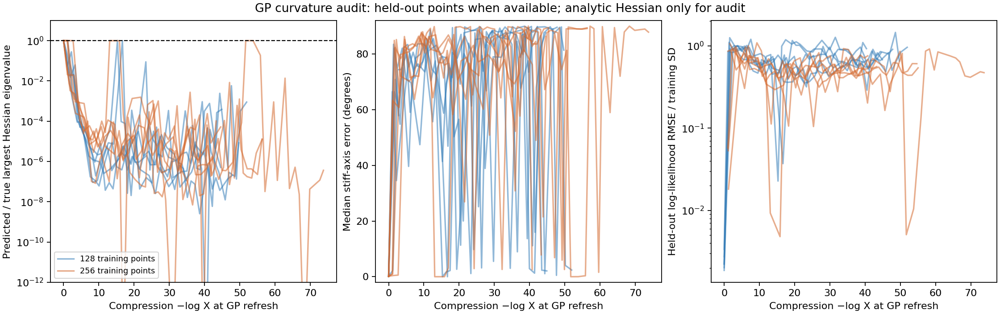

# GP predictive-mean Hessian experiment

The learned GP Hessian does not reproduce the improvement from the analytic
Hessian on this ridge. It can interpolate stored log likelihoods while learning
poor curvature between those observations. Increasing the representative set
from 128 to 256 points does not resolve the failure in the tested runs.

This is an exploratory comparison on the analytic toy, not a pRT result or a
production GP direction API. The input population and kernel are explicit
choices below; these results do not rule out other GP models or training sets.

## Controlled comparison

All runs use the same normalized 18D curved ridge, sigma_stiff=1e-5, 150 roots,
90 slice transitions, float64 cube coordinates, uniform allocation, one
default depth epoch (`dlogZ=log1p(1e-3)`), replacement width 150, and no phantoms.
Seeds 0–5 are compared with the matching six archived isotropic and scaled
analytic-Hessian runs. True log evidence is approximately zero. The three flat
marginals have standard deviation 0.288675; x5 has standard deviation 0.05.

| Directions | Mean log Z | RMSE | Mean quoted SD | Mean likelihood calls | Median peak gap | Within 2 quoted SD |
|---|---:|---:|---:|---:|---:|---:|
| Isotropic | -12.543 | 13.464 | 0.507 | 9.716M | 5.388 | 0/6 |
| Analytic Hessian | +0.093 | 0.989 | 0.459 | 1.878M | 1.106 | 4/6 |
| GP 128 | -5.428 | 7.010 | 0.485 | 7.075M | 2.457 | 0/6 |
| GP 256 | -13.241 | 17.129 | 0.523 | 7.784M | 1.922 | 0/6 |

All twelve GP runs complete normally but miss the true evidence by more than twice their quoted uncertainty. Individual errors are:

| Seed | GP 128 log Z ± quoted SD | GP 256 log Z ± quoted SD |
|---:|---:|---:|
| 0 | -5.485 ± 0.482 | -21.129 ± 0.557 |
| 1 | -12.226 ± 0.513 | -5.645 ± 0.488 |
| 2 | -1.389 ± 0.476 | -1.401 ± 0.472 |
| 3 | -2.027 ± 0.451 | -31.512 ± 0.646 |
| 4 | -10.399 ± 0.514 | -3.102 ± 0.490 |
| 5 | -1.041 ± 0.475 | -16.659 ± 0.482 |



Median posterior standard deviations across the six seeds:

| Directions | x1 SD | x16 SD | x17 SD | x5 SD |
|---|---:|---:|---:|---:|
| Truth | 0.2887 | 0.2887 | 0.2887 | 0.0500 |
| Isotropic | 0.0248 | 0.0254 | 0.0411 | 0.0352 |
| Analytic Hessian | 0.1225 | 0.2810 | 0.2805 | 0.0499 |
| GP 128 | 0.0096 | 0.1700 | 0.1505 | 0.0394 |
| GP 256 | 0.0074 | 0.1528 | 0.1533 | 0.0299 |



These width summaries do not establish ridge coverage. The CDF plots show
where each run puts its mass. The analytic-Hessian comparison itself remains
imperfect, as documented in [HESSIAN_REPORT.md](HESSIAN_REPORT.md).

## What is learned and when

The surrogate models **log likelihood**, using the usual GP predictive mean
with a constant mean and an ARD squared-exponential kernel. Its regression
equations follow [Rasmussen and Williams, chapter 2](https://gaussianprocess.org/gpml/chapters/RW2.pdf).
No true gradients or Hessians enter fitting or direction generation. Analytic
derivatives are used only in the separate curvature audit.

At initialization, the population is the 150 prior roots. Subsequent fits use
every stored classic point strictly above the shallowest finite parent contour
of the just-completed dispatch batch. These are stored classics, not an
independent live-point ensemble or posterior-weighted observations. Rejected
slice proposals are not retained by the existing core and are not training data.

At each refit:

1. Compute the empirical input mean and covariance from that entire population.
   Add `1e-8 * trace(C)/18 * I`, then compute its Cholesky factor. Whiten the
   population with this factor.
2. Choose up to 128 or 256 representatives by deterministic farthest-point
   coverage in these whitened coordinates. Recompute the output mean and
   standard deviation on that training subset.
3. Fit 18 kernel length scales and an amplitude by marginal likelihood, with
   at most 100 L-BFGS-B iterations per start. Compare a fresh initialization
   with the preceding length metric projected into the new whitening frame;
   retain the better objective. The initial fit has only the fresh start.
   Length bounds are 0.1–1000 in whitened units; log amplitude is bounded by
   −7 and 7. The correlation matrix has relative diagonal jitter 1e-10.
4. Freeze the resulting kernel Cholesky, input/output normalization, length
   scales and predictive-mean coefficients for subsequent chains.

Refits occur at the first completed-batch boundary where expected log volume
differs from the previous fit by at least one e-fold. The volume is reconstructed
from the current classic block/race law, rather than inferred from sample count.
The new GP takes effect on the **next** batch. This quantizes the requested
cadence to batch boundaries; it does not guarantee an update at every integer
log volume. No refit happens inside a chain, and no refit creates an allocation
or stopping boundary.

The completed runs use 28–51 fits including initialization. Observed
refresh intervals range from 1.003 to 3.090 e-folds, with median
1.302. The full sequence is retained in each seed's fit history.

The Hessian and its spectral factor are evaluated **locally at each slice
endpoint**, using that frozen predictive-mean function. These local factors
are different from the once-per-e-fold empirical/input and GP/kernel Cholesky
factors.

## Metric and reversibility

The experiment replaces the analytic negative Hessian by
`H(x) = -Hessian(GP predictive mean)(x)` in original cube coordinates. For a
fixed parent contour lambda, retain exactly the earlier scale and cap:

```
s = 2 * (known_peak - lambda) / 17
H(x) = Q diag(h) Q.T
precision(x) = Q diag(max(h / s, 12)) Q.T
```

Thus the **known toy peak and its 15 Gaussian residual dimensions are still
oracle information**. This isolates the quality of learned curvature. It is
not yet an end-to-end learned metric for an unknown likelihood. Negative and
flat Hessian axes receive the prior-variance cap; no GMM is involved.

Draw a normalized Gaussian direction with covariance equal to inverse
precision. Hold it fixed during the existing full-cube slice/shrinkage move,
evaluate the candidate with the true likelihood, then accept with
`min(1, q_candidate(v)/q_current(v))`, using the angular central Gaussian
density. The GP and parent contour are identical in both endpoint densities.
Rejections remain self-transitions and count toward the 90 transitions.

For a frozen surrogate, the same detailed-balance argument as the analytic
experiment applies: the reversible fixed-direction slice kernel is multiplied
by the symmetric factor `min(q_x(v), q_y(v))`. This does not by itself prove
independence of nested-sampling descendants or calibrate adaptation to a
population that contains related chains.

## Why the learned geometry is unreliable here



The initial broad-prior GP fit identifies the stiff direction well. Later
fits can almost interpolate the training values while missing the stiff
curvature by many orders of magnitude. For seed 0 with 128 representatives,
at log X = −13.66:

- Training log-likelihood RMSE: `4.73e-9` nats.
- Held-out log-likelihood RMSE: `6.80` nats.
- Median predicted/true largest Hessian eigenvalue: `3.52e-7`.
- Median absolute alignment with the true stiff eigenvector: `0.303`.

At log X = −29.48 the eigenvalue ratio is `1.75e-7` and alignment is `0.0269`.
The held-out points are omitted from the fit but come from the same stored
population; they are not an independent constrained-prior validation ensemble.
The Hessian truth at each audit point is nevertheless known exactly.
When the whole population fits within the training budget, the curvature
audit uses training points and no held-out value error is reported. This
includes the initial 256-point-budget fit to the 150 roots.

An additional fixed-population audit increases the optimizer budget from 100
to 500 iterations at updates 0, 1, 2, 10 and 20 of seed 0. The selected fits
are unchanged at 0, 2 and 10. At 1 and 20, optimization converges after 118
and 159 iterations but barely changes the bad curvature and held-out error.
This audit does not support insufficient iterations as the main problem for
these selected fits. It does not establish a global optimum or test a full
500-iteration sampling cohort.

My interpretation is that these representatives on a thin curved population
do not adequately constrain an ordinary stationary GP's normal curvature.
The fit also discovers spurious dependence on flat coordinates. An input
covariance transformation cannot straighten the nonlinear ridge. This is an
explanation consistent with the diagnostics, not a proof that all GP metrics
fail. Training with information on both sides of the local ridge, including
rejected proposals, or fitting more local models would be separate experiments.

## Frozen-kernel check

A frozen archived fit (128 points, seed 0, update 20) is applied to 8,192
independent exact constrained-prior seeds at `peak - 15`, for 90 transitions.
All samples remain in the cube and strictly above the contour. The largest
KS statistic across 19 analytic probability-integral transforms is 0.01543,
below the preselected bound 0.05524. These cover all flat/ball coordinates and
the radial distribution.

MH acceptance is 0.99949, but endpoint correlations in x16 and x17 are
0.999707 and 0.999663; their RMS displacements are only 0.00704 and 0.00747.
Mean likelihood work is 1,521 calls per 90-transition chain. Passing a
stationarity check and having high acceptance do not demonstrate mixing.
The frozen fit is intentionally unchanged for this test, including when a
validation seed lies outside the training population's occupied ridge segment.

## Implementation, validation and artifacts

The code is confined to benchmark tooling and its tests. `gp_geometry.py`
fits the surrogate, `gp_hessian_sampler.py` implements the custom sampler,
and `gp_refresh.py` temporarily wraps the existing bounded depth entry point.
The wrapper returns the original growth, seed-publication and schedule events
to the production runner. It is an offline, single-process hook and has no
checkpoint/resume support; a production adaptation API would need to own the
GP fit and refresh position explicitly in State.

Sixteen focused tests pass, including the GP Hessian against independent
autodiff after a nontrivial coordinate transform, a learned quadratic,
padding exclusion, representative selection, and retained MH self-transitions.
A frozen-kernel replay through the batch hook exactly matches every leaf of
the ordinary runner's final state, including random keys. An additional
nonconstant GP direction law preserves a 2D uniform target under MH.
Existing analytic-Hessian tests and the reviewer checks also pass.

All 24 saved runs in the matched comparison pass independent likelihood,
actual cube/physical dtype, support, peak and weighted-moment checks. All
12 GP runs additionally pass strict recorded-parent constraints, successful
depth completion, source checksums and fit population/selection/cadence
checks. The maximum NumPy-versus-stored likelihood difference is
2.19e-5 nats (the existing TFP scalar-constant precision difference).
New Python files pass Ruff and Flake8. All three figures were inspected.
The full repository suite was not rerun.

JAX 0.11.1, Python 3.12.9, one pinned CPU core per process. Wall times include
GP fitting, host boundaries and compilation, and several processes run
concurrently; likelihood-call counts are the comparable cost. All likelihood
calls used by the slice chains retain the existing accounting. GP fitting
and the independent audits do not call the forward model during sampling.

Raw cohort records and fit histories are in `raw/gp-*`. Complete sample and
fit arrays remain under `/tmp/jaxns-gp-final{128,256}-{a,b}` in this workspace.
Seven portable fit/population snapshots in `gp_audit/seed-0` reproduce the
500-iteration audit and frozen-kernel check. Source and sample checksums are
recorded in the cohort records and summary CSV. The preliminary single-start
development pilots are not included in the matched comparison.

Run each cohort in the experimental worktree:

```bash
PYTHONPATH=.:src JAX_ENABLE_X64=1 conda run --no-capture-output -n jaxns_py \
  python benchmarks/issue_312/run_gp_hessian.py \
  --seeds 0 1 2 --cpu 4 --training-points 128 \
  --output-dir /tmp/jaxns-gp-final128-a
```

Repeat seeds 3–5 into suffix `b`, then both groups with 256 training points.
Output directories must be new. Rebuild the comparison with
`python benchmarks/issue_312/summarise_gp_hessian.py` in the same conda
environment, after also restoring the earlier isotropic/Hessian archives.

The portable diagnostics do not require a sampling rerun:

```bash
PYTHONPATH=.:src JAX_ENABLE_X64=1 conda run --no-capture-output -n jaxns_py \
  python benchmarks/issue_312/audit_gp_fit.py \
  --directory benchmarks/issue_312/gp_audit/seed-0 \
  --updates 0 1 2 10 20 --iterations 500 --cpu 3 \
  --output /tmp/gp-iterations.json

PYTHONPATH=.:src JAX_ENABLE_X64=1 conda run --no-capture-output -n jaxns_py \
  python benchmarks/issue_312/validate_gp_hessian.py \
  --fit benchmarks/issue_312/gp_audit/seed-0/fit-020.npz --cpu 3 \
  --output /tmp/gp-stationarity.json
```
