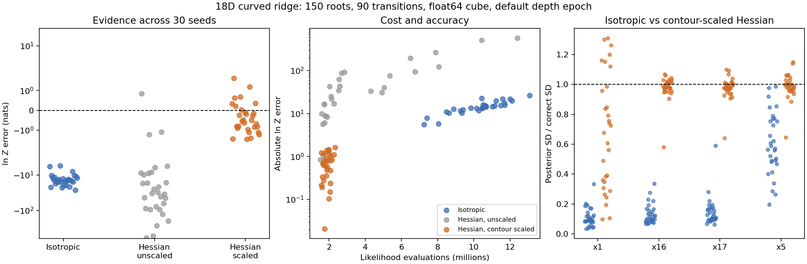
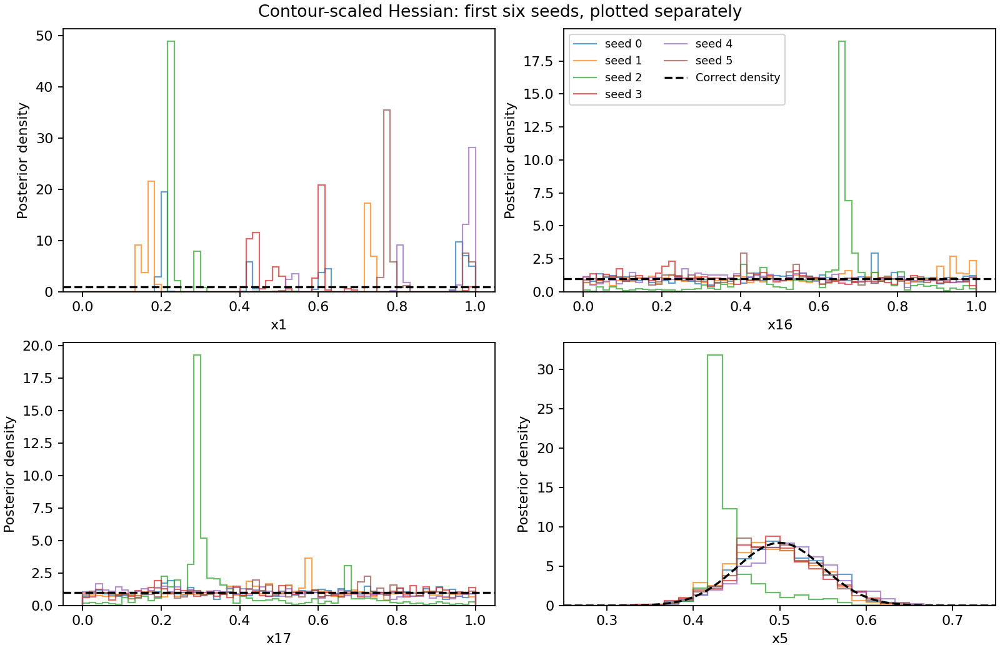

# Analytic Hessian directions on the stiff ridge

Tracks [issue #312](https://github.com/Joshuaalbert/jaxns/issues/312) and
[PR #314](https://github.com/Joshuaalbert/jaxns/pull/314).

The contour-scaled, Metropolis-corrected Hessian kernel substantially improves
evidence and likelihood work on the curved toy, but does not recover the ridge
marginal. An initial unscaled inverse-Hessian experiment fails badly, including
on the straight control. Both experiments and all their seeds are retained.

## Matched experiment

All JAXNS comparisons use 18 dimensions, sigma_stiff = 1e-5, 150 roots,
90 transitions, float64 cube coordinates, uniform allocation, replacement
width 150, no phantoms, classic evidence, and one default depth epoch
(`dlogZ=log1p(1e-3)`). All 80 new runs finish that epoch normally, without
hitting the scientific sample cap. The isotropic baseline is the preceding
30-seed float64 experiment. Curved cohorts use seeds 0–29; straight controls
use seeds 0–9. Identical seed labels do not imply shared Markov trajectories.

| Configuration | Seeds | Mean ln Z | Evidence RMSE | Mean likelihood calls | Median peak gap | Within 2 quoted SD |
|---|---:|---:|---:|---:|---:|---:|
| Curved, isotropic | 30 | -14.634 | 15.379 | 10.282M | 4.571 | 0/30 |
| Curved, unscaled Hessian | 30 | -82.006 | 159.737 | 3.755M | 1.236 | 1/30 |
| Curved, contour-scaled Hessian | 30 | -0.387 | 0.846 | 1.886M | 1.150 | 21/30 |
| Straight, unscaled Hessian | 10 | -44.980 | 71.904 | 1.657M | 1.202 | 0/10 |
| Straight, contour-scaled Hessian | 10 | -0.087 | 0.432 | 1.152M | 0.837 | 9/10 |

True ln Z is zero up to negligible prior truncation. The contour-scaled curved
errors range from -1.452 to +1.618 nats, with mean quoted uncertainty 0.461.
Its mean likelihood cost is 81.7% below the isotropic baseline. The curvature
still adds error: the straight control is better calibrated and recovers its
flat marginals. This is an oracle-geometry experiment, not a GP implementation.

For context, the earlier six-seed Dynesty 150-live/90-rslice control had RMSE
2.950 at 3.739M actual likelihood calls. That comparison has fewer seeds and
a different stopping tolerance; it is not a matched implementation ablation.



The evidence-error panel uses a symmetric logarithmic axis to show the large
unscaled failures as well as the useful range near zero. Standalone
[PDF comparison](hessian_comparison.pdf) is also included.

## What is still wrong

| Median posterior standard deviation | Isotropic | Contour-scaled Hessian | Correct |
|---|---:|---:|---:|
| Ridge coordinate x1 | 0.0264 | 0.2023 | 0.2887 |
| Inert x16 | 0.0293 | 0.2853 | 0.2887 |
| Inert x17 | 0.0330 | 0.2832 | 0.2887 |
| Gaussian x5 | 0.0290 | 0.0497 | 0.0500 |

Width alone understates the ridge failure. Multiple narrow surviving segments
can yield a broad overall standard deviation. Median x1 Wasserstein distance
to the true uniform is still 0.202 cube units (0.700 reference SD). The
corresponding inert distances are 0.0268 and 0.0261 cube units. Seed 2 also
concentrates the inert coordinates and narrows x5; typical width recovery is
not uniform success across the cohort.



These are the first six seeds, not selected examples or a pooled posterior.
Pooling seeds would conceal their missing coverage. A standalone
[marginal PDF](hessian_marginals.pdf) and all per-seed widths and Wasserstein
distances in [hessian_summary.csv](hessian_summary.csv) are included.

## Direction law and correction

The toy log likelihood has 15 Gaussian residuals and three flat directions.
Let `f(x1) = 0.5 + 0.3 sin(2 pi x1)` and `r = x0 - f(x1)`.
The exact negative Hessian's coupled block is

```text
H[0:2,0:2] = [[1, -f'], [-f', f'^2 - r f'']] / sigma_stiff^2
```

The other fourteen Gaussian eigenvalues are 400; the two unused axes have
zero eigenvalues. The `-r f''` term is retained: this is the exact Hessian,
not the positive-semidefinite Gauss-Newton approximation. Away from the ridge
it can be indefinite, so it must be regularised before inversion.

For the fixed parent log-likelihood contour `lambda`, define

```text
s = 2 * (peak - lambda) / 17
H(x) = Q diag(h) Q.T
G_lambda(x) = Q diag(max(h / s, 12)) Q.T
C_lambda(x) = inverse(G_lambda(x))
```

The factor 17 is 15 + 2: the covariance of a uniform 15-ball of squared
radius `2*(peak-lambda)` is that squared radius divided by 17. Flooring
precision at 12 caps every covariance eigenvalue at the unit-uniform prior
variance 1/12. This bounds zero or negative Hessian curvature and makes early
broad contours much closer to isotropic. The unscaled experiment sets `s=1`
throughout. A tiny positive lower bound on the gap prevents division by zero.
There is no additional isotropic mixture or empirical covariance fit.

Each transition draws and normalizes `z ~ Normal(0,C_lambda(x))` to obtain
direction `v`, then calls the existing full-cube slice/shrinkage implementation
against the true likelihood. Candidate `y` is accepted with

```text
alpha = min(1, q_lambda,y(v) / q_lambda,x(v))
q_lambda,x(v) proportional to
    det(G_lambda(x))^(1/2) * (v.T G_lambda(x) v)^(-18/2)
```

This is the angular central Gaussian density, not the ordinary Gaussian
density evaluated at the normalized direction. Determinants and quadratic
forms are evaluated in the eigenbasis to avoid cancellation in the stiff
direction. Only the 2x2 coupled block requires an eigendecomposition.

For a fixed direction, the existing full-cube slice kernel `K_v` is reversible
for the uniform constrained prior. The accepted flux is proportional to
`pi(x) K_v(x,dy) min(q_x(v),q_y(v))`, symmetric under reversing the move.
The base shrinkage reversibility is described in
[Neal's slice-sampling paper](https://arxiv.org/pdf/physics/0009028); the
direction-density correction here follows from that fixed-direction property.
Likelihood ratios are absent because the constrained target is uniform.

The analytic geometry function never adapts to the generated population.
It is evaluated at both endpoints of every proposed transition, with the
same parent contour scale. The current geometry is cached after acceptance
or rejection. MH rejections remain self-transitions and count toward the 90
steps. Retrying until acceptance would bias the transition law. This experiment
does not test a 0.13-e-fold empirical-covariance refresh interval.

## Why contour scaling matters

The unscaled negative Hessian describes posterior-scale anisotropy even when
the likelihood contour still spans much of the prior. On the straight toy,
it restricts the x0 direction to approximately 1e-5 relative to broad axes
from the first transition. Seeds then retain their initial stiff-coordinate
locations through early compression. Its 10-seed straight evidence errors
range from -186.04 to +1.76 nats despite good final widths.

Scaling by the contour gap before imposing the prior variance cap removes
this startup failure in the straight control. It is a separate, explicit
change from local Hessian orientation, not a hidden tuning choice. No parameter
sweep was used; the scale comes from the known quadratic-contour covariance.
The experiment uses the toy's known peak as well as its analytic Hessian.

A direct broad-contour check confirms the movement mechanism. At a gap of
2e8 nats on the straight toy, the permitted x0 interval is almost [0.3,0.7].
From 8,192 independent exact constrained-prior seeds, 90 unscaled transitions
move x0 by only 0.0000678 RMS, with endpoint correlation 0.99999983. Scaling
raises RMS movement to 0.0908 and lowers correlation to 0.690. MH acceptance
is 100% for both constant-geometry kernels: the problem here is short moves,
not correction rejections. See [the startup probe](validate_hessian_startup.py)
and [raw measurements](raw/hessian-startup-movement.jsonl).

## Stationarity and movement checks

The shear `(x0,x1) -> (x0-f(x1),x1)` has unit Jacobian. Independent uniform
15-ball draws times three independent uniform coordinates therefore provide
exact constrained-prior seeds for interior contours. For each gap below the
peak of 5, 15 and 40 nats, 8,192 independent seeds undergo 90 transitions.
All endpoints are checked against the strict true contour and the cube.

The distribution check uses the three flat marginals, all fifteen standardized
ball-coordinate marginals, and the radial distribution. Ball coordinates map
through Beta(8,8); radius to the power 15 maps to uniform. For the scaled
corrected kernel, maximum KS statistics across these nineteen checks are
0.0139, 0.0145 and 0.0168, below the predetermined bound `5/sqrt(8192)=0.0552`.
Removing the MH correction gives 0.1321, 0.1354 and 0.1373, failing all three
controls. The unscaled kernel also passes with correction and fails without it.
These checks support the implementation; they do not prove independence.

At gap 15, the scaled kernel accepts 42.2% of moves. After 90 transitions,
x1 RMS displacement is only 0.00308 and its start/end correlation is 0.999944.
Independent uniform draws would have RMS displacement sqrt(1/6) = 0.408.
Stationarity and decorrelation are very different properties here.

A tangent line departs from a curved ridge quadratically with distance. Near
x1=0.25, `|f''|` is about 11.84; even at gap 15 a perfectly tangent line from
the ridge centre remains in the tube for only about 0.003 in x1. This motivates
testing curved trajectories separately. For this toy, the exact unit-Jacobian
shear supplies a particularly clean oracle construction. Generic reflection
or metric-following trajectories would require their own reversible proposal
and boundary treatment. Neither was implemented in this experiment.

## Reproduction and validation

The custom sampler is confined to
[hessian_sampler.py](hessian_sampler.py), using the existing `AbstractSampler`
interface. No production sampler source, default, GMM policy, allocation or
bracketing rule changed. It uses the complete-chain batching reference path;
the isotropic baseline uses continuation scheduling. Likelihood counts are
comparable; wall-time speedups are not claimed, and Hessian arithmetic is not
included in the likelihood-call count.

```bash
PYTHONPATH=.:src JAX_ENABLE_X64=1 conda run --no-capture-output -n jaxns_py \
  python benchmarks/issue_312/run_ridge.py --mode hessian \
  --unit-dtype float64 --seeds 0 1 2 3 4 5 6 7 8 9 --cpu 2 --no-warmup \
  --output /tmp/hessian-scaled.jsonl --archive-dir /tmp/hessian-scaled-samples

PYTHONPATH=.:src conda run --no-capture-output -n jaxns_py \
  python benchmarks/issue_312/validate_hessian.py --cpu 3 --gap 15 \
  --output /tmp/hessian-stationarity.jsonl
```

Repeat the first command for seeds 10–19 and 20–29 using separate output and
archive paths. `--curvature 0` selects the straight control;
`--no-hessian-contour-scale` reproduces the unscaled kernel. The fixed
precision floor is exposed as `--precision-floor` for future experiments.

Raw records and unscaled executed-source snapshots are in `raw/`. The main
scaled runner and sampler hashes match the committed source. Saved arrays
remain under `/tmp/issue312-{raw-file-stem}/seed-{seed}.npz`; the inherited
isotropic archives use `/tmp/issue312-precision-f64/`. Their checksums are in
the CSV. These full arrays are local artifacts, not committed. The summariser
requires them at those paths, or regenerated equivalents, to revalidate and
rebuild the plots. Raw metrics, figures and code are committed.

All 110 saved runs (80 new plus 30 baseline) pass configuration, successful
termination, dtype, cube-domain, independent NumPy likelihood, peak and
posterior-moment checks. Maximum absolute likelihood discrepancy is below
2.4e-5 nats over the whole prior; the inherited TFP scalar constants use
float32 even though evaluated points and results are float64. Kernel tests
independently check the full autodiff Hessian, NumPy spectral regularisation,
angular density, analytic straight-contour covariance, and retained MH
self-transitions. Source hashes and data checksums are validated before
summarization. No pRT model was run.

Validation passed 88 targeted cases: 54 cube-bracket cases, 23 existing
constrained-sampler cases, seven new Hessian cases and four reviewer checks.
All changed Python files pass Ruff and Flake8. The full repository suite was
not rerun for this benchmark-only change.
