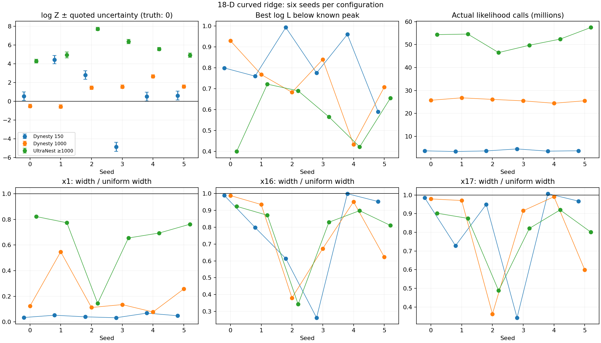
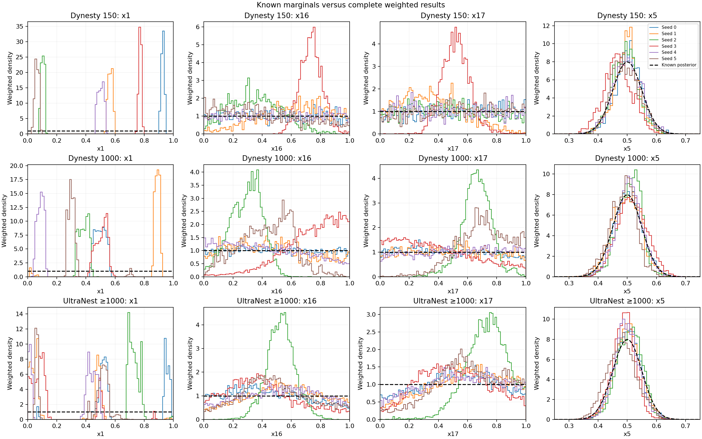
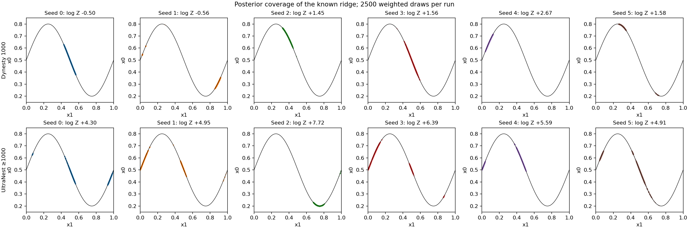
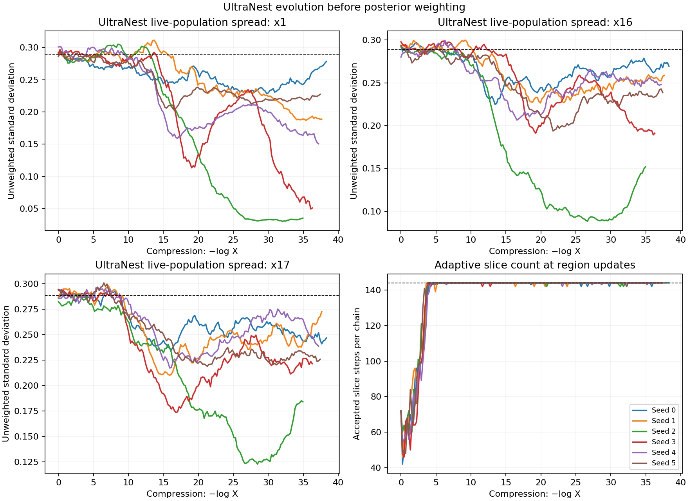

# Larger-population Dynesty and UltraNest controls

This follow-up runs the analytic ridge with 1,000 live points in Dynesty and
a minimum of 1,000 in reactive UltraNest, with seeds 0–5 fixed before execution.
It follows the [150-live-point Dynesty check](DYNESTY_REPORT.md) and tracks
[issue #312](https://github.com/Joshuaalbert/jaxns/issues/312) and
[draft PR #314](https://github.com/Joshuaalbert/jaxns/pull/314).

**Neither tested configuration reliably recovers this extreme toy at 1,000
live points.** All twelve runs complete normally, and all reach within one nat
of the known likelihood peak. None has an evidence error within twice its
reported uncertainty, and none recovers the uniform ridge-coordinate marginal.
UltraNest covers more separated pieces of the curve in most seeds, but its
evidence is systematically high in this cohort.

| Configuration | Evidence error range | Evidence RMSE | Within 2× quoted uncertainty | Mean likelihood calls | x1 SD range |
| --- | ---: | ---: | ---: | ---: | ---: |
| Dynesty, 150 live, 90 slices (previous control) | -4.859 to +4.445 | 2.950 | 3/6 | 3.74M | 0.009–0.020 |
| Dynesty, 1,000 live, 90 slices | -0.556 to +2.669 | 1.566 | 0/6 | 25.67M | 0.022–0.158 |
| UltraNest, 1,000 minimum, adaptive 72–144 slices | +4.298 to +7.723 | 5.755 | 0/6 | 52.49M | 0.042–0.237 |

The true log evidence is approximately zero and the true x1 standard deviation
is 0.2887. All UltraNest runs retain 1,000 roots and a maximum population of
1,000; none needs a reactive widening round. The six seeds were chosen before
execution, with no discarded or selectively rerun seeds. These are independent
cohorts, not coupled random-number pairs across methods or population sizes.



## Dynesty results

All six 1,000-live-point Dynesty runs completed normally. Increasing the
population reduces evidence RMSE from 2.950 to 1.566 nats in these cohorts,
but none of the six new results falls within twice its quoted uncertainty.
The evidence errors range from -0.556 to +2.669 nats, with quoted errors
0.177–0.186. Each run reaches within one nat of the likelihood peak, yet the
ridge-coordinate marginal remains severely distorted.

| Seed | log Z ± quoted uncertainty | Peak gap | Actual likelihood calls | x1 SD | x16 SD | x17 SD | x5 SD |
| --- | ---: | ---: | ---: | ---: | ---: | ---: | ---: |
| 0 | -0.4995 ± 0.1857 | 0.929 | 25.73M | 0.0355 | 0.2852 | 0.2826 | 0.0493 |
| 1 | -0.5561 ± 0.1849 | 0.768 | 26.78M | 0.1579 | 0.2698 | 0.2802 | 0.0491 |
| 2 | +1.4520 ± 0.1829 | 0.683 | 26.10M | 0.0324 | 0.1098 | 0.1047 | 0.0410 |
| 3 | +1.5613 ± 0.1794 | 0.840 | 25.47M | 0.0390 | 0.1943 | 0.2643 | 0.0506 |
| 4 | +2.6693 ± 0.1770 | 0.434 | 24.43M | 0.0223 | 0.2746 | 0.2861 | 0.0454 |
| 5 | +1.5763 ± 0.1787 | 0.708 | 25.50M | 0.0742 | 0.1799 | 0.1729 | 0.0449 |

The correct flat-coordinate standard deviation is 0.2887. The x1
Wasserstein distances from its uniform target are 0.218–0.414 in unit-cube
coordinates, so none of these runs recovers that marginal. Seeds 2 and 5
also appreciably narrow both inert directions. The larger population helps
some diagnostics, but does not establish reliable evidence or posterior
recovery for this extreme toy at 90 slices.

## UltraNest results

| Seed | log Z ± quoted uncertainty | Peak gap | Actual likelihood calls | x1 SD | x16 SD | x17 SD | x5 SD |
| --- | ---: | ---: | ---: | ---: | ---: | ---: | ---: |
| 0 | +4.2978 ± 0.2021 | 0.400 | 54.34M | 0.2372 | 0.2667 | 0.2606 | 0.0454 |
| 1 | +4.9479 ± 0.3234 | 0.722 | 54.57M | 0.2232 | 0.2514 | 0.2526 | 0.0444 |
| 2 | +7.7230 ± 0.1608 | 0.690 | 46.51M | 0.0419 | 0.0990 | 0.1408 | 0.0425 |
| 3 | +6.3864 ± 0.2229 | 0.566 | 49.71M | 0.1889 | 0.2395 | 0.2370 | 0.0403 |
| 4 | +5.5855 ± 0.1795 | 0.422 | 52.37M | 0.2001 | 0.2593 | 0.2657 | 0.0424 |
| 5 | +4.9148 ± 0.2338 | 0.655 | 57.46M | 0.2200 | 0.2340 | 0.2312 | 0.0507 |

The larger x1 widths do not imply recovery of its uniform density. The
Wasserstein distances are 0.157–0.339 in unit-cube coordinates, and the maximum
weighted-CDF deviations from uniformity are 0.395–0.676. The posterior still
concentrates on a few pieces of the curve. The inert directions are usually
less affected, although seed 2 severely narrows both. Each run also narrows at
least one of the fourteen ordinary Gaussian coordinates: the minimum width
ratio ranges from 0.685 to 0.871. The stiff residual itself has nearly correct
width, 0.996–1.019 times sigma_stiff.





The curve figure uses 2,500 weighted draws per run solely for visualization.
Every numerical score and marginal histogram uses the complete weighted result.

### Native movement diagnostics

UltraNest's own movement diagnostics indicate inadequate movement at the
144-step cap. The geometric mean jump-distance/reference-distance ratio is
0.187–0.284, and only 5.67–6.24% of recorded chains exceed the reference
distance. Logged mean step counts are 137.3–138.1; 86.2–87.7% of logged chains
use the maximum 144 steps. These are averages over the entire run, including
the easier initial contours.

In contrast, its insertion-order diagnostic reports convergence for all six
runs. Passing that check does not establish recovery of the flat directions
or calibrated evidence on this target. Remaining posterior tail fractions are
0.009994–0.010005, consistent with the requested `frac_remain=0.01`; premature
termination by a hard work limit does not explain these results.



Some live-population widths recover late, but the marginal plots still reveal
missing intervals and incorrect relative mass. Width alone is insufficient as
a mixing check. This follow-up therefore supports retaining movement and
distributional diagnostics alongside evidence uncertainty and weight-based ESS.

## Scope of the conclusion

These runs show that raising the population to 1,000 is insufficient for the
tested configurations on the sigma_stiff `1e-5` toy. They do not establish that
Dynesty or UltraNest cannot solve it with different or more intensive settings.
In particular, UltraNest spends most of its run at the specified step cap while
its movement diagnostic remains poor. Further adaptation above 144 steps was
not tested.

The reported agreement between converged UltraNest and Dynesty on the pRT
retrieval remains separate evidence. That likelihood and its opacity data were
not run here, and this extreme toy is not interchangeable with the pRT model.
The analytical evidence and posterior, rather than any one sampler's output,
remain the reference for the toy. These controls also change several mechanisms
together and do not isolate full-chord bracketing as the cause of a failure.

## Target and configuration

The target is the same normalized 18-dimensional toy: sigma_stiff `1e-5`,
curvature 0.3, fourteen other Gaussian factors with sigma 0.05, and uniform
priors. The exact log evidence is zero to negligible Gaussian truncation
error. Coordinates x1, x16 and x17 have uniform posterior marginals with
standard deviation `1/sqrt(12)`; x5 has standard deviation 0.05.

| Setting | Dynesty | UltraNest |
| --- | --- | --- |
| Version | 3.0.0 | 4.6.3 |
| Population | 1,000 fixed live points | 1,000 minimum; reactive growth allowed |
| Directions | `multi` bounds with `rslice` | `SliceSampler`, `generate_mixture_random_direction` |
| Transitions | 90 | 72 initially, `move-distance` adaptation, maximum 144 |
| Depth stopping | `dlogz=0.01`, remaining evidence | `frac_remain=0.01` |
| Additional goals | Static nested sampling | Defaults: `dlogz=0.5`, `dKL=0.5`, `min_ess=400` |
| Hard limits | None | No call, iteration or improvement-loop limit |
| Precision | NumPy float64 | NumPy float64 |
| Seeds | `np.random.default_rng(0..5)` | `np.random.seed(0..5)` |

The Dynesty runner is unchanged from the previous six-seed control: only
`--live-points` changes from 150 to 1000. This retains 90 slices rather than
changing simultaneously to the pRT report's 72 slices.

The reporter did not specify the UltraNest version, slice-direction generator,
or adaptive-step criterion. This is a documented control with comparable
population and step settings, not an exact reproduction of that configuration.
The selected mixture gives equal probability to differential directions between
live points and directions along the fitted region axes. This is the mixture
used in the official [high-dimensional example](https://johannesbuchner.github.io/UltraNest/example-sine-highd.html).
See also the [UltraNest API](https://johannesbuchner.github.io/UltraNest/ultranest.html)
and [Dynesty 3.0.0 API](https://dynesty.readthedocs.io/en/v3.0.0/api.html).

UltraNest keeps its default MLFriends region and reactive allocation. Adaptation
can lower the number of steps below 72; 72 is an initial value, not a floor.
`check_nsteps=False` avoids repeating the same movement diagnostic separately
from `adaptive_nsteps="move-distance"`; adaptation still records jump distances.
The native adaptive implementation is used without modification. Its source
warns that adaptive step counts do not strictly preserve detailed balance;
these tests evaluate the requested practical configuration empirically.

All calculations use complete weighted results, not equal-weight posterior
resamples. Dynesty includes its final live points. UltraNest's stored `logw`
is a quadrature-volume weight, so the archive adds `logl` to obtain evidence
contributions in the same convention as Dynesty's `logwt`.
The two packages' quoted error estimates have different constructions; counts
within twice the quoted error are descriptive, not a claim that both bars have
the same Gaussian coverage interpretation. Wasserstein scores use 16,384
uniform midpoint reference points; CDF deviations use the exact uniform CDF.

## Reproduction

Packages are isolated under `/tmp`; repository dependencies and the development
environment are unchanged. UltraNest's extensions were built during installation.

```bash
conda run --no-capture-output -n jaxns_py python -m pip install \
  --no-cache-dir --no-deps --target /tmp/issue312-dynesty-3.0.0 dynesty==3.0.0
conda run --no-capture-output -n jaxns_py python -m pip install \
  --no-cache-dir --no-deps --target /tmp/issue312-ultranest-4.6.3 ultranest==4.6.3

PYTHONPATH=/tmp/issue312-dynesty-3.0.0 OPENBLAS_NUM_THREADS=1 OMP_NUM_THREADS=1 \
  conda run --no-capture-output -n jaxns_py \
  python benchmarks/issue_312/run_dynesty_ridge.py \
  --seed 0 --cpu 0 --live-points 1000 --slices 90 \
  --output /tmp/dynesty-rslice90-1000-0.jsonl

PYTHONPATH=/tmp/issue312-ultranest-4.6.3 MPLCONFIGDIR=/tmp/issue312-matplotlib \
  OPENBLAS_NUM_THREADS=1 OMP_NUM_THREADS=1 \
  conda run --no-capture-output -n jaxns_py \
  python benchmarks/issue_312/run_ultranest_ridge.py \
  --seed 0 --cpu 1 --output /tmp/ultranest-adaptive72-144-1000-0.jsonl
```

Repeat for seeds 1–5 with separate output paths. Each run uses one CPU, with
affinity established before numerical imports. Runs execute concurrently, so
wall times should not be interpreted as isolated hardware benchmarks.
The initial twelve-process placement assigned each sampler cohort to three
physical cores with two SMT threads per core. After Dynesty completed,
UltraNest's six processes were moved to six distinct physical cores while
continuing their existing runs. The [placement record](raw/ultranest-cpu-placement.json)
records the original/final affinity and nearest preceding progress record.
No sampler parameter, random state, stopping rule or likelihood changed.
The UltraNest callback records live-point spread and current step count at
region updates, without extra likelihood evaluations or random draws.

The [summary script](summarise_large_population_controls.py) validates source
and archive hashes, configurations, sample counts, prior support, evidence
normalization, weighted moments and ESS. It independently recomputes every
stored likelihood and all three flat-coordinate Wasserstein distances. It also
computes maximum weighted-CDF deviations from uniformity; these are descriptive
distances, not independent-sample KS significance tests.

All eighteen records, including the six earlier 150-point controls, pass these
checks. All twelve new processes exit successfully. A separate SciPy-normal
calculation also validates every saved likelihood in the new Dynesty cohort.
The UltraNest API smoke run and the new driver's CLI-help check pass; both new
Python scripts pass Ruff and full Flake8 at line length 100. All four PNG
figures were visually inspected, and PDF versions are included for export.

Runs use Python 3.12.9, NumPy 2.2.6 and SciPy 1.15.3. Source HEAD is `f6d212e`;
each record contains the runner and complete-sample archive checksums. The new
driver was uncommitted when launched, so its checksum binds the exact source
used. Actual likelihood calls include UltraNest's two constructor checks;
its native counter excludes those two. Dynesty's native counter additionally
counts some outside-cube interval tests, as documented in the earlier report.
Both counters are preserved. Raw records, progress logs and complete sample
archives are under `raw/`, with `*-1000-{0..5}` filenames. Summary data are
available as [CSV](large_population_summary.csv) and [JSON](large_population_summary.json).

```bash
MPLCONFIGDIR=/tmp/issue312-matplotlib \
  conda run --no-capture-output -n jaxns_py \
  python benchmarks/issue_312/summarise_large_population_controls.py
```

This comparison concerns the analytic toy only. It does not independently
reproduce the reported pRT retrieval or change production JAXNS behavior.
The existing JAXNS sampler test suite was not rerun for this external-control
follow-up; validation here exercises the new benchmark workflow and results.
