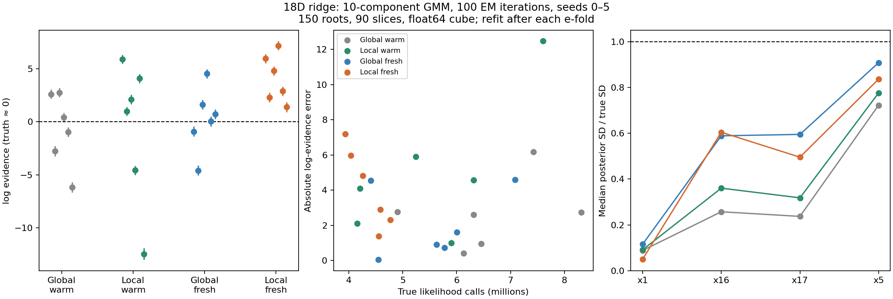
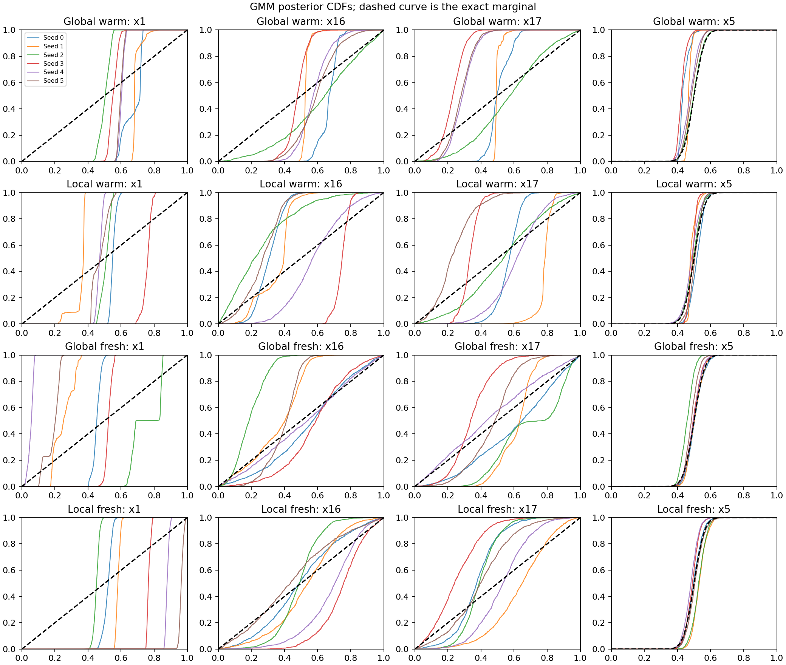
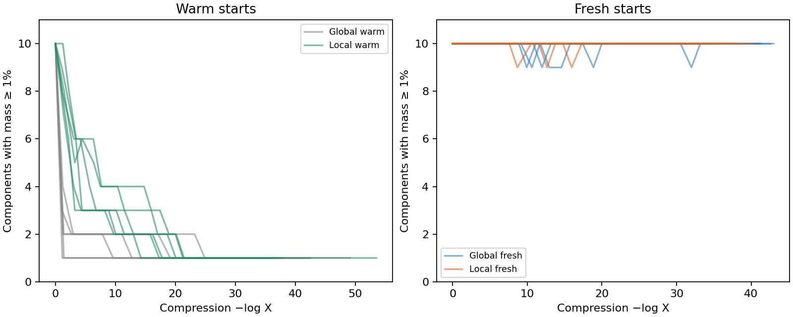

# Local Gaussian-mixture directions with a Metropolis correction

Local component selection does **not** solve the stiff curved-ridge problem
in this experiment. With ten components and 100 EM iterations per fit,
six-seed evidence RMSE is **6.24 nats with warm starts** and **4.59 with fresh
fits**. Matched global-component controls give 3.20 and 2.76 nats. Every local
run misses zero by more than twice its quoted uncertainty. Ridge and inert
marginals remain too narrow even when the sampler reaches the peak.

The exact scaled Hessian and reflection controls remain substantially better
on the same six seeds, with RMSE 0.99 and 0.91. Neither recovers the full
curved marginal reliably, so they should not yet be described as complete
solutions. These are toy results, not a rerun of the pRT retrieval.

Tracks [issue #312](https://github.com/Joshuaalbert/jaxns/issues/312) and
[draft PR #314](https://github.com/Joshuaalbert/jaxns/pull/314). The
[protocol](LOCAL_GMM_PROTOCOL.md) records the original cohort and the reason
for adding fresh-fit controls. All 24 new runs are included here.

## Actual local-Gaussian direction law

For a frozen fitted mixture with centres mu_k, covariances C_k and masses
pi_k, compute responsibilities at the current point x:

```text
r_k(x) = pi_k N(x; mu_k, C_k) / sum_j pi_j N(x; mu_j, C_j)
```

Choose component k from r(x), draw v from N(0, C_k), and normalize it to a
direction d. The component mean supplies locality through r(x); the
displacement Gaussian is centred at zero. A 1% branch draws an isotropic
direction. No likelihood gradients, Hessians or known peak enter this law.

The full direction density, omitting a common sphere-area constant, is

```text
g_k(d) = det(C_k)^(-1/2) * (d^T inverse(C_k) d)^(-D/2)
q(d | x) = 0.01 + 0.99 * sum_k r_k(x) g_k(d)
```

After the ordinary true-constrained slice proposes y along d, accept with
`min(1, q(d | y) / q(d | x))`. This marginalizes every Gaussian and the
isotropic branch at both endpoints. Using just the selected component's
probability would implement a different transition. Rejections are retained
as self-transitions. The same fitted mixture is frozen through all 90 steps;
responsibilities are evaluated at the changing positions.

[local_gmm_sampler.py](local_gmm_sampler.py) implements this benchmark-only
sampler. Cholesky factors and inverses are computed once at each fit boundary.
The paired global control uses normalized pi_k in place of r_k(x). Its
direction law is independent of position, so its MH ratio is identically one.
The production GMM's contour-volume selector and public fitting API are
unchanged.

## Fitting and run settings

All runs use the same 18D toy with stiff width 1e-5, 150 roots, 90 slices,
actual float64 cube coordinates, replacement width 150, uniform allocation,
one default depth epoch (`dlogZ=log1p(1e-3)`), and no phantoms. There is no
evidence-uncertainty goal or ESS-doubling continuation in this comparison.

The initial mixture fits all roots. Later fits use every stored classic
strictly above the completed batch's shallowest finite parent contour, with
equal weights. The fit refreshes after at least one expected-volume e-fold
and applies to the next batch. Actual median intervals are 1.29–1.31 e-folds;
the overall range is 1.003–3.475 because checks occur at batch boundaries.
This uses the existing isolated host hook and does not add a checkpointable
production adaptation interface.

Each fit uses the existing full-covariance `fit_gmm`, exactly 100 EM iterations,
ten components, and relative covariance regularization 1e-6. Initialization
uses deterministic weighted mass quantiles and a shared diagonal covariance.
Padding changes compilation capacity only; masked rows have no fitting weight.
The lower-level benchmark permits the initial regularized fit at 150 points,
below the public staged API's K*(D+1) = 190 observation gate. Some initial
components are underdetermined; effective memberships and eigenvalues are
recorded. The results do not establish that these fits have reached a good
optimum merely because 100 iterations were performed.

The first cohort warm-starts each fit from the previous mixture. After its
first completed seeds showed loss of component support, a second cohort
reinitializes at every refresh using the same 100-iteration budget. Both
cohorts include six local and six global runs, seeds 0–5. All actual training
points come from their own trajectories; controls share initial roots and key
splitting, not their subsequently sampled populations.

This differs from the earlier [staged GMM study](GMM_ITERATIONS_REPORT.md),
which fitted posterior weights once after reaching evidence uncertainty 0.1,
used 180 slices and then doubled ESS. The new global controls isolate local
selection under the present above-contour fitting protocol; they do not
reproduce the released contour-volume rule or that older staged workflow.

## Evidence, peak and cost

The true ln Z is zero up to negligible Gaussian tails. All 24 runs finish
their ordinary depth epoch without a cap or interruption.

| Directions | Mean ln Z | ln Z RMSE | Mean likelihood calls | Median peak gap | Within 2 quoted SD |
|---|---:|---:|---:|---:|---:|
| Isotropic control | -12.543 | 13.464 | 9.716M | 5.388 | 0/6 |
| Exact scaled Hessian control | +0.093 | 0.989 | 1.878M | 1.106 | 4/6 |
| Reflection + 9 slices control | +0.083 | 0.913 | 1.443M* | 1.032 | 4/6 |
| GP, 128 representatives | -5.428 | 7.010 | 7.075M | 2.457 | 0/6 |
| GMM global, warm starts | -0.680 | 3.198 | 6.590M | 2.420 | 1/6 |
| GMM local + MH, warm starts | -0.653 | 6.241 | 5.569M | 1.296 | 0/6 |
| GMM global, fresh fits | +0.239 | 2.762 | 5.573M | 1.209 | 3/6 |
| GMM local + MH, fresh fits | +4.098 | 4.589 | 4.354M | 0.880 | 0/6 |

All rows use matched seeds 0–5; earlier controls are reused. *Reflection calls
include value-and-gradient evaluations counted once in its total, whereas
other rows count value-only likelihood calls. Exact-Hessian arithmetic, GMM/GP
fitting and direction work are additional costs. This is not a wall-time
speedup comparison. The reflection control uses nine isotropic slices plus
nine ten-bounce paths; other rows use 90 slices.

GMM fitting consumes no additional likelihood calls. Median total elapsed
times are 53–57 seconds per run, including compilation and fitting; median
fit/audit time is 35–39 seconds. Runs used separate pinned CPU cores, with
concurrent jobs, so these timings are not controlled throughput measurements.

| Seed | Global warm | Local warm | Global fresh | Local fresh |
|---|---:|---:|---:|---:|
| 0 | +2.618 | +5.916 | -0.918 | +5.973 |
| 1 | -2.749 | +1.005 | -4.592 | +2.311 |
| 2 | +2.774 | +2.114 | +1.613 | +4.817 |
| 3 | +0.411 | -4.572 | +4.551 | +7.198 |
| 4 | -0.959 | +4.091 | +0.047 | +2.896 |
| 5 | -6.177 | -12.473 | +0.732 | +1.391 |

Entries are ln Z. Mean quoted uncertainties are 0.436–0.458 nats. The fresh
local runs all overestimate evidence, despite good peak recovery. Lower
likelihood work does not establish better efficiency when errors remain large.



## Posterior coverage and component survival

The following widths are medians over seeds of weighted posterior standard
deviations, in cube coordinates:

| Directions | x1, ridge | x16, inert | x17, inert | x5, Gaussian |
|---|---:|---:|---:|---:|
| Truth | 0.2887 | 0.2887 | 0.2887 | 0.0500 |
| Exact scaled Hessian | 0.1225 | 0.2810 | 0.2805 | 0.0499 |
| Reflection + 9 slices | 0.1680 | 0.2140 | 0.2400 | 0.0491 |
| GMM global, warm | 0.0256 | 0.0743 | 0.0685 | 0.0361 |
| GMM local + MH, warm | 0.0264 | 0.1041 | 0.0919 | 0.0388 |
| GMM global, fresh | 0.0335 | 0.1700 | 0.1718 | 0.0454 |
| GMM local + MH, fresh | 0.0146 | 0.1746 | 0.1431 | 0.0418 |



All twelve warm-started runs end with only one component carrying at least
1% mixture mass. Their other components retain tiny masses and older
parameters under the existing empty-component policy. In local seed 0, the
last fit assigns effectively every current point to a single component with
mass 0.999326. Thus late local and global selection become nearly identical,
even though earlier differences have changed the trajectories.

Fresh initialization retains all ten components above the 1% threshold at
every run's final fit. It improves evidence RMSE and inert widths relative to
the corresponding warm-started cohort, but local selection still performs
worse than global selection on evidence and the ridge marginal in these
seeds. Retaining components does not recover coverage already lost by the
sampling population.



Independent NumPy replays of the first and final local fits, for both fitting
schemes, agree with the executed 100-step EM results: maximum centre error
1.06e-15, covariance error 1.98e-16 and log-mass error 4.80e-14. The component
loss is not an arithmetic mismatch between the JAX and reference EM updates.
This does not establish a good statistical fit or isolate the effects of
regularization, small populations, curvature and adaptation.

## Frozen-kernel correctness and movement

Independent dense Gaussian calculations check responsibilities and the full
angular mixture, including normalization on the circle and sign symmetry.
A 4,096-chain uniform-cube test passes with the MH correction and fails when
it is deliberately omitted. Rejections remain self-transitions and likelihood
evaluation counts are checked exactly on that target.

For each saved local seed-0 final fit, a separate audit starts 8,192 chains
from independent exact constrained-prior samples at peak minus 15 nats.
Both local and global corrected kernels pass cube/contour support and all
19 PIT tests. Maximum KS statistics are 0.0133–0.0167 against a prespecified
0.0552 threshold. This probes a fixed interior contour, not the terminal
contour of the adaptive run.

| Frozen fit, selection | MH acceptance | x1 correlation | x16 correlation | x17 correlation |
|---|---:|---:|---:|---:|
| Warm, local | 99.997% | 0.999878 | 0.977315 | 0.963153 |
| Warm, global | 100% | 0.999881 | 0.977500 | 0.963327 |
| Fresh, local | 99.661% | 0.999695 | 0.932976 | 0.965482 |
| Fresh, global | 100% | 0.999619 | 0.918743 | 0.966336 |

These correlations remain after 90 transitions. Fresh local x1 RMS movement
is only 0.00716, versus a true marginal standard deviation of 0.2887. The
frozen ridge audit's uncorrected variants also pass the short stationarity
probe, because little movement can hide bias; that does not override the
uniform-target negative control or justify omitting the correction.

The checks support the frozen transition law, not independence of replacement
points or unbiased adaptive nested sampling. This experiment does not
separate finite-chain dependence from population-driven adaptation effects.
It gives no evidence that local GMM selection fixes either.

## Reproduction and validation

For the fresh local cohort's first three seeds:

```bash
PYTHONPATH=.:src JAX_ENABLE_X64=1 conda run --no-capture-output -n jaxns_py \
  python benchmarks/issue_312/run_local_gmm.py --selection local \
  --no-warm-start --seeds 0 1 2 --cpu 0 \
  --output-dir /tmp/jaxns-gmm-local100-fresh-a
```

Repeat with seeds 3–5 and suffix `b`. Use `--selection global` and matching
directory names for the global control. Omit `--no-warm-start` and `-fresh`
from the directory name to reproduce the warm cohort. Output directories
must be new; this offline runner does not resume checkpoints.

The portable final fresh fit supports an independent stationary check:

```bash
PYTHONPATH=.:src JAX_ENABLE_X64=1 conda run --no-capture-output -n jaxns_py \
  python benchmarks/issue_312/validate_local_gmm.py --cpu 6 \
  --fit benchmarks/issue_312/local_gmm_audit/fresh/fit-023.npz \
  --output /tmp/local-gmm-stationarity.json

PYTHONPATH=.:src JAX_ENABLE_X64=1 conda run --no-capture-output -n jaxns_py \
  python benchmarks/issue_312/audit_local_gmm_fit.py --cpu 10 --no-warm-start \
  --directory benchmarks/issue_312/local_gmm_audit/fresh \
  --output /tmp/local-gmm-fit-replay.json
```

All [24 raw run records](raw/local-gmm-runs.jsonl),
[692 fit records](raw/local-gmm-fits.jsonl), summaries and plots are committed.
Full arrays remain at the local paths recorded in those files. Selected warm
and fresh fits are committed under `local_gmm_audit` for both independent
audits. [summarise_local_gmm.py](summarise_local_gmm.py) validates the full
local archives and regenerates the CSV/JSON summaries and PNG/PDF plots.

All 24 sample archives pass source/hash, float64, cube/strict-parent support,
independent likelihood, peak and weighted-moment checks. Maximum absolute
likelihood discrepancy is 1.90e-5 nats. All 692 fits pass population,
covariance, mass and refresh-cadence checks. Thirty-six focused tests and
reviewer checks pass; Ruff, Flake8 and whitespace checks pass. The full
repository suite and pRT retrieval were not rerun.

Environment: JAX 0.11.1, Python 3.12.9, JAXCTX 1.2.0, one pinned CPU core per
run. Records retain base commit `4ecb53d` and exact executed source hashes.
The warm-only runner is archived before adding the fresh-fit option; its
default numerical behavior is preserved. This phase changes benchmark
tooling, tests and documentation only.
