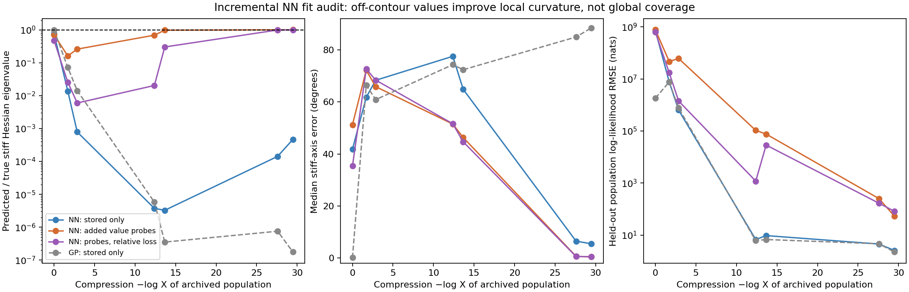

# Learned representation follow-up after reflections

The first NN audit supports investigating the representation and its training
data together. Stored points from the thin population still leave the stiff
curvature badly underestimated. Off-contour likelihood observations improve
the local Hessian substantially, but the network remains inaccurate elsewhere
along the ridge. This is a fit-and-curvature experiment, not an end-to-end
NN-driven nested-sampling result or a production sampler change.

The subsequent [NN sampling report](NN_SAMPLING_REPORT.md) now tests both the
stored-only and augmented fits in actual nested runs. Both fail; that report
audits the weaker and flat directions missed by a stiff-axis-dominated norm.

The requested order is recorded in [the experiment queue](../../EXPERIMENT_QUEUE.md):
the reflection implementation and first nested runs preceded these NN fits.

## Representation and incremental fitting

[nn_geometry.py](nn_geometry.py) implements a smooth residual-feature model:

```
z = inverse(input_cholesky) @ (x - input_mean)
features = z @ A + b + tanh(z @ W + c) @ V
predicted_log_L = known_peak - energy_scale * ||features||² / 2
```

There are 18 residual features, 32 tanh hidden features and 1,526 fitted
parameters. The affine path can exactly represent a Gaussian precision;
the nonlinear path can bend the residual coordinates. Automatic differentiation
supplies the Hessian. No true gradient or Hessian observations enter fitting.
The known toy peak is an additional assumption: the GP previously used that
peak only to scale sampling directions. This comparison therefore changes
more than network architecture alone.

Seven archived GP seed-0 populations are fitted in order: updates 0, 1, 2, 9,
10, 19 and 20, through compression -log X = 29.48. Each contains stored
classics above its recorded contour. They are correlated populations and
may already have lost portions of the ridge.

Mean/Cholesky and energy scale are recomputed at each offline fit. The prior
network is rebased exactly into the new normalization, preserving its physical
prediction and Hessian. A deterministic fresh start is also tried. L-BFGS-B
fits squared energy error with weak weight regularisation, and the smaller
training objective selects the result. Analytic curvature never enters that
selection. This is a sparse sequence of archived fits, not a new sampler
refreshing at every e-fold.

| Training data | Iteration cap per start | Added true value queries per fit |
|---|---:|---:|
| 128 representatives of the stored population | 1,000 | 0 |
| Those 128 plus symmetric off-contour probes | 1,000 | 1,024 |
| Same augmented data, relative-energy loss | 2,000 | 1,024 |

Representatives match the GP audit's deterministic coverage set. For each,
four random isotropic directions supply paired positive/negative physical
offsets of lengths 1e-5, 1e-4, 1e-3 and 1e-2. Cube folding keeps probes inside
the prior. Each augmented fit trains on 1,152 points; each seven-fit sequence
adds 7,168 training likelihood evaluations. Oracle diagnostic work is separate.
Both augmented arms use identical probes. The relative loss divides energy
residuals by true energy, floored at one nat. Its larger iteration budget means
it is an exploratory refinement, not an isolated loss-function comparison.

The stored-only arm selected the fresh start at every update. Merely offering
a warm start therefore did not retain earlier learned geometry. The augmented
arms selected warm starts at 2/7 and 3/7 updates. All selected augmented fits
reached their iteration cap; these are not converged optima. Neither replay
of earlier observations nor regularisation preserving earlier predictions
was used.

## Curvature audit

The local audit uses omitted points from the same archived population, with
up to 64 used for Hessians. A separate fixed set of 256 independent exact
draws at gap 15 audits the whole ridge, including portions no longer covered
by the fitting population. Neither set affects fitting.

At the last population, -log X = 29.48:

| Fit | Local held-out value RMSE (nats) | Stiff eigenvalue / truth | Stiff-axis alignment | Relative Hessian error |
|---|---:|---:|---:|---:|
| Previous GP, 128 stored points | 2.24 | 1.75e-7 | 0.027 | ≈1 |
| NN, stored points only | 2.58 | 4.71e-4 | 0.99547 | 0.9995 |
| NN + off-contour observations | 53.98 | 1.0153 | 0.999973 | 0.0238 |
| NN + probes, relative loss | 82.42 | 1.0050 | 0.999963 | 0.0210 |

Curvature columns report medians. Alignment is the absolute dot product of
predicted and true stiff eigenvectors. Relative Hessian error uses the
Frobenius norm and is dominated by the stiff axis; it does not certify the
moderate or flat directions. The stored-only network interpolates its
training values to 4.6e-6 nats RMS while its stiff eigenvalue remains about
2,100 times too small.



Off-contour data helps identify the normal curvature locally. But all three
networks generalize poorly to the independent whole-ridge set. Their final
median global Hessian errors are approximately 1.00, 1.15 and 1.22, and global
value RMSEs are 2.45e5, 6.25e8 and 6.78e8 nats. Earlier populations also have
poor local derivative fits. The final local improvement does not establish
an improved sampling kernel or that an NN is preferable to a GP in general.

Further investigations are recorded in the queue: replay older/off-contour
observations, preserve useful earlier representations, and test local or
lower-dimensional residual features. The subsequent sampling comparison
keeps fits frozen within chains and uses the true constraint and endpoint
direction-density MH correction; these do not supply sufficient mixing.

## Reproduction and validation

```bash
PYTHONPATH=.:src JAX_ENABLE_X64=1 conda run --no-capture-output -n jaxns_py \
  python benchmarks/issue_312/audit_nn_fit.py --cpu 4 \
  --output-dir /tmp/nn-stored-reproduction

PYTHONPATH=.:src JAX_ENABLE_X64=1 conda run --no-capture-output -n jaxns_py \
  python benchmarks/issue_312/audit_nn_fit.py --cpu 5 --augment \
  --output-dir /tmp/nn-augmented-reproduction

PYTHONPATH=.:src JAX_ENABLE_X64=1 conda run --no-capture-output -n jaxns_py \
  python benchmarks/issue_312/audit_nn_fit.py --cpu 5 --augment --relative-loss \
  --iterations 2000 --output-dir /tmp/nn-relative-reproduction
```

Inputs are committed `gp_audit/seed-0/fit-*.npz` populations. Outputs include
every fitted network, observations, training indices, optimizer diagnostics
and source hashes. Full fit archives remain local in
`/tmp/jaxns-nn-{stored-final,augmented-final,relative}/`. Committed raw summaries
are [stored](raw/nn-stored.jsonl), [augmented](raw/nn-augmented.jsonl) and
[relative loss](raw/nn-relative.jsonl). [summarise_nn.py](summarise_nn.py)
checks source hashes, objectives and query counts and regenerates the plot.

Independent tests recover a known Gaussian precision with both losses,
check values/Hessians against a quadratic reference, and verify preservation
of the represented function when normalization changes.
