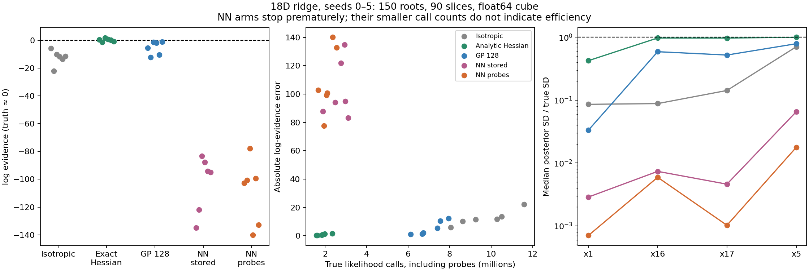
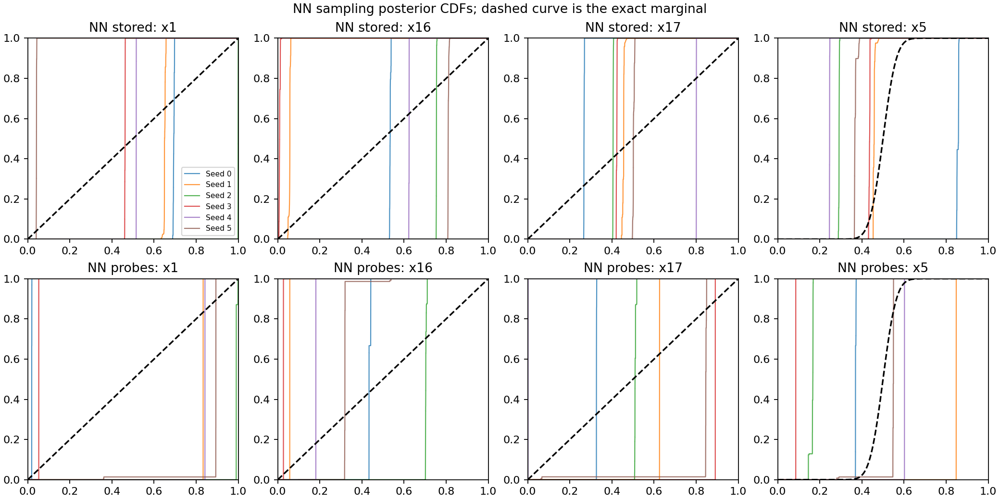

# NN-driven nested sampling on the stiff ridge

The actual NN-Hessian sampling runs fail badly. With 150 roots, 90 slices and
seeds 0–5, evidence RMSE is **104.52 nats** using stored observations and
**110.96 nats** after adding off-contour observations. The previous matched
GP and exact-Hessian controls give 7.01 and 0.99 nats. Both NN arms collapse
the flat directions and even the moderately constrained Gaussian directions.
These results concern this representation and fitting procedure; they do not
establish that neural-network geometry cannot work.

This completes the sampling follow-up to the earlier
[representation audit](NN_REPRESENTATION_REPORT.md), tracked in
[issue #312](https://github.com/Joshuaalbert/jaxns/issues/312) and
[draft PR #314](https://github.com/Joshuaalbert/jaxns/pull/314).

## Configuration

The target is the same 18D curved ridge with stiff width `1e-5`. There are
15 Gaussian residual dimensions and three flat coordinates; true ln Z is
zero up to negligible truncation tails. All twelve new runs use actual
float64 cube coordinates, 150 roots, 90 MH-corrected slices, uniform
allocation, one default depth epoch (`dlogZ=log1p(1e-3)`), replacement width
150 and no phantoms. There is no subsequent evidence- or posterior-improving
allocation stage in this comparison. The controls reuse seeds 0–5 from the
[GP study](GP_HESSIAN_REPORT.md), with identical run settings.

[NNHessianSliceSampler](nn_hessian_sampler.py) uses the existing smooth
residual-feature network: 18 residual outputs, 32 tanh hidden features and
1,526 parameters. It differentiates the predictive log-likelihood mean
twice at the current and proposed positions. Eigenvalues of the negative
Hessian are divided by `2 * (known_peak - contour) / 17`, then floored at
12 before drawing a normalized Gaussian direction. This is the previous
GP/exact-Hessian contour scale and prior-variance cap. The known peak also
enters NN fitting, which gives it extra oracle information relative to the GP.

Each slice uses the true likelihood constraint and the angular direction
density ratio at its endpoints. Rejected moves remain self-transitions.
The NN weights and normalization are frozen throughout a chain; only the
evaluation position changes. [hessian_chain.py](hessian_chain.py) shares this
transition law with the GP experiment. Exact replay against the archived GP
implementation matches every array, including intermediate transitions,
for 64 chains of 90 steps.

An initial fit uses the roots. Later fits use stored classic points strictly
above the just-completed batch's shallowest finite parent contour. A refit
takes effect on the next batch when expected log volume has changed by at
least one e-fold. Batch quantization makes actual intervals 1.01–2.71 e-folds
for stored observations (median 1.39), and 1.01–2.52 with probes (median 1.34).
There are 90 and 85 fits respectively across six runs. The hook remains an
offline, single-process benchmark without checkpoint support.

The stored-only arm recomputes input mean and regularized covariance Cholesky
from all points above that contour, then selects 128 representatives by
coverage in whitened coordinates. The augmented arm first selects the same
kind of 128 centres, then adds 1,024 symmetric isotropic probes at physical
offset lengths `1e-5`, `1e-4`, `1e-3` and `1e-2`, folded into the cube.
Its NN mean/Cholesky are computed from this 1,152-point training cloud.
Probe values come from the true JAX model; they never enter the race tree
or posterior weights. Training randomness does not advance sampler keys.

At every refresh, a fresh start competes with an exactly rebased previous
network, using at most 1,000 L-BFGS-B iterations per start. The smaller training
objective wins; no analytic derivatives select or train the fit. Warm starts
win at 29/90 stored-only and 36/85 augmented fits. All 85 selected augmented
fits and 52/90 stored-only fits reach their iteration cap, so these are
budgeted fits, not converged optima. The loss is the original squared
normalized-energy loss, not the relative-energy variant from the offline audit.

## Sampling results

| Directions | Mean ln Z | ln Z RMSE | Mean true value calls | Median peak gap |
|---|---:|---:|---:|---:|
| Isotropic control | -12.54 | 13.46 | 9.716M | 5.39 |
| Exact scaled Hessian control | +0.09 | 0.99 | 1.878M | 1.11 |
| GP, 128 representatives | -5.43 | 7.01 | 7.075M | 2.46 |
| NN, 128 stored observations | -102.80 | 104.52 | 2.699M | 117.99 |
| NN, 128 centres + 1,024 probes | -108.91 | 110.96 | 2.115M | 126.76 |

All NN runs return the ordinary depth stopping event, but this occurs far
below the true peak. Their small call counts reflect premature stopping and
do not indicate useful sampling efficiency. Augmented totals include an
average 14,507 extra true likelihood evaluations for training; stored-only
fits add no true value queries. NN fitting and Hessian arithmetic are extra
work. Median end-to-end times on one pinned CPU core are 75.7 and 129.0 s,
including compilation, fitting and audits. Median fit/audit time is 33.5 and
58.9 s. These timings are not controlled throughput measurements.

The nominal number of NN Hessian evaluations per run is about 0.277M stored
and 0.252M augmented: one initial Hessian plus 90 proposal Hessians per
retained child chain. This excludes audit derivatives, padded batch lanes
and compiler work; it is not a hardware operation count.

| Seed | Stored ln Z ± quoted SD | Probes ln Z ± quoted SD |
|---|---:|---:|
| 0 | -134.795 ± 0.311 | -102.734 ± 0.291 |
| 1 | -121.975 ± 0.336 | -100.757 ± 0.316 |
| 2 | -83.305 ± 0.329 | -77.752 ± 0.297 |
| 3 | -87.813 ± 0.295 | -140.061 ± 0.328 |
| 4 | -94.071 ± 0.325 | -99.316 ± 0.318 |
| 5 | -94.860 ± 0.303 | -132.826 ± 0.292 |

None is within two quoted standard deviations of zero. The following are
medians over seeds of posterior standard deviations, in cube coordinates:

| Directions | x1 | x16 | x17 | x5 |
|---|---:|---:|---:|---:|
| Truth | 0.28868 | 0.28868 | 0.28868 | 0.05000 |
| Exact scaled Hessian | 0.12251 | 0.28102 | 0.28054 | 0.04992 |
| GP, 128 | 0.00961 | 0.17005 | 0.15054 | 0.03944 |
| NN stored | 0.00083 | 0.00213 | 0.00133 | 0.00326 |
| NN probes | 0.00020 | 0.00171 | 0.00030 | 0.00089 |





## Why the improved stiff-axis fit did not help

At augmented seed 0's final fit, log X = -16.63, the local median stiff
eigenvalue is 0.996 of truth, alignment is 0.999985, relative Frobenius
Hessian error is 0.0102, and omitted-population value RMSE is 2.01 nats.
Those apparently good metrics conceal badly learned weaker directions.
Median negative-Hessian diagonal entries for x16 and x17 are **7.25e6** and
**5.10e7**, although their true values are zero. The x5 entry is **-1.99e6**,
against a true positive curvature of 400. Similar errors occur across seeds.

After eigenvalue scaling and clipping, the learned Gaussian direction
variance in x16 relative to the true stiff-axis variance is about 29,634;
the oracle ratio is 247,295,976. The corresponding x17 ratios are 16,213
versus 247,295,976. These ratios remove the irrelevant common scale of
normalized directions. The learned flat-to-normal standard-deviation ratios
are about 91 and 123 times too small. The
[full-axis audit](raw/nn-sampling-geometry.json) covers all 79 noninitial
augmented fits. Large false curvatures and small angular errors matter even
when a stiff-axis-dominated Hessian norm looks accurate.

Population audits omit selected row indices, but their points remain
correlated and can duplicate training coordinates. They do not establish
generalization to the whole ridge. Median duplicate-classic fractions are
17.8% stored-only and 24.2% augmented, another indication of failed movement.
The poor initial broad-population fits and unconverged optimizers can also
contribute. The audit identifies harmful geometry; it does not isolate a
single cause or show that a larger optimization budget would fix it.

An independent frozen-kernel check starts 8,192 chains from exact constrained
prior draws at peak minus 15 nats, using the saved augmented seed-0 final NN.
After 90 transitions, all support checks and 19 probability-integral-transform
checks pass: maximum KS is 0.0141 against a prespecified 0.0552 bound. MH
acceptance is 69.8%, yet endpoint correlations are **0.999984 for x1,
0.998494 for x16 and 0.999264 for x17**. RMS displacements are 0.00165,
0.01595 and 0.01103 respectively. This tests an independent interior contour,
not the terminal contour of that failed run. It supports frozen-kernel
stationarity while directly exposing poor decorrelation; it does not certify
adaptive nested-sampling correctness or independence.

## Reproduction and validation

```bash
PYTHONPATH=.:src JAX_ENABLE_X64=1 conda run --no-capture-output -n jaxns_py \
  python benchmarks/issue_312/run_nn_hessian.py --cpu 2 --seeds 0 1 2 3 4 5 \
  --no-augment --output-dir /tmp/nn-stored-reproduction

PYTHONPATH=.:src JAX_ENABLE_X64=1 conda run --no-capture-output -n jaxns_py \
  python benchmarks/issue_312/run_nn_hessian.py --cpu 3 --seeds 0 1 2 3 4 5 \
  --augment --output-dir /tmp/nn-probes-reproduction

PYTHONPATH=.:src JAX_ENABLE_X64=1 conda run --no-capture-output -n jaxns_py \
  python benchmarks/issue_312/validate_nn_hessian.py --cpu 4 \
  --fit benchmarks/issue_312/nn_audit/sampling-seed-0-fit-012.npz \
  --output /tmp/nn-stationarity-reproduction.json
```

Raw run records are [stored](raw/nn-sampling-stored.jsonl) and
[augmented](raw/nn-sampling-augmented.jsonl); all 175 fitting records are in
[the fit log](raw/nn-sampling-fits.jsonl). The CSV/JSON summaries and PNG/PDF
plots accompany this report. Full archives remain at the directories recorded
in those raw records; the frozen diagnostic fit is committed for portability.
[summarise_nn_sampling.py](summarise_nn_sampling.py) validates those local
archives and regenerates the summaries and plots. Update the records'
directory fields to summarize runs in another location.

All twelve sample archives pass independent NumPy likelihood, float64 dtype,
cube and strict-parent support, peak, weighted-moment and checksum checks;
maximum absolute likelihood discrepancy is 1.87e-5 nats. All 175 fit archives
pass source provenance, population/normalization, training-query accounting,
optimizer selection and refresh-cadence checks. The transition refactor's
[bit-for-bit GP replay](raw/nn-gp-kernel-replay.json) preserves the previous
controls. Twenty-eight focused tests and reviewer checks pass, including the
new independent uniform-target NN MH test. Ruff, Flake8 and diff whitespace
checks pass. The full repository suite and pRT retrieval were not rerun.

The experiment uses JAX 0.11.1, Python 3.12.9 and JAXCTX 1.2.0. Run records
identify base commit `dc02be0` and exact executed source hashes, including
then-uncommitted NN sampler and runner code. The production sampler and
orchestration are unchanged by this follow-up.
