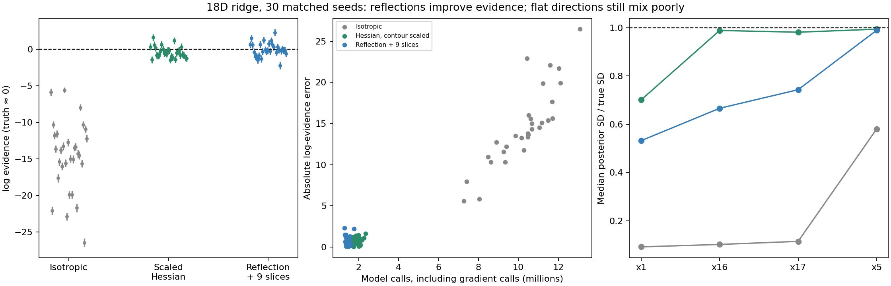
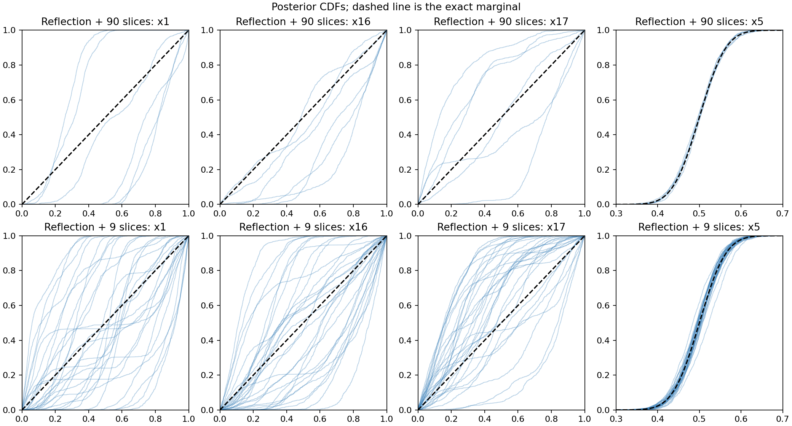

# Reversible reflections on the stiff ridge

The reflection experiment substantially improves evidence recovery over
isotropic slicing, but does not solve the flat posterior marginals. Across
30 matched seeds, the cheaper configuration gives mean ln Z = -0.017 and
RMSE 0.922 at 1.465 million model evaluations, including 0.586 million
value-and-gradient evaluations. The exact ln Z is effectively zero.

This remains an experimental `AbstractSampler` implementation in
[reflection_sampler.py](reflection_sampler.py). Production defaults, race
allocation, stopping, evidence calculation and sampler interfaces did not
change. The true toy gradient is supplied by JAX autodiff through the model;
there is no learned geometry, Hessian, whitening or surrogate in these runs.

## Construction and reversibility

The trajectory uses the midpoint reflection construction of
[Ludkin and Sherlock, Hug and Hop, §2.1](https://academic.oup.com/biomet/article/110/2/301/6633932):
half drift, velocity reflection in the plane normal to the local gradient,
half drift. Repeating this map follows a curved level set approximately.
It does not solve for an exact likelihood-boundary intersection.

In this implementation, each drift is an exact cube billiard flight. Folding
the unfolded coordinate across cube faces also flips the corresponding
velocity components. At an interior midpoint the reflection is
`v' = v - 2 n (n·v)`, with `n` the normalized true likelihood gradient.
A zero gradient gives the identity. Both half drifts use the same step size.

At fixed midpoint the velocity reflection is an involution with unit absolute
Jacobian and preserves speed. Cube flights preserve volume and reverse under
a velocity flip. The palindromic composition therefore retraces when started
from its endpoint with reversed velocity. Isotropic Gaussian velocities have
the same density before and after the path, so the extended-target MH ratio
for the uniform constrained prior reduces to the endpoint support test.

Only a final point strictly above the true parent contour is accepted.
Intermediate midpoints may lie below that contour; the cube drifts keep them
inside the prior. The whole path has a fixed number of reflections, independent
of accept/reject history. Rejected paths remain self-transitions. Step-size
jitter is sampled independently of position and remains fixed along a path.
No step reduction, early termination or retry-until-accept is used.

An optional `boundary_only=True` variant reflects only when the midpoint
likelihood fails the constraint. That switch depends on position alone, so
the same involution argument holds. It is covered by the reversal and
stationarity tests and a small movement grid; the full nested-sampling runs
below use reflection at every midpoint, i.e. the Hug variant. This is not an
implementation of the paper's separate Hop kernel.

## Protocol and result

The toy and controls match the preceding Hessian study: 18 dimensions,
sigma_stiff = 1e-5, curvature = 0.3, 150 roots, replacement width 150,
uniform allocation, one default depth epoch with `dlogZ=log1p(1e-3)`, classic
evidence, no phantoms, and actual float64 unit-cube coordinates. Runs use
JAX 0.11.1 / Python 3.12.9 on one pinned CPU core per process.

Each child uses nine cycles. A cycle first takes ordinary isotropic full-chord
slice transitions, then proposes a ten-bounce path with a fresh N(0,I)
velocity. Step size is 0.003 times Uniform(0.8,1.2). This setting was selected
from an independent constrained-prior movement grid before nested-sampling
results were available. Increasing the step to 0.01 reduced acceptance from
about 42% to below 1%; more bounces at fixed step were not automatically better.

The initial six runs kept ten slice transitions per cycle: 90 slices plus
90 gradient reflections per child. Because the slice calls dominated cost,
a second configuration reduced this to one slice per cycle: nine slices plus
90 reflections. That configuration was extended to seeds 0–29.

| Kernel | Seeds | Mean ln Z | ln Z RMSE | Mean model calls | Of which value + gradient | Median peak gap | Within 2 quoted SD |
|---|---:|---:|---:|---:|---:|---:|---:|
| Isotropic, 90 slices | 30 | -14.634 | 15.379 | 10.282M | 0 | 4.571 | 0/30 |
| Scaled exact Hessian, 90 slices | 30 | -0.387 | 0.846 | 1.886M | 0* | 1.150 | 21/30 |
| Reflection + 9 slices | 30 | -0.017 | 0.922 | 1.465M | 0.586M | 1.023 | 22/30 |
| Reflection + 90 slices | 6 | -0.282 | 0.829 | 9.471M | 0.621M | 0.970 | 4/6 |

\* The Hessian baseline evaluates an analytic Hessian separately; that work
is not included in its likelihood-call column. Each reflection gradient call
includes a forward likelihood evaluation and reverse differentiation. It is
counted once in total model calls and also exposed in the gradient column,
not counted twice. A gradient need not cost the same as a value-only call.
These are logical work counts, not a wall-time speedup claim. Complete-chain
batching can execute extra masked work; compilation is included in archived
timings and is generally paid on the first seed of each process.

The evidence errors are still wider than the reported uncertainty: the
reflection mean quoted SD is 0.460, versus RMSE 0.922. A small mean bias does
not establish calibrated uncertainty or independent constrained draws.



| Kernel | Median SD x1 | Median SD x16 | Median SD x17 | Median SD x5 |
|---|---:|---:|---:|---:|
| True posterior | 0.289 | 0.289 | 0.289 | 0.050 |
| Isotropic | 0.026 | 0.029 | 0.033 | 0.029 |
| Scaled exact Hessian | 0.202 | 0.285 | 0.283 | 0.050 |
| Reflection + 9 slices | 0.154 | 0.192 | 0.214 | 0.049 |
| Reflection + 90 slices, six seeds | 0.113 | 0.219 | 0.229 | 0.051 |

The reflection kernel recovers the moderately constrained Gaussian coordinate
well, but still loses coverage along the ridge and in the inert coordinates.
It does not dominate the scaled exact-Hessian kernel: that kernel has much
better inert marginals. Marginal CDFs make the remaining distortion clearer
than widths alone. No pRT retrieval was run.



## Correctness and movement checks

Tests cover multiple cube-face crossings, phase-space reversal and Jacobian
determinants for both reflection policies, numerical reversal on the actual
1e-5 ridge, rejected self-transitions and exact evaluation accounting. A
reflection-only 2D curved-tube test starts from independent exact draws.

For the full 18D target, the unit-Jacobian shear supplies exact independent
uniform constrained-prior draws: a 15-ball times three unit intervals. From
8,192 such seeds, the cheaper kernel passes all 19 marginal/radial PIT checks
at gaps 5, 15 and 40 nats. Maximum KS statistics are 0.0182, 0.0163 and 0.0149,
below the prespecified `5/sqrt(8192)=0.0552` bound. The reflection-only and
90-slice combined kernels also pass at gap 15. These checks support
stationarity, not decorrelation of the full nested-sampling population.

At gap 15, the cheaper kernel has 41.1% path acceptance. RMS movement in x1
is 0.0366 versus 0.00308 for the earlier 90-step scaled-Hessian probe, about
12 times greater. However, its x1 endpoint correlation is still 0.9920;
independent uniform endpoints would have RMS displacement 0.408. Inert RMS
movement is only about 0.055. Path motion therefore improves without becoming
long enough to prevent lineage-driven marginal collapse at 150 roots.

All 36 new sample archives pass dtype, cube, strict parent-contour,
independent NumPy likelihood, peak, posterior moment, checksum and work-count
checks. The maximum likelihood discrepancy is 2.26e-5 nats, consistent with
the previously documented TFP constant rounding. Baseline metrics are reused
from the validated Hessian study. Unit tests and reviewer coverage checks are
listed with the final validation results in the PR.

## Reproduction

```bash
PYTHONPATH=.:src JAX_ENABLE_X64=1 conda run --no-capture-output -n jaxns_py \
  python benchmarks/issue_312/run_reflection.py --cpu 2 \
  --seeds 0 1 2 3 4 5 --slices 1 --bounces 10 --step 0.003 \
  --output-dir /tmp/reflection-reproduction

PYTHONPATH=.:src JAX_ENABLE_X64=1 conda run --no-capture-output -n jaxns_py \
  python benchmarks/issue_312/probe_reflection.py --cpu 3 \
  --chains 8192 --gap 15 --slices 1 --bounces 10 --steps 0.003 \
  --output /tmp/reflection-stationarity.jsonl
```

Use `--slices 10` for the original 90-slice mixture. The runner's constructor
defaults are exposed in its CLI; the report uses explicit arguments because
the exploratory defaults were not retuned from the observed outcomes.

Raw records are `raw/reflection-*.jsonl`; aggregate metrics are in
[reflection_summary.csv](reflection_summary.csv) and
[reflection_summary.json](reflection_summary.json). Local full arrays are
under `/tmp/jaxns-reflection-{hug,short}-{a,b,c,d,e}/` (only a/b for hug).
Groups a/b contain seeds 0–2/3–5; short groups c/d/e contain 6–13/14–21/22–29.
The summariser needs those arrays, or regenerated equivalents at the recorded
paths, to revalidate and regenerate figures. Figures, raw records and code
are committed; full arrays remain local. Source hashes identify the exact
executed code. The early sampler is preserved in commit `0e4b6d5` and
`raw/reflection_sampler.initial.py.gz`; its only later source change renames
an unused return value.

After these reflection runs, the requested learned-representation follow-up
was started as a separate [NN curvature audit](NN_REPRESENTATION_REPORT.md).
