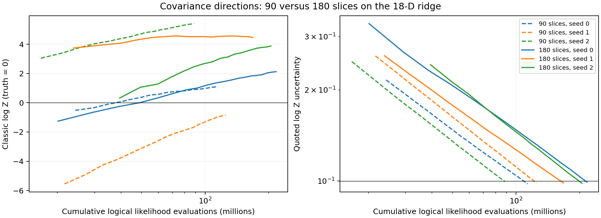

# Covariance directions with 10D slice transitions

Follow-up to [issue #312](https://github.com/Joshuaalbert/jaxns/issues/312).

Doubling the slice count from 90 (5D) to 180 (10D) improves some posterior
widths and peak likelihoods, but does not resolve the curved-ridge failure in
these three seeds. Evidence RMSE changes from 3.23 to 3.63 nats while mean
logical likelihood work increases by 80%. Three seeds are insufficient to
conclude that 180 slices generally worsens evidence accuracy.

## Controlled comparison

Both cohorts use the same analytic 18-dimensional curved ridge, seeds 0–2,
150 initial roots, covariance directions with a relative isotropic ridge of
`1e-8`, one-e-fold geometry refreshes, `evidence_improving` allocation, default
depth condition, replacement width 150, and default `delta_K=150`.
Each run stops at the first completed epoch with
`state.expected_log_Z_uncert <= 0.1`; automatic sample-buffer growth is unlimited.
Only `num_slices` changes. All six runs reach the goal without hard termination.
The 90-slice records are reused from [EVIDENCE_REPORT.md](EVIDENCE_REPORT.md).

The true log evidence is approximately zero. Uncertainties are the classic
block-moment approximation.

| Seed | 90 slices: log Z +/- uncertainty | 180 slices: log Z +/- uncertainty | Calls, 90 slices | Calls, 180 slices |
| --- | ---: | ---: | ---: | ---: |
| 0 | +1.0935 +/- 0.0978 | +2.1275 +/- 0.0992 | 113.40M | 216.60M |
| 1 | -0.8412 +/- 0.0984 | +4.4774 +/- 0.0985 | 124.99M | 167.96M |
| 2 | +5.4149 +/- 0.0995 | +3.8779 +/- 0.0983 | 88.58M | 204.80M |

The 180-slice runs complete after 20, 18 and 18 epochs, using 98,832, 89,439
and 96,372 classic samples. Their errors are about 21–45 quoted standard
deviations. Neither cohort has a run within two quoted standard deviations
of truth. Mean likelihood work rises from 108.99M to 196.45M.

## Posterior widths and peaks

These are median posterior standard deviations across the three seeds:

| Slices | x1 | x16 | x17 | x5 |
| --- | ---: | ---: | ---: | ---: |
| Expected | 0.2887 | 0.2887 | 0.2887 | 0.0500 |
| 90 | 0.0238 | 0.0487 | 0.0485 | 0.0357 |
| 180 | 0.0293 | 0.0572 | 0.1161 | 0.0410 |

All three 180-slice runs reach higher peak likelihoods than their corresponding
90-slice runs. The median peak deficit decreases from 2.00 to 1.09 nats.
The improved widths and peaks show some benefit from longer chains, but the
flat-coordinate widths remain far too small. Better peak finding does not
establish correct contour coverage or evidence calibration.

Dashed lines use 90 slices; solid lines use 180. The figure is also available
as [PDF](slice_count_progress.pdf). Exact values are in
[slice_count_summary.csv](slice_count_summary.csv) and
[slice_count_summary.json](slice_count_summary.json).

## Reproduction and validation

The new runs use commit `2fd6f3a72cd01a8695de6291b3f50aa21c53c7c6`, with a clean
tracked-source diff at launch. The scientific sampler implementation remains
`0b16e67`; no sampler changes were made. JAX 0.11.1, Python 3.12.9, CPU,
x64 covariance/evidence arithmetic and float32 model unit-cube coordinates
match the previous runs. The three processes run concurrently on separate
pinned cores. Elapsed times include compilation and are not used to claim
a wall-time speedup.

See [README.md](README.md) for commands. The new records and epoch traces are
`raw/evidence-covariance-180-*.jsonl`. The summariser verifies each seed,
direction mode, slice count, allocation target, uncertainty goal, and successful
termination. It and the geometry diagnostic pass Ruff and Flake8. The existing
sampler/core test suite was not rerun because no sampler code changed.

The subsequent [geometry review](GEOMETRY_REVIEW.md) separates the cost of the
initial bracket from short line intersections and identifies a cube-face
boundary bug. That bug is recorded but not changed in this experiment.
