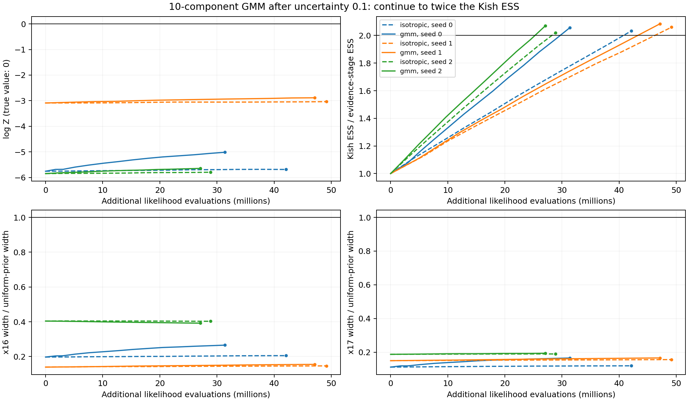

# Ten-component GMM after the evidence uncertainty goal

The requested staged workflow improves the peak and modestly improves evidence
and some posterior widths, but does not recover this curved ridge. Across three
seeds, evidence RMSE changes from 5.06 nats at the fitting boundary to 4.67 with
GMM directions, versus 5.00 for paired isotropic continuations. All final quoted
uncertainties are about 0.1; none covers the true log evidence of approximately
zero. The GMM runs' inert-coordinate standard deviations remain 0.045–0.113,
versus 0.289 expected.

This is a benchmark-only follow-up to [issue #312](https://github.com/Joshuaalbert/jaxns/issues/312)
and [draft PR #314](https://github.com/Joshuaalbert/jaxns/pull/314). It uses the
existing GMM direction law, with no empirical covariance whitening. The
cube-face bracket correction from `f72a696` is included in every arm.

## Protocol

The 18-D analytic target has sigma_stiff `1e-5`, curvature `0.3`, fourteen
Gaussian coordinates of width `0.05`, and uniform posterior marginals for
x1, x16 and x17. Gaussian tails outside the prior cube make a negligible
correction to log Z = 0. The three independent seeds are 0, 1 and 2.

1. Start with 150 roots, **180 slice transitions (10D)**, isotropic directions,
   and `evidence_improving` allocation. Continue until
   `state.expected_log_Z_uncert <= 0.1` at a completed depth boundary.
2. Save that state and its classic posterior-weight Kish ESS. Fork two
   continuations from the exact same checkpoint and random keys. The GMM arm
   calls `state.fit_gmm_directions(num_components=10)` once; the control retains
   isotropic directions.
3. Both continuations use `posterior_improving` allocation until classic Kish
   ESS reaches at least twice its value at the fitting boundary. The GMM is
   frozen throughout this stage.

Both stages use the default depth condition, `dlogZ=log1p(1e-3)` and no
`cummax_XL_frac` cutoff, default replacement width 150 and delta_K, no phantom
collection, and unlimited automatic sample-buffer growth. The GMM retains its
defaults: ten EM iterations, covariance regularisation `1e-6`, and a 1%
isotropic-direction mixture. It is fitted to posterior-weighted stored classic
points, not an unweighted population above one contour. It uses stored
likelihoods and consumes no extra likelihood evaluations or sampler keys during
fitting.

All three evidence goals and all six ESS goals completed without hard
termination. The evidence stages took 22, 22 and 25 epochs. GMM continuation
took 13, 12 and 11 more epochs; isotropic continuation took 10, 11 and 10.
Final ESS overshoots twice the baseline slightly because it is checked at
depth boundaries. The second stage targets ESS only: seed 0's GMM uncertainty
ends at 0.10018, slightly above the first stage's threshold.

## Evidence, cost and peak

Likelihood calls below are logical evaluations, in millions. The continuation
cost excludes the shared first stage.

| Seed | Evidence-stage log Z ± SD | First-stage calls | GMM final log Z ± SD | GMM extra calls | Isotropic final log Z ± SD | Isotropic extra calls |
| --- | ---: | ---: | ---: | ---: | ---: | ---: |
| 0 | -5.7528 ± 0.0990 | 319.27M | -5.0127 ± 0.1002 | 31.38M | -5.6839 ± 0.0980 | 42.10M |
| 1 | -3.0882 ± 0.0986 | 282.75M | -2.8858 ± 0.0974 | 47.12M | -3.0360 ± 0.0971 | 49.17M |
| 2 | -5.8456 ± 0.0991 | 365.77M | -5.6432 ± 0.0987 | 27.08M | -5.7923 ± 0.0984 | 28.87M |

The GMM adds 35.19M calls per seed on average, versus 40.05M for the control,
a 12.1% saving during continuation. Including the first stage, the mean costs
are 357.79M and 362.65M: a 1.3% saving overall. This is a three-seed comparison,
not a precise estimate of average performance on other targets.

| Seed | Baseline ESS | Final GMM ESS / baseline | Final isotropic ESS / baseline | Peak gap before | Peak gap after GMM | Peak gap after isotropic |
| --- | ---: | ---: | ---: | ---: | ---: | ---: |
| 0 | 12,250.77 | 2.057 | 2.032 | 3.927 | 0.450 | 2.682 |
| 1 | 16,027.32 | 2.084 | 2.060 | 2.163 | 1.092 | 1.505 |
| 2 | 10,519.56 | 2.070 | 2.020 | 2.001 | 1.172 | 1.735 |

Peak gap is the analytic maximum log likelihood minus the best observed log
likelihood. GMM improves it in every seed and reaches within about one nat in
two of them. Reaching the peak does not recover the missing posterior volume.

## Posterior coverage

The following are posterior standard deviations, not ratios. The correct widths
are 0.288675 for x1/x16/x17 and 0.05 for x5.

| Seed | Stage | x1 | x16 | x17 | x5 |
| --- | --- | ---: | ---: | ---: | ---: |
| 0 | Before continuation | 0.0196 | 0.0570 | 0.0321 | 0.0291 |
| 0 | GMM | 0.0243 | 0.0767 | 0.0477 | 0.0339 |
| 0 | Isotropic | 0.0204 | 0.0593 | 0.0344 | 0.0301 |
| 1 | Before continuation | 0.0332 | 0.0403 | 0.0431 | 0.0325 |
| 1 | GMM | 0.0344 | 0.0448 | 0.0478 | 0.0338 |
| 1 | Isotropic | 0.0342 | 0.0423 | 0.0450 | 0.0336 |
| 2 | Before continuation | 0.0321 | 0.1167 | 0.0540 | 0.0328 |
| 2 | GMM | 0.0331 | 0.1132 | 0.0558 | 0.0328 |
| 2 | Isotropic | 0.0323 | 0.1163 | 0.0546 | 0.0333 |

Median GMM widths across seeds are 0.0331/0.0767/0.0478 for x1/x16/x17.
The corresponding isotropic widths are 0.0323/0.0593/0.0450. Inert-coordinate
Wasserstein distances also remain large. In unit-cube units, the GMM medians
are 0.2405 and 0.3545, versus 0.2512 and 0.3558 for isotropic continuation.
These use a 4,096-point midpoint grid for the known uniform reference, rather
than another sampler's posterior. All 18 posterior means and standard
deviations are retained in the raw continuation records.



The rapidly increasing Kish ESS measures the distribution of posterior weights.
It does not account for correlation between constrained draws. Doubling this
quantity is therefore compatible with the persistent collapse seen here.

## What the fitted GMM actually selects

All ten components are valid in every seed, and the fit update count remains
one throughout continuation. The observed isotropic fractions are
0.9954%, 0.9982% and 0.9869%, consistent with the requested 1% mixture. The
experiment is using the fitted direction kernel, rather than falling back to
isotropic directions.

However, the existing selector does **not** choose the component local to the
chain's current point. At a fixed contour it chooses a component independently
of that point, with probability proportional to its fitted super-level
ellipsoid volume. It then uses that component's covariance for a direction
through the current point. It does not move the point to the component centre.

| Seed | Range of fitted centres in x1 | Largest fitted mixture mass | Largest selection probability at peak − 5 | Largest selection probability at peak − 10 |
| --- | --- | ---: | ---: | ---: |
| 0 | 0.5305–0.5790 | 28.86% | 99.9887% | 99.9998% |
| 1 | 0.7109–0.8174 | 24.44% | 98.4895% | 99.8958% |
| 2 | 0.2448–0.3654 | 20.91% | 99.9323% | 99.8935% |

Selection probabilities are calculated from the actual fitted state using
`component_probabilities`, conditional on taking the GMM branch. They are not
observed component counts. Nearer the peak the probabilities become less
concentrated; at peak − 1 the largest probabilities are 58.9%, 52.3% and 70.6%.
The full contour grid and all component parameters are in the fit records.

This exposes two limitations of this particular workflow: the late fit places
its centres within an already collapsed ridge segment, and over much of the
tested contour range the volume weighting gives almost all fitted-direction
probability to one component. The direction law is position independent by
design; it is not automatically a local tangent law along the curve. These
observations suggest why ten components provide only limited benefit, but do
not isolate a single cause of the remaining evidence error. In particular,
they do not establish a violation of the fixed-kernel invariant distribution.
Selecting a component based on the current location would require a separate
invariance argument or correction, rather than just replacing these weights.

This experiment does not test an earlier fit, repeated refitting, different
regularisation, a different component-selection law, or more continuation.
It establishes failure to recover the known target with the requested late
fit and ESS doubling under the existing GMM API.

## Reproduction and validation

See the [staged commands](README.md#staged-gmm-comparison). The production
sampler source is `f72a696` in all runs. Evidence-stage records report that
commit; continuation records report `738cd63` or `1096bad`, whose intervening
changes are benchmark tooling only. All recorded source diffs are empty.
JAX is 0.11.1, Python is 3.12.9, and x64 is enabled. As in the earlier
experiments, the JAXCTX unit-cube coordinates are float32 and evidence
arithmetic is float64. Each process sets CPU affinity before importing JAX.
Elapsed times include compilation and concurrent processes on the same host;
no throughput conclusion is drawn from them. No pRT likelihood was run.

Raw files follow `raw/staged-gmm10-180-{seed}.{stage}.jsonl`, with stage
`evidence`, `gmm`, or `isotropic`. Their sibling `.progress.jsonl` files record
every completed epoch. The three `.gmm.fit.json` files contain the fitted
centres, covariances, masses, calibrated and analytic mean likelihoods, and
component probabilities. Checkpoints remain local and are not committed.

The [summariser](summarise_gmm_stage.py) checks each final goal, matching baseline
checkpoint checksums and metrics, the exact ESS target, no whitening, the GMM
settings, and a single frozen fit with ten valid components. It writes the
[CSV](staged_gmm_summary.csv), [JSON](staged_gmm_summary.json), and
[PNG](staged_gmm_progress.png)/[PDF](staged_gmm_progress.pdf) figures:

```bash
MPLCONFIGDIR=/tmp/issue312-matplotlib conda run --no-capture-output -n jaxns_py \
  python benchmarks/issue_312/summarise_gmm_stage.py
```

The runner passed an end-to-end one-epoch GMM smoke continuation before the
full experiment. Both new Python files pass Ruff and full Flake8 with a
100-character line limit. The summary checks pass for
all six completed continuations. Production sampler code is unchanged by this
follow-up, so the previously recorded sampler test suite was not rerun.
